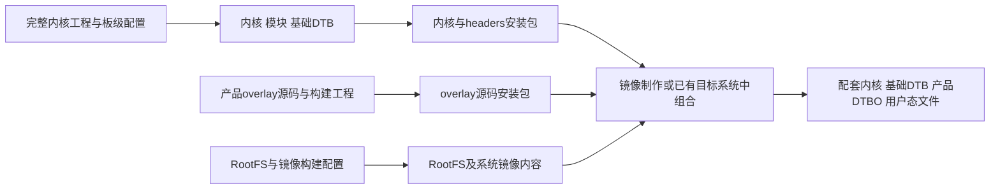
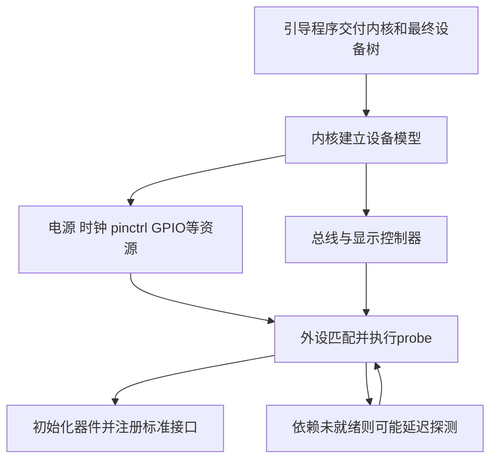
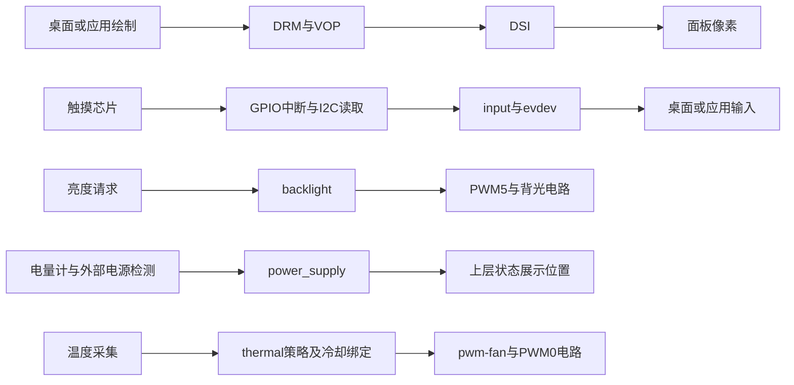

# 01 项目总览：从手持地面端到板级适配

本章先回答“这套系统在做什么”，再确定后续各章的位置。板级适配的成果，是让通用 Linux 能够正确使用这块具体底板上的器件，并向上层提供稳定、可理解的接口。

## 地面站需要什么，当前材料覆盖到哪里

**资料记录。** [RADXA CM3 地面站编译文档](<../../RADXA CM3地面站编译.docx>)开篇描述一套高亮、低成本、具备散热能力并方便 ROS 开发的手持无人机地面端。方案采用 RK3566/Radxa CM3，文档记录 2 GB LPDDR4、16 GB eMMC，并规划显示触摸、背光、风扇、电池监测、充电检测和无线通信等能力。

对使用者而言，屏幕让信息可见，触摸让操作可输入，电源状态让人知道剩余使用条件，散热让计算平台在负载下维持可用。这些体验最终需要应用组织，但应用首先依赖底层把每个外设正确接入操作系统。

**源码事实与包内事实。** 当前目录能够支撑的主干，是基础设备树和产品 overlay、GT9XX 触摸驱动、内核及 overlay 安装包。它还提供原理图、屏幕参数和历史构建记录，足以分析许多适配机制与配置之间的矛盾。

**待确认事项。** 完整 Linux/BSP 工程、最终 RootFS、启动配置、地面站应用及当前板端日志没有随目录提供。因此，“地面站”是产品背景，不代表当前可以跟踪一条从飞控报文到 UI、数据库和任务下发的应用调用链。

## CM3 与自定义底板怎样分工

CM3 是核心板：计算、存储及一部分电源与外围支持集中在模块上，通过连接器把可用信号引出。自定义底板把这些信号接到具体屏幕、触摸、电量计、接口与供电电路上。SoC 支持某个外设，只说明具备控制器；底板是否引出、引到哪里、是否与其他用途冲突，还要看实际接线。

例如，SoC 的 PWM 控制器可以产生周期性信号，但它不能仅凭设备树文字给高亮背光提供足够电流。底板上的驱动、电源和使能电路承担实际负载，软件负责申请正确的控制器、引脚和参数。这个分工决定了软件排查必须能回到电路。

| 层级 | 在本项目中的工作 | 交给下一层的条件 |
| --- | --- | --- |
| CM3 与底板电路 | 引出总线，提供电压、使能、复位及负载驱动 | 器件获得合适供电，信号能到达正确引脚 |
| 设备树 | 描述器件位置、总线地址、GPIO、供电和连接关系 | 内核可以创建设备并解析资源依赖 |
| 驱动 | 执行通信协议、初始化和运行时控制 | 向对应 Linux 子系统注册设备能力 |
| Linux 子系统 | 统一输入、显示、亮度、电源和冷却的表达 | 上层通过标准接口读事件、查状态或提交控制 |
| 桌面及应用 | 消费事件、绘图、呈现电池状态与定义业务 | 本目录只说明使用位置，具体实现待补 |

这种拆分的收益是复用：更换底板连接，主要调整硬件描述；更换触摸芯片，需要相应驱动；上层仍可消费 input 事件。代价是必须维护各层契约，特别是属性名称、信号极性、坐标系及产物版本。

## 用三个视角看同一个系统

### 构建与交付：把材料变成系统组成件

这一视角由开发主机、构建环境和包工具执行，处理的是源码、配置和文件，不是在运行屏幕或采集触摸。

图中完整工程位于当前材料之外。overlay 包怎样借助 DKMS 生成 DTBO，及“进镜像”和“更新已有系统”的关系，见[第 02 章](02_BSP构建与交付.md)。这不是一条“编完内核就已经验证屏幕”的串行流程。

### 上电与初始化：把描述变成可工作的设备

这一视角由引导程序与运行中的内核执行。最终硬件描述进入内核后，资源提供者、总线控制器与外设驱动依赖彼此建立工作条件。

**通用原理。** 这是一张依赖关系图，不是当前 BSP 的完整函数调用栈。设备树不按文本行号逐条执行。先写触摸节点、后写 regulator 节点，不表示触摸先于电源初始化；实际由总线、驱动注册和资源依赖共同决定。

**待确认事项。** 当前没有引导配置，无法断言 overlay 在哪个启动阶段合并，也不能指定实际使用的 loader、启动分区或 initramfs 路径。后续章节从已知设备树和驱动入口继续分析。

### 运行时：多条外设链路分别工作

图中“上层”是接口消费者的位置；具体桌面输入栈、电池小部件和地面站程序并未在本目录提供。温控也不需要等待应用读到电池状态才执行，它有自己的内核控制关系。

## 同一块屏幕为什么有三条链路

显示负责“显示什么”：VOP 从图像数据形成输出，DSI 传输到面板，panel 配置让面板按正确模式接收。触摸负责“哪里被操作”：控制器产生触点，通过 I2C 读取，再报告为 input 事件。背光负责“用多少光照亮”：PWM 和使能电路影响 LED 驱动。

这三个结果互不等价。背光亮但面板没退出睡眠，仍可能没有图像；图像正常但触摸中断接错，仍可能无法操作；触摸事件正常但桌面坐标变换与显示旋转不一致，仍会点错位置。

本项目 7 英寸 overlay 的面板原生尺寸为 800×1280，而触摸节点声明了 1280×800 的范围并存在旋转配置。要解释横屏操作，必须追踪面板方向、触摸 CFG、驱动变换和桌面变换的每一次交接，不能看到一个 `rotation` 就认为输入输出已一致。

## 先锁定材料对象，再讨论实现

**以下为当前材料的范围划分，不是最终装配清单。** 完整文件定位与哈希集中在[阅读索引](13_关键资料阅读索引.md)。

| 材料组 | 对象与用途 | 使用时的限制 |
| --- | --- | --- |
| 云奥 6 英寸资料 | 另一面板方案和 V2.2 触摸代码 | 不套用 7 英寸时序、CFG 或亮度条件 |
| 阿美林 7 英寸资料 | ILI9881C 面板序列、GT911 CFG、V2.8.7 通用驱动 | 同目录存在不等于这套驱动已进入交付内核 |
| `src/` 基础设备树 | CM3 与 IO 板文本快照 | 与包内 DTB 的若干启用状态不同 |
| AIRCAS 产品 overlay | 7 英寸显示触摸、电量与供电组合 | 属性属于特定驱动契约，不能任意换驱动 |
| 普通 / PWM overlay 包 | 同包名、同版本号的两份不同内容 | 必须靠文件哈希和内部成员区分 |
| 较早底板原理图 | 有屏幕、电池、风扇等电路的地面站方案 | 原理图是设计证据，仍需确认实物版本 |
| 后续根目录底板图 | `3566cam_internet` 相机接口方案 | 多个 GPIO 用途已改变，不能按日期自动替换 |

**包内事实。** 现有内核包的 CM3 DTB 禁用了 SDMMC0，而当前基础 DTS 启用了它。这个差别会影响 GPIO1_D5 是否与屏幕电源使能冲突。由此可见，分析一处 overlay 时还必须知道它叠加在哪份基础 DTB 上。

## 相机、通信与应用放在哪里

相机应接在 sensor、供电/时钟、CSI/CIF/ISP 和 V4L2 的链路上。当前有 IMX415 调试文档、相机 FPC 图及相关编译能力，但缺少本产品完整媒体连接图和采集程序，不能推导出实际视频可用。

无线图传应在网络设备与用户态收发、编码解码之间组织。Word 提到 WFB-NG 和 RTL8812EU，但未提供服务配置与运行链路。ROS 和 QGC 处在应用使用层；飞控串口还需要确认具体 GPIO 复用、设备节点和占用关系。基础 DTS 的 UART1 已用于 Bluetooth，这与文档开篇笼统的串口分配不能直接等同。

这些边界不妨碍理解板级适配，反而帮助确定成果：先把标准接口做对，上层才有可靠的输入与输出条件。

## 自查与回答要点

1. **为什么 RK3566 支持 DSI，还需要底板与 panel 适配？** 控制器能力没有描述实际接线、电源、复位、面板命令和时序；这些条件不成立，像素无法可靠抵达并被显示。
2. **为什么不能把“生成镜像、probe、触摸中断”画成一张主调用图？** 三者的执行者、时间与数据不同；构建产物是初始化的输入，初始化建立运行条件，运行处理事件。
3. **发现黑屏时，为什么先问底板和配置版本？** 不同图纸和 DTB 可能为同一 GPIO 分配不同用途；按错版本推理会使后面的测量失去意义。
4. **怎样说明这个项目的应用边界？** 能解释标准设备接口及其消费者位置，缺少应用源码的图传、遥测和任务流程标为待确认，不用内核编译开关代替业务证据。

接下来进入[第 02 章](02_BSP构建与交付.md)：先搞清楚正在阅读的源码、设备树和安装包在整个交付体系中是什么关系，随后再把硬件连接逐层交给驱动。
