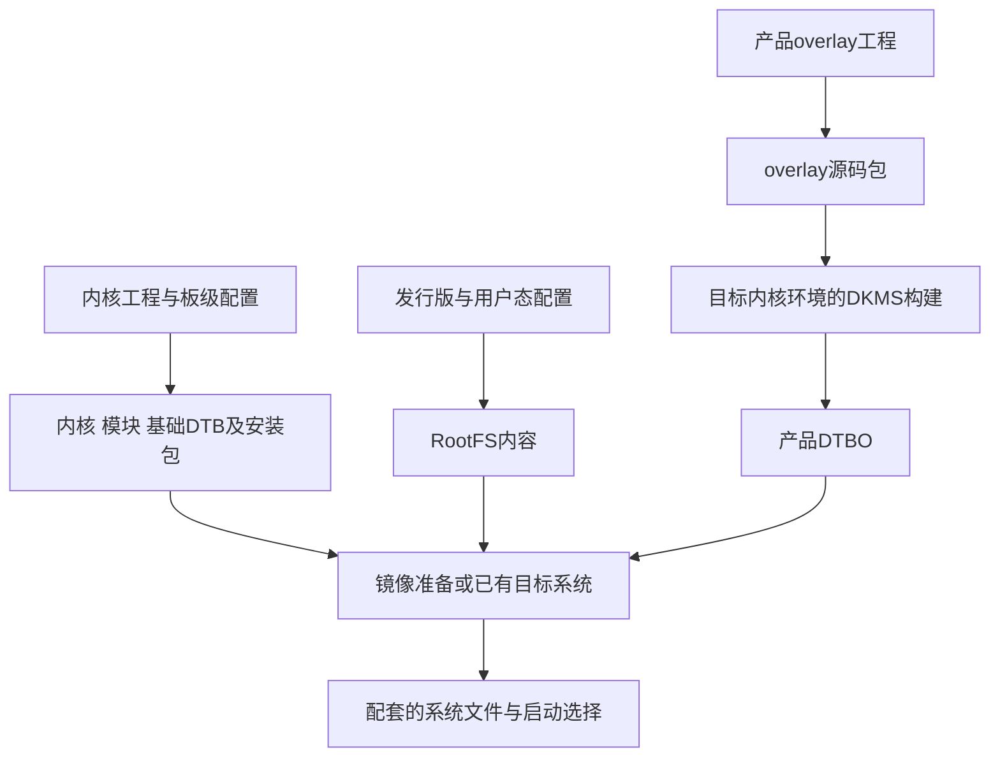
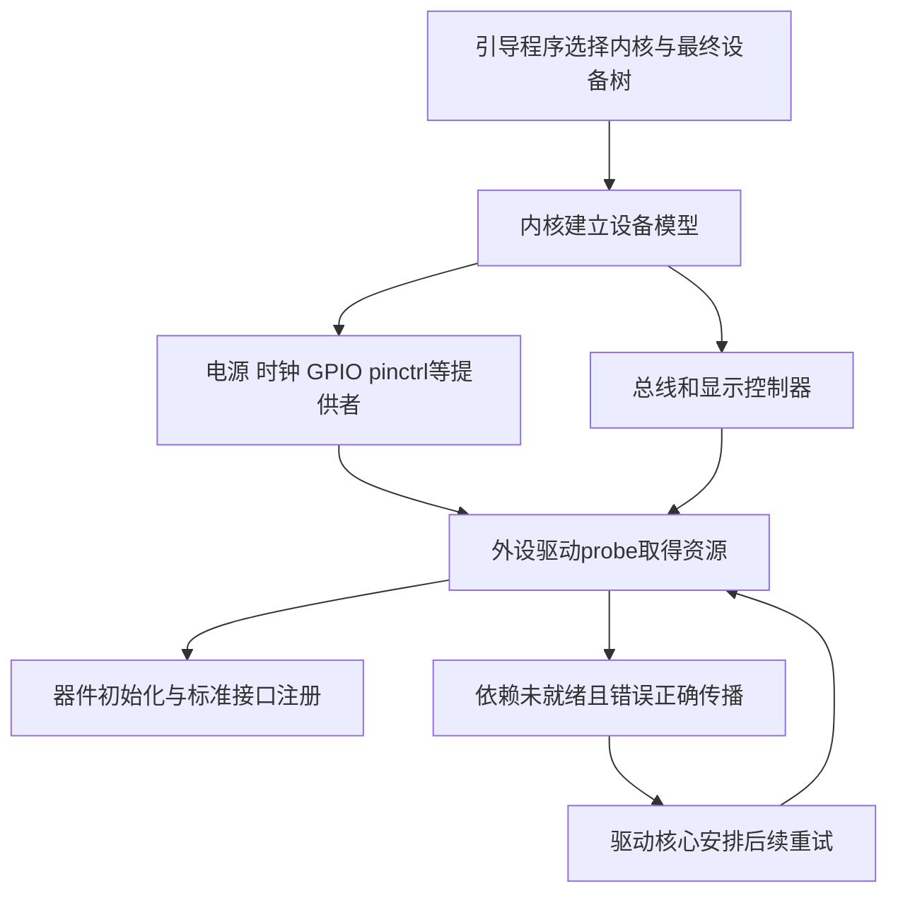
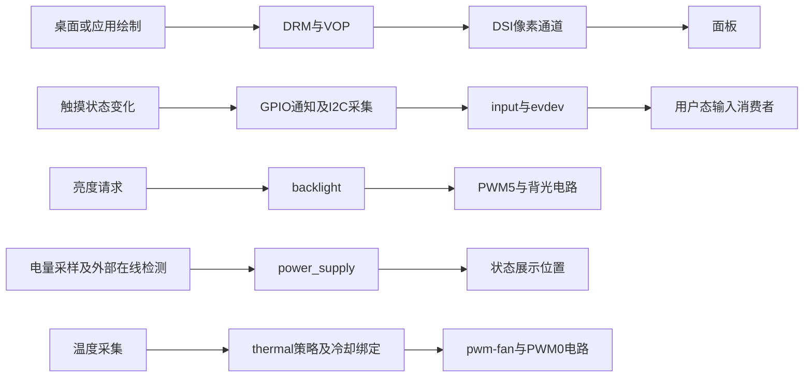

# 01 项目总览

设想一次正常使用：设备上电后显示界面，手指点击某个位置，上层收到对应输入；电池状态可读，计算负载持续上升时散热系统能够作出合适响应。这里每一种体验都跨过了电路、驱动和用户空间。板级适配要建立的，就是这些跨层行为赖以成立的条件。

本章先建立整个系统的分工与流程。后面的章节会选择实际文件深入，但始终回到同一个目标：让读者知道当前解释的是哪一层、正在交接什么，以及下一层为什么依赖它。

## 1.1 产品需要与项目范围

[历史构建记录](<../../RADXA CM3地面站编译.docx>)以高亮、低成本、具备散热能力、方便 ROS 开发的手持无人机地面端为背景，记录了 RK3566、2 GB LPDDR4、16 GB eMMC，以及显示触摸、电池监测、充电检测和通信等规划。这些属于资料记录，提供设计动机；当前实物容量、贴装方案及功能状态仍需与设备对应。

对使用者，屏幕提供输出，触摸提供输入，电池状态帮助判断剩余使用条件，散热维持持续运行。对适配工程师，这些需求首先转化为更具体的问题：面板需要什么电压和复位时序，触摸接在哪条 I2C 总线，背光由哪个 PWM 控制，哪些电源状态可以测得，以及温控策略怎样驱动负载。

本仓库的设备树、触摸代码、安装包与硬件资料能支撑这些问题的深入分析。完整 BSP 工程和地面站应用源码没有随材料提供，所以本文从板级机制讲到标准接口及消费者位置。飞控报文解析、视频收发、任务下发或 UI 事件处理需要另外的实现证据，不能从产品名称推导出来。

## 1.2 从核心板到应用的职责交接

### 1.2.1 核心板提供能力，底板确定连接

Radxa CM3 将 RK3566、内存、存储和部分供电支持集中在核心板上，经连接器引出可用信号。自定义底板把这些信号接到具体器件，并补充负载供电、开关、接口和保护电路。芯片有一个 PWM 控制器，只说明它能产生周期信号；实际驱动高亮背光需要底板上的电源和 LED 驱动电路。

同样，I2C 控制器能够发送地址和数据，但要读到触点，还需触摸芯片已经上电、总线电压和上拉合适、复位及地址选择完成。板级适配面对的是这些条件的组合，不能只看某一根总线是否“支持”。

### 1.2.2 描述、操作与统一接口

硬件描述与驱动分离后，同一驱动可以适应不同板子的连接方式。设备树告诉内核器件在哪里、占用哪些 GPIO、由谁供电；驱动读取这些信息，申请资源，按芯片协议执行；Linux 子系统再把结果整理成上层可以复用的接口。

| 层次 | 本项目中的职责 | 交接出去的对象 |
| --- | --- | --- |
| 电路与引脚 | 提供电压、信号连接、使能、复位和负载驱动 | 可被控制和通信的真实器件 |
| 设备树 | 描述地址、供电、引脚、显示连接及启用关系 | 设备身份与资源依赖 |
| 设备驱动 | 初始化器件、处理事务、管理状态与恢复 | 输入能力、显示能力或可查询属性 |
| Linux 子系统 | 统一同类设备的表达与生命周期 | DRM、input、backlight、power_supply、thermal 等接口 |
| 桌面及应用 | 绘图、消费事件、呈现状态和组织业务 | 用户可见行为；具体实现需另行核对 |

这里的“子系统”可以理解为内核为一类设备提供的公共规则和代码。例如 input 规定怎样报告按键、坐标和一帧输入变化，具体驱动负责把芯片私有数据转换成这些事件。驱动与子系统主要在内核中工作；桌面和普通应用运行在用户空间，通过内核提供的接口使用结果。

以一次触摸为例：GT9XX 驱动读出触点后交给 input，evdev 再把输入事件提供在 `/dev/input/eventN` 一类设备节点上，桌面输入组件读取后才决定哪个窗口收到点击。`eventN` 是某次枚举得到的编号，不是芯片地址。这是标准接口的通用关系；当前系统由哪个组件打开它，仍需实际配置确认。[Linux input 接口说明](https://www.kernel.org/doc/html/v6.1/input/input.html)

其他子系统也有各自的交付方式，例如 backlight 用亮度属性表达控制请求，power_supply 用属性表达供电状态，不能把所有外设都想成同一种事件设备。这种复用以约定一致为前提：设备树属性名必须被驱动真正读取，坐标范围还要与上层映射对应。分层让每个交接处都有明确的检查对象。

## 1.3 三种流程如何衔接

### 1.3.1 构建与交付产生系统文件

开发主机和构建工具处理的是源码、配置与文件产物。内核工程、产品 overlay 工程和 RootFS 组织工作可以独立推进，再在镜像制作或已有目标系统中组合。

先辨认图中的三个名称：DTB 是编译后的基础设备树数据；overlay 是针对基础树的补充或覆盖，编译后称 DTBO；RootFS 是根文件系统内容，容纳程序、库和系统配置。前两者帮助内核认识硬件，后者提供启动后的用户空间。第 2 章再解释它们的生成细节。

这是产物关系图；完整构建工程和最终镜像目前缺失。图中的 DKMS 是管理外部构建与安装的机制，本项目用它生成设备树插件，详细脚本交接在[第 02 章](02_BSP构建与交付.md)。图的终点只是系统文件及其选择条件，还没有证明板子使用了它们。

### 1.3.2 上电初始化建立工作条件

引导程序加载内核，并将最终硬件描述交给内核。内核据此建立设备模型；总线控制器、时钟、GPIO、电源等提供者逐步就绪，外设驱动匹配后执行探测函数 `probe()`，取得资源并初始化设备。

这张图说明通用依赖关系，不代替本 BSP 的完整启动调用栈。设备树不是按书写顺序执行的脚本；先写触摸、后写电源，不会因此规定谁先初始化。资源未就绪时是否能够重试，还取决于具体驱动是否正确返回延迟探测错误，第 05 章会用实际代码解释。

当前缺少引导配置和日志，overlay 在哪个阶段合并、使用哪份启动分区和 initramfs 均是待确认事项。后文从现有设备树与驱动可证实的位置继续追踪，不虚构这些缺失环节。

### 1.3.3 运行时处理事件和控制请求

初始化建立条件后，多条外设链路各自运行。它们不需要按章节顺序轮流执行：一次触摸不会先等电池采样，温控也不依赖桌面读完温度。

图中的桌面、应用和状态展示是接口使用位置。历史记录提到 XFCE/X11，当前没有最终 RootFS 与会话配置，不能据此认定当前系统采用了某条完整用户态调用链。

## 1.4 屏幕组件包含三条独立通道

显示决定画面内容：VOP 组织像素输出，DSI 传到面板，panel 驱动使面板进入合适的工作模式。触摸决定手指位置：触摸控制器通过 GPIO 通知状态变化，CPU 再用 I2C 取数据。背光决定照明：PWM 与使能脚控制 LED 驱动电路。

因此，一块屏幕“亮了”只证明部分照明条件成立。面板仍可能没有退出睡眠，显示路由仍可能不通；反过来，触摸事件可以正常产生，而桌面将它映射到错误的位置。分析现象时先分开这三条链，再检查它们共享的供电或坐标约定。

当前 7 英寸产品 overlay 描述 800×1280 面板、旋转参数和 1280×800 触摸参数。横竖方向改变可能交换两轴范围，因此两个数互换是一条需要追踪方向的线索，本身不证明配置错误。面板方向、触摸芯片配置数据（CFG）、驱动变换和桌面变换需要逐层对应，第 06、07 章将分别解释。

## 1.5 技术选择与资料版本

### 1.5.1 技术在系统中的作用

| 技术或组件 | 本项目的用途 | 采用它需要承担的约束 |
| --- | --- | --- |
| C 与 Linux 驱动模型 | GT9XX 状态管理、I2C 事务、IRQ 与输入上报 | 执行上下文、并发和资源释放必须正确 |
| DTS/DTSI、DTB、DTBO | 将芯片能力、板级连接和产品差异分层描述 | 基础树目标、属性契约和启用组合必须兼容 |
| Linux 子系统 | 用标准接口统一显示、输入、电源和冷却 | 接口存在仍需核对真实数据和物理效果 |
| Make/Kbuild、Shell hooks、Debian 包 | 把构建选择变成可安装产物 | 内核发行号、包内容和安装后动作需要可追溯 |
| I2C、DSI、PWM、GPIO | 分别承载寄存器事务、显示数据、周期控制和离散信号 | 各通道的供电、时序和物理含义不同 |

历史记录包含 Linux 5.10/Debian 11 和 Linux 6.1/Debian 12 两条路线；当前交付包对应 `6.1.84-12-rk2410-nocsf`，overlay 包版本为 `0.2.4`。这些版本属于资料或包内事实，不能用其中任一个直接替代当前板上的运行版本。

### 1.5.2 先确定正在讨论哪套组合

云奥 6 英寸目录与阿美林 7 英寸目录保存不同面板资料和触摸分支；目录中出现某份驱动，并不证明它进入了交付内核。8 页地面站底板图包含屏幕、电池和风扇；根目录另一份 3 页底板图标识为 `3566cam_internet`，若干 GPIO 已改作相机方案的其他用途。具体对应见[资料索引](13_关键资料阅读索引.md)。

产品 overlay 也要与实际基础树配对。包内 CM3 DTB 禁用了 SDMMC0，而当前本地基础 DTS 启用了它；同一 GPIO1_D5 在屏幕供电和 SDMMC0 数据线之间可能形成不同的资源组合。普通/PWM 两个 overlay 包同名同版本，内容仍有差异。版本控制能够保存当前材料，却不能自动补齐这些材料与历史构建之间的来源对应。

## 1.6 上层集成的位置与缺口

相机接入同样需要先供电、提供时钟，再通过控制总线配置传感器。图像数据随后进入相机串行接口 CSI、SoC 接收模块及可能使用的图像处理器 ISP，最后由用户态通过 Linux 视频接口 V4L2 取帧。这只给出理解集成位置所需的角色，实际接收路径和处理模块组合要看配套硬件与媒体配置。当前 IMX415 调试记录、相机 FPC 图及内核能力尚不足以证明本产品已经完成采集。

无线图传需要网络设备、用户态收发和视频编解码协作。Word 记录 WFB-NG 方向及 RTL8812EU 相关工作，服务配置和完整运行路径未包含在目录中。ROS、QGC 属于上层使用位置；飞控串口还要核对引脚复用、实际设备和占用。基础 CM3 描述将 UART1 用于 Bluetooth，不能直接采用历史开篇的“UART1 飞控调试串口”作为当前配线结论。

到这里，项目地图已经建立。下一章先回答“这些驱动和描述怎样成为系统组成件”，再回到硬件接线，沿设备树、probe 和各外设运行链继续深入。

## 1.7 自查与回答要点

### 1.7.1 自查问题

1. RK3566 有 DSI 和 PWM 控制器，为什么接上屏幕仍需要板级适配？
2. 将“生成镜像 → probe → 触摸中断”画成一条调用链，会掩盖哪些不同关系？
3. 背光正常、触摸有事件，但点击位置不对。现有信息说明了什么，接下来应比较什么？
4. 要介绍图传、ROS 或飞控接口，怎样同时说明集成位置和证据范围？

### 1.7.2 回答要点

1. 控制器能力之外还有接线、电压、复位、命令、时序和负载电路。设备树提供具体资源关系，驱动执行器件协议，两者还需与实际硬件相配。
2. 构建工具产出文件；启动时内核利用描述建立设备；运行时处理事件。三者以产物和初始化结果相接，执行者与时间尺度不同。
3. 已知照明与输入链的部分环节工作，但还不能认定坐标契约一致。应核对面板方向、input 范围、四角原始坐标及桌面变换，避免重复旋转。
4. 先给出必需的硬件、内核与用户态接口，再指出当前资料覆盖到哪一步。驱动启用、历史记录和本次联调结果分别说明，不用产品目标替代实现。

继续阅读：[第 02 章 BSP 构建与交付](02_BSP构建与交付.md)。
