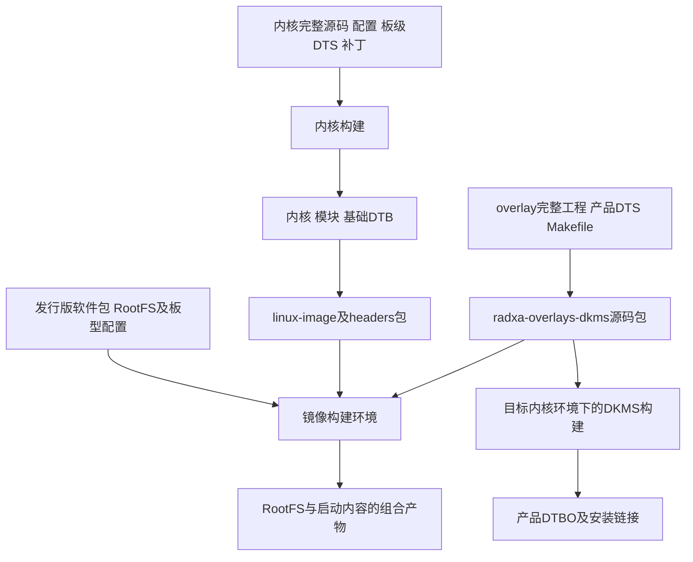

# 02 BSP 构建与交付：组件怎样成为一套系统

[上一章](01_项目总览.md)把板级适配放进了整个产品。本章解释这些适配内容怎样成为内核、设备树和系统文件。先掌握产物之间的关系，再回看 Word 中的命令，才能知道一条命令在构建哪一层。

## BSP 解决的是平台可用性

BSP（Board Support Package，板级支持包）在这里指支持这类板卡所需的内核、驱动、硬件描述、配置与构建包装。它并不天然等于一个名为 `bsp/` 的目录，也不等于地面站应用。

**通用原理。** 构建要解决三个相互关联的问题：生成目标处理器能执行的内核与模块；生成描述目标硬件的设备树；把内核、模块、启动需要的文件和用户态组成可使用的系统。镜像工具往往负责最后的组织工作，不一定重新编译前两项。

**资料记录。** 本项目历史记录有两套路线：较早的 Linux 5.10 / Debian 11 使用 `bsp` 与 `rbuild`；后续 Linux 6.1 / Debian 12 使用 `linux-rk2410-nocsf`、独立 `radxa-overlays` 工程和 RSDK。当前目录保存的是部分输入与交付物，没有这些完整工程及可追溯的版本锁定。

## 先认识产物的身份

| 产物 | 谁产生它、表达什么 | 下游怎样使用 |
| --- | --- | --- |
| 内核映像 | 编译器与链接器根据内核源码和配置产生机器代码 | 引导程序加载后开始执行操作系统 |
| `.ko` 模块 | 被配置为模块的驱动或功能单独链接产生 | 匹配运行内核后由模块机制加载 |
| 基础 DTB | 设备树编译器将板级 DTS 与 include 内容编成二进制树 | 提供平台身份、控制器及基础板级资源 |
| 产品 DTBO | 将 `/plugin/;` overlay 编成可叠加的设备树对象 | 与可解析目标的基础树合并，补充产品器件或覆盖属性 |
| `.deb` 安装包 | Debian 打包工具包装文件、元数据和维护脚本 | 包管理器解包、维护安装记录并执行相应 hooks |
| RootFS | 系统构建工具组织程序、库、配置、服务及系统目录 | 内核挂载根文件系统，用户态从其中启动 |
| 系统镜像 | 平台镜像工具将启动所需组成件和文件系统组织成分发介质 | 写入介质后供实际引导路径使用；分区形式依平台而定 |

DTB 与 DTBO 是数据，驱动是代码。改变一个器件的 I2C 地址通常改变设备树；改变触点协议解析则改变驱动。把 DTS 放进源码树但没有进入构建目标，或者把新的 `.ko` 放进不匹配的内核目录，都不能形成有效适配。

### 配置如何决定驱动进入哪里

**通用原理。** Kconfig 决定可选择的功能，最终 `.config` 决定本次取值；Kbuild/Makefile 根据这些取值组合目标文件。`y` 表示编入内核，`m` 表示作为模块，未启用则不会通过这项配置形成该功能。

外部模块不仅要匹配 ARM64 指令集，还依赖目标内核的接口、配置和构建信息。模块通常位于 `/lib/modules/<内核发行号>/`。内核头文件包提供相关构建条件，`linux-libc-dev` 则主要面向用户态 UAPI 头文件，两者不能替代。见 [Linux v6.1 Kbuild 说明](https://www.kernel.org/doc/html/v6.1/kbuild/kbuild.html)。

**包内事实。** 当前内核包配置为 `TOUCHSCREEN_GT9XX=y`、`INPUT_EVDEV=y`、`BATTERY_CW2015=y`、`CHARGER_GPIO=y`、`BACKLIGHT_PWM=y`、`PWM_ROCKCHIP=y`、`DRM_PANEL_SIMPLE=y`；`DRM_PANFROST=m`，另一项 `TOUCHSCREEN_GOODIX=m`。因此不能统一写成“启动时 insmod 所有外设驱动”，也不能把两个 Goodix 配置项当成同一实现。

## 三条构建支线在哪里汇合



这张图只表示构建与交付。DKMS 构建可能在镜像准备的目标环境中触发，也可能在已有板端系统安装包时触发；本目录未提供每次镜像构建日志，不能为当前包指定唯一执行地点。

**资料记录。** Word 中 `rsdk build radxa-cm3-io bookworm xfce --no-cache --debs ./debs` 的作用，是把指定板型、发行版、桌面与自定义包带入镜像制作。它不是“在本目录自动找到并编译全部驱动”的入口。RSDK 官方入口将其定位为 Radxa 系统开发工具集，可作工具背景；它不证明历史命令与今天任一源码版本直接兼容。[RSDK 官方介绍](https://radxaos-sdk.github.io/rsdk/)

### 编译环境中的几个角色

开发主机负责运行工具；构建容器负责固定一组依赖与环境；目标架构是产物要运行的 ARM64。交叉编译器可在一种主机架构上产生另一种架构代码；QEMU 用户态模拟可帮助执行目标架构程序。这些角色可以配合，但“用了 Docker”不自动表示“构建发生在完整 ARM64 虚拟机中”。

**资料记录。** Word 记录 Ubuntu 24.04、devcontainer、QEMU/binfmt 与 ARM64 工具的安装和使用。**待确认事项。** 当前没有容器配置、构建日志和依赖清单，不能确定每个阶段使用了交叉编译还是模拟执行，也不能复述历史耗时为当前预计耗时。

## 现有包能反向告诉我们什么

`.deb` 内含控制档案与数据档案。控制信息记录包名、版本、架构和依赖；数据档案存放安装后的文件；维护脚本描述安装或删除时的附加动作。查看这些内容不需要执行安装脚本。

**包内事实。** 本目录五个交付文件的完整哈希见[索引的交付包表](13_关键资料阅读索引.md)。关键读取结果如下：

| 包 | 关键内容 | 能证明什么 |
| --- | --- | --- |
| `linux-image-6.1.84-12-rk2410-nocsf_6.1.84-12_arm64.deb` | 内核、`boot/config-*`、`System.map-*`、模块及各板 DTB | 包针对的内核发行号和编译能力，且包含 CM3 IO DTB |
| 同版本 `linux-headers-*` | 目标内核相关的头文件与构建材料 | 可为配套外部构建提供输入，不能替代完整源代码与修改历史 |
| `linux-libc-dev_6.1.84-12_arm64.deb` | 用户态内核接口头文件 | 是开发材料，不决定当前运行哪个内核 |
| 普通 `radxa-overlays-dkms_0.2.4_all.deb` | overlay 源码、Makefile、DKMS 配置和 hooks | 具备目标环境编译安装 overlay 的材料 |
| `radxa-overlays-dkms_pwm.deb` | 普通 overlay 加 PWM 变体及构建目标 | 内容不同，但包身份仍与普通包相同 |

当前 `System.map` 能找到 `goodix_ts_probe`、`goodix_ts_work_func`、`gtp_dat_gt9112` 等符号。符号表提供编译内容线索，不能还原函数实现，也不能证明本地 V2.2 文件就是打包版本。源代码与交付物一一对应，仍需要构建版本、配置和补丁记录。

### 内核包安装之后还有什么动作

包内 `postinst` 将 `6.1.84-12-rk2410-nocsf` 和 `/boot/vmlinuz-6.1.84-12-rk2410-nocsf` 传给 `/etc/kernel/postinst.d` 下的 hooks，并设置 `INITRD=Yes`。

这里的执行者是包管理器和目标系统脚本。包自身给出回调入口，但实际是否生成 initramfs、更新了哪份启动配置，取决于目标系统的 hooks。`INITRD=Yes` 是意图与参数，不能代替生成文件及启动使用的证据。

**通用原理。** initramfs 是可供内核早期用户态使用的临时根环境，常用于准备正式根文件系统所需条件。它不是所有驱动的固定容器；某功能若已内建，也不需要因为“是驱动”就再次放入模块加载链。当前平台到底如何使用它，应回到实际启动文件与日志。

## overlay 的 DKMS 路径需要单独理解

DKMS 通常用于跟随目标内核维护外部构建。本包利用这一生命周期管理设备树插件：对使用者来说，真正关心的结果是配套 DTBO 文件、安装位置和选用关系，不是仅看到一个名为 `radxa-overlays` 的构建目标。

**包内事实。** 两包 `Package` 均为 `radxa-overlays-dkms`，`Version` 均为 `0.2.4`，架构均为 `all`；依赖 DKMS ≥2.1.0.0，推荐 rsetup ≥0.4.3。包内源码前缀是：

```text
usr/src/radxa-overlays-0.2.4/
```

`Architecture: all` 描述这个源码包的打包属性，不意味着其内所有硬件插件都适用于任意板卡。

实际交接依次是：

1. 包 `postinst` 在配置阶段调用 DKMS 的 `common.postinst`，传入 `radxa-overlays` 和 `0.2.4`。
2. `dkms.conf` 设置 `AUTOINSTALL=yes`，指定 `dkms.post_build`、`dkms.post_install` 和删除回调。Makefile 含各 vendor overlay 子目录。
3. 构建完成后，`dkms.post_build` 保存各 vendor 的 `.dtbo` 到 DKMS 对应内核/架构的 `module/.../overlays`，避免构建目录清理后丢失结果。
4. `dkms.post_install` 将结果链接到 `/usr/lib/linux-image-<kernelver>/<vendor>/overlays`。若目标内核不支持该 vendor，或该位置已有真实 overlay 目录，脚本会跳过相应安装。
5. 若找到 `rsetup`，回调调用 `rsetup rebuild_overlays <kernelver>`。具体选择哪些 overlay、如何写入启动配置，还由 rsetup 与目标系统决定。

因此，“包状态为已安装”只能回答安装状态的一部分。源码可能解包成功而构建失败；DTBO 可能生成成功却未被选中；选中了 DTBO 也可能与实际基础 DTB 不兼容。第 10 章将按这些交接点设计检查。

### 相同版本号为什么不够

普通包内 `aircas-compact-GCS.dts` 与工作区 overlay 按行归一化后相同；PWM 包还含 `aircas-compact-GCS-pwm.dts`。普通亮度表为 256 项，默认索引 200；变体表为 197 项，仍保留默认索引 200。

这是一处**包内可确认的配置差异** ，不是板端故障结论。它说明只记录“装了 0.2.4”不足以重建行为，还应记录原始包哈希、实际插件名和最终属性。亮度表如何被驱动解释，见[显示与背光](06_显示与背光.md)。

## 历史构建记录怎样转化为理解

阅读 [Word 构建文档](<../../RADXA CM3地面站编译.docx>)时，按以下对应关系定位，而不是从第一页开始照抄全部命令：

| 历史章节与定位词 | 当时解决的问题 | 当前能够复核到哪里 |
| --- | --- | --- |
| “Linux5.10+debian11”、`bsp/rbuild` | 内核、U-Boot 与 RootFS 的分工 | 只有操作记录，不是当前目录完整工程 |
| “适配Linux6.1”、`RSDK部署` | 准备镜像与容器环境，接收自定义包 | 可解释构建汇合位置；实际镜像未提供 |
| “BSP(rk2410-nocsf) CM3-IO移植” | 将 CM3 板级描述纳入另一内核工程 | 当前有基础 DTS/DTSI，包中有 CM3 DTB，但配置有差异 |
| “内核修改”、GT911/CW2015 | 增加或选择产品所需驱动和配置 | 可核对包内开关与部分符号；完整修改源码缺失 |
| “overlay源码部署/修改” | 独立维护产品插件并制作 DKMS 包 | 可直接检查当前两包的源码与 hooks |

历史“成功启动”保留为资料记录。当前包具备 CM3 DTB，也不能据此把那次启动记录转换成本次硬件验证。Word 中关于 `make deb`、分支缺少 CM3、参数选项和构建耗时的说明，应以当时对象理解，不作为任意新版本工具的保证。

## 要恢复可重复构建，还缺哪些输入

若以后要重建，应先收齐确切仓库与提交、子模块版本、补丁、defconfig/最终 `.config`、基础 DTS 与产品 overlay、构建目标及镜像包清单。随后在独立输出位置构建，记录产物哈希和构建日志，再与预期硬件组合关联。

当前基础源码与包内 DTB 已存在 HDMI、PCIe、SDMMC0 和 CH482D 节点差异。只把现有 `.dts` 复制进某个同版本内核，可能改变当前交付物的行为。构建是否完成和行为是否一致，是两个独立问题。

设计上，独立 overlay 便于复用一个基础内核适配不同产品；代价是要维护基础树符号、属性契约和启用组合。将驱动内建可以减少模块装载依赖；代价是更新该驱动通常要更新内核。两种取舍都应围绕产品发布与故障恢复需求，而不是只比较文件数量。

## 自查与回答要点

1. **只改 DTBO，能修复触摸协议解析错误吗？** 一般不能。DTBO提供配置和资源，解析行为在驱动代码中；除非故障本来就是配置选择错误。
2. **headers 和 libc-dev 都叫头文件，为什么不能混用？** 前者提供内核相关构建条件，后者提供面向用户态的 UAPI；消费者不同。
3. **为什么 DKMS 显示完成还不能宣布屏幕可用？** 还需检查 DTBO 安装/选择、基础树兼容、启动应用、驱动绑定和最终显示链路。
4. **要证明两次交付相同，记录版本号够吗？** 不够。现有两个 overlay 包同版本而内容不同，应关联源码、配置、包哈希和实际启用的插件。
5. **为什么本章不提供一键完整重建命令？** 缺少完整工程与版本锁定，现有历史命令不能覆盖输入缺口；先补齐构建对象才有可执行且可验证的流程。

本章交出了“系统由哪些产物组成”的框架。[下一章](03_硬件资源与供电.md)从这些产物要描述的真实对象出发，沿供电与信号接线确定资源，再进入设备树和驱动。
