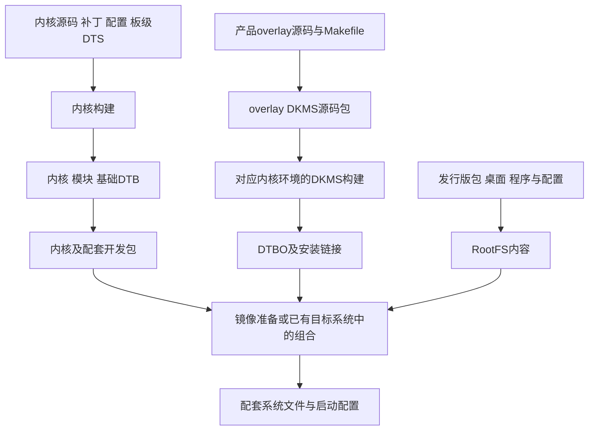

# 02 BSP 构建与交付

[上一章](01_项目总览.md)确定了板级适配的目标：让具体硬件能够被 Linux 正确使用。接下来首先要弄清一个容易混淆的问题：源代码、设备树、安装包和系统镜像并不是同一种东西。只有知道它们如何产生和组合，后面修改某个节点、检查某份驱动才有明确对象。

本章先建立通用产物关系，再以当前五个 `.deb` 和历史构建记录为实例。这里的包内事实来自现有包的离线读取，历史命令用于解释当时流程；当前目录不具备直接完整重建所需的全部工程。

## 2.1 从一次修改判断它属于哪条构建链

BSP 是 Board Support Package，即支持某类板卡的软件、配置与构建材料的组合。在本项目中，它涉及内核和驱动、板级硬件描述、构建配置以及产物包装，而不是一个固定名称的目录。地面站应用依赖这些支持，但不能与 BSP 混为一层。

假设触摸 RST 脚换到了另一根 GPIO，驱动通信协议没有变化，修改对象通常是硬件描述；若触点字节解析有误，修改对象就在驱动；若只是要在桌面显示电池状态，还需要用户态程序和配置。三类修改可能最后进入同一个系统镜像，生成路径却不同。

| 需要改变的行为 | 主要输入 | 生成的对象 | 生效前仍需满足的条件 |
| --- | --- | --- | --- |
| 芯片协议或内核控制行为 | C 源码、内核配置与构建信息 | 内核映像或 `.ko` 模块 | 系统实际启动/加载这个版本并绑定设备 |
| 接线、地址、供电或产品器件组合 | DTS/DTSI、产品 overlay | 基础 DTB 或产品 DTBO | 最终树采用它，且属性被匹配驱动消费 |
| 桌面、程序、库和服务配置 | 发行版包及用户态配置 | RootFS 内容 | 用户态确实启动对应消费者 |

这种划分让修改有边界：设备树负责表达可配置的硬件条件，驱动负责执行行为。只有驱动本来就支持相应配置时，改 DTBO 才能改变那项行为；它不会自动修复错误的 C 代码。

## 2.2 内核与设备树分别怎样形成

### 2.2.1 配置决定代码进入内核还是模块

内核源码包含大量平台与驱动，编译时不可能无条件全部装入一块板子。Kconfig 描述可选项及其依赖，最终 `.config` 给出本次选择，Kbuild/Makefile 再依据选择组织编译和链接。对于支持三态的选项，`y` 表示内建，`m` 表示生成可加载模块，未启用则不会通过该配置纳入功能。

可以用仓库内 [V2.8.7 Makefile](../../阿美林-1000nit-7inch/GT9XX通用调试包/Makefile) 的两行实际规则理解这个交接：

```makefile
obj-$(CONFIG_TOUCHSCREEN_GT9XX) += gt9xx_core.o
gt9xx_core-y := gt9xx.o gt9xx_update.o goodix_tool.o
```

第一行把配置值代入规则名：为 `y` 时进入内建对象集合，为 `m` 时进入模块集合。第二行说明 `gt9xx_core` 由三个对象文件组合而成；这里的 `-y` 是组合对象的写法，不能单独据此认定整个驱动一定内建。这样便把熟悉的 C 文件编译、目标文件链接与内核配置连接起来。该片段仅说明本地分支的构建规则，不证明它就是包内 GT9XX 的源码。[Kbuild 对象组合说明](https://www.kernel.org/doc/html/v6.1/kbuild/modules.html)

内建驱动随内核启动进入注册过程，模块则还要经历装载与注册。这是两种代码进入运行系统的方式，都不能跳过设备匹配和 probe。例如本包 `CONFIG_TOUCHSCREEN_GT9XX=y`，因此不能用 `lsmod` 中没有 GT9XX 就判定触摸驱动不存在。

当前内核包配置还包含 `CONFIG_INPUT_EVDEV=y`、`CONFIG_BATTERY_CW2015=y`、`CONFIG_CHARGER_GPIO=y`、`CONFIG_BACKLIGHT_PWM=y`、`CONFIG_PWM_ROCKCHIP=y` 和 `CONFIG_DRM_PANEL_SIMPLE=y`；`CONFIG_SENSORS_PWM_FAN=m`、`CONFIG_DRM_PANFROST=m`，另一项 `CONFIG_TOUCHSCREEN_GOODIX=m`。这些是包内编译选择：两种 Goodix 配置并存不代表同一份实现，风扇也不能因其他外设内建就省略模块环节。

模块通常安装在 `/lib/modules/<kernel release>/`。kernel release 是内核运行与模块目录使用的发行标识，本包为 `6.1.84-12-rk2410-nocsf`。目标架构相同只是一个条件，外部模块还需匹配内核接口、配置及构建信息。Linux 的 Kbuild 负责这些构建关系和安装路径约定，参见[版本对应的说明](https://www.kernel.org/doc/html/v6.1/kbuild/kbuild.html)。

### 2.2.2 硬件描述被编译为数据

板级 `.dts` 是设备树源文件，`.dtsi` 保存供它引用的公共描述。板级文件引入 SoC 和核心板描述，再补充连接，构建工具将其编译为基础 `.dtb`。设备树编译器通常写作 `dtc`；它处理树形数据，不会把 `reg` 或 GPIO 属性翻译成芯片驱动的机器指令。

产品 overlay 描述对基础树的补充或覆盖，生成 `.dtbo`。它可以表达启用 DSI、增加 panel、触摸或电量计等产品差异，但必须能找到基础树中的目标。相关标签与引用如何解析、叠加后怎样形成资源关系，在[第 04 章](04_设备树与overlay.md)展开。

基础 DTB 和产品 DTBO 配对后形成内核可用的描述。具体由哪个构建或启动组件完成合并，取决于目标系统；本仓库缺少最终引导配置，不能指定一个未经核实的合并阶段。**生成了 DTBO、选择了 DTBO、内核实际看到叠加结果，是三件需要分别证明的事。**

### 2.2.3 主机、容器、工具链与目标架构

开发主机运行构建工具，工具链产生目标架构代码，构建容器组织依赖环境。例如，在 x86 主机上运行 ARM64 交叉编译器，执行编译器的是 x86 CPU，产出的机器指令才面向 ARM64；若某一步还要运行产物中的 ARM64 程序，则又需要对应执行环境，某些流程会借助 QEMU 用户态模拟。容器与模拟器解决不同问题，不能把“用了 Docker”直接解释成“所有构建都运行于完整 ARM64 虚拟机”。

历史 Word 记录了 Ubuntu 24.04、devcontainer、QEMU/binfmt 和 ARM64 工具的准备。这些属于资料记录。当前缺少容器配置、完整日志及依赖锁定，无法逐阶段确认究竟采用交叉编译还是模拟执行，也不能把历史耗时当成本次预计耗时。

## 2.3 RootFS 与系统镜像让组成件汇合

RootFS 是系统使用的根文件系统内容，包括程序、共享库、配置、服务和标准目录。内核提供执行与硬件访问能力，RootFS 提供实际用户空间。镜像制作再按平台启动要求组织相关文件与存储布局；它可以使用已经构建好的内核包，不一定重新编译内核。



这是构建与交付关系图。DKMS 可以在镜像准备的目标环境触发，也可以在已有板端安装包时触发；当前没有对应完整日志，不能把其中一种写成唯一地点。图中三条支线在交付组合处汇合，不表示 RootFS 必须等用户逐行编完所有驱动才开始制作。

历史记录包含 Linux 5.10/Debian 11 的 `bsp`、`rbuild` 路线，以及 Linux 6.1/Debian 12 的 `linux-rk2410-nocsf`、独立 `radxa-overlays` 和 RSDK 路线。后者把内核相关构建与系统内容组织分开。RSDK 的官方入口将它定位为 Radxa 系统开发工具集，可用于理解工具背景；历史命令仍须结合当时版本解释。[RSDK 介绍](https://radxaos-sdk.github.io/rsdk/)

下面是 Word 中的历史命令，展示板型、发行版、桌面和指定包在哪一步汇合，**本次没有执行**：

```text
rsdk build radxa-cm3-io bookworm xfce --no-cache --debs ./debs
```

它表达的是在相应 RSDK 环境中为 CM3 IO 组织 Bookworm/XFCE 系统并使用指定包，不能当成当前材料目录的完整编译入口。前置工程、板型支持及命令选项必须匹配；把旧命令复制到任意新版本环境，并不能恢复那次构建。

## 2.4 安装包保存了哪些交付信息

### 2.4.1 文件身份与开发用途

`.deb` 同时保存控制信息和数据文件。控制信息描述包名、版本、架构及依赖，维护脚本在安装等阶段执行；数据档案提供要部署的文件。可以离线读取两部分而不安装包，这使我们能从交付物反向检查构建选择。

| 当前包 | 包内对象与用途 | 不能由它单独推断的结果 |
| --- | --- | --- |
| `linux-image-6.1.84-12-rk2410-nocsf_6.1.84-12_arm64.deb` | 内核、模块、DTB、配置和符号表 | 当前板正在运行此内核 |
| 同版本 `linux-headers-*` | 配套内核的头文件与构建材料 | 已拥有完整源代码、补丁和可重复构建环境 |
| `linux-libc-dev_6.1.84-12_arm64.deb` | 用户态使用的内核接口头文件，即 UAPI | 可代替内核模块的构建输入 |
| `radxa-overlays-dkms_0.2.4_all.deb` | 普通 overlay 源码、构建规则与回调 | 产品 DTBO 已被启动系统选择 |
| `radxa-overlays-dkms_pwm.deb` | 普通插件及额外 PWM 变体 | 与同版本普通包具有相同内容 |

headers 面向与内核相关的构建，UAPI 面向用户态程序访问内核公开接口；消费者不同，不能因为都叫“头文件”就互换。五个包的链接、SHA-256 与成员路径在[第 13 章](13_关键资料阅读索引.md)，这里保留它们在交付过程中的角色。

包中 `System.map` 的 `goodix_ts_probe`、`goodix_ts_work_func`、`gtp_dat_gt9112` 等符号说明编译内容存在相关线索。符号名不能还原函数体，也不足以证明本地 V2.2 源码就是打包版本。确定这种对应仍需当时的源码提交、补丁与配置。

### 2.4.2 解包完成后还有目标系统动作

内核包的 `postinst` 是安装后配置阶段使用的维护脚本。它将发行号 `6.1.84-12-rk2410-nocsf` 和 `/boot/vmlinuz-6.1.84-12-rk2410-nocsf` 传给目标系统 `/etc/kernel/postinst.d` 下的 hooks，即按约定调用的后续脚本，并设置 `INITRD=Yes`。这属于包内脚本事实。

包管理器负责执行脚本，目标系统的 hooks 决定具体后续动作。因此，单看包脚本只能知道它请求了哪些回调；是否成功生成 initramfs、更新了哪份引导配置、下次是否选择新内核，仍要在目标系统确认。

initramfs 是启动早期展开在内存中的用户态文件集合，可先准备正式根文件系统的挂载条件。例如，若访问根存储需要尚未加载的驱动，早期环境可提供相应模块，随后再进入正式根文件系统。这是通用机制示例，不表示本板采用这种存储方案；也不是所有驱动都必须放入 initramfs。应先确认内建/模块选择和实际启动需求，不能由 `INITRD=Yes` 推导完整启动布局。[Linux initramfs 说明](https://www.kernel.org/doc/html/v6.1/filesystems/ramfs-rootfs-initramfs.html)

## 2.5 产品 overlay 怎样进入 DKMS 生命周期

### 2.5.1 源码包与构建结果是两个阶段

DKMS 通常管理随内核版本维护的外部构建。本包借用这一生命周期来构建设备树插件，最终关心的是 DTBO 与安装链接，而不是仅看到一个叫 `radxa-overlays` 的构建目标。

这里容易混淆的是“按内核版本管理”与“作为驱动执行”。DTBO 仍是硬件描述数据，不能用装载 `.ko` 的方式让它成为驱动；按内核版本保存，是为了把插件与对应的基础树、构建环境和安装目录配套。插件最后还要经过树的组合与启动选择，才会影响设备描述。

两个 overlay 包内部的 `Package` 都是 `radxa-overlays-dkms`，`Version` 都是 `0.2.4`，`Architecture` 都是 `all`，依赖 DKMS ≥2.1.0.0、推荐 rsetup ≥0.4.3。这些包内元数据描述包装方式；`all` 不表示每个硬件插件适用于所有板卡。

源码位于包成员 `usr/src/radxa-overlays-0.2.4/`。从安装到后续选用，实际脚本交接如下：

1. 包控制档案的 `postinst` 在配置阶段调用 DKMS 的 `common.postinst`，传入项目名和版本。至此进入外部构建管理流程。
2. `dkms.conf` 设置 `AUTOINSTALL=yes`，并指定 `POST_BUILD`、`POST_INSTALL` 和删除回调。Makefile 决定需要构建的 vendor 子目录和插件目标。
3. 构建生成 DTBO 后，`dkms.post_build` 把结果保存到对应内核/架构的 `module/.../overlays`。这样后续清理构建目录时，安装仍有可用产物。
4. `dkms.post_install` 将该结果链接到 `/usr/lib/linux-image-<kernelver>/<vendor>/overlays`。目标内核没有相应 vendor 目录，或该位置已有真实 overlay 目录时，会跳过相应安装。
5. 若存在 `rsetup`，回调调用 `rsetup rebuild_overlays <kernelver>`。哪些插件被选择、怎样进入启动配置，继续由目标系统与工具实现决定。

`postinst` 与 `dkms.post_install` 因而不是同一个阶段：前者让包进入 DKMS，后者处理构建后的安装。包已解开、构建成功、链接正确、插件选用和运行树生效逐步依赖，不能相互替代。第 10 章会在这些交接点检查真实结果。

### 2.5.2 同名同版本仍要核对内容

普通包中的 `aircas-compact-GCS.dts` 与工作区产品 overlay 按行归一化后相同。PWM 包额外包含 `aircas-compact-GCS-pwm.dts` 及构建目标：普通亮度表 256 项、默认索引 200；变体只有 197 项，默认索引仍为 200。

这项包内差异说明版本号不足以唯一标识一次交付。默认值首先是表索引，是否超出表长可以静态判定；实际驱动如何处理越界以及实板表现，还需匹配实现与运行证据，[第 06 章](06_显示与背光.md)会作具体推导。本章只据此建立发布记录要求：包哈希、插件名和基础树身份都应进入组合记录。

## 2.6 从历史步骤恢复工程关系

理解产物后再读[原始 Word](<../../RADXA CM3地面站编译.docx>)，各段操作才有位置。`bsp/rbuild` 记录早期内核、引导与系统组织；“RSDK部署”记录后续镜像环境；“BSP(rk2410-nocsf) CM3-IO移植”记录板型描述纳入内核；“内核修改”记录 GT911、CW2015 等支持；“overlay源码部署/修改”记录产品插件维护。

历史成功启动说明当时某个软硬件组合得到过相应结果。当前包包含 CM3 DTB，能与记录建立线索，但不能把过去成功直接写成本次板端验证。记录里的 `make deb`、工具选项、板型缺失与构建耗时，都有对应时期和对象。

如果以后要完整重建，先收齐确切仓库与提交、子模块、补丁、工具链与环境、defconfig/最终配置、基础 DTS、产品 overlay、构建目标及镜像包清单。随后在独立输出位置构建，保存日志和产物哈希，再检查行为。编译通过回答“输入能否生成产物”，功能验证回答“这套产物能否正确驱动这块板”，两者不能合并成一个结论。

当前本地基础源码与包内 DTB 已有 HDMI、PCIe、SDMMC0 及 CH482D 节点差异。直接把现有源码放进同版本号内核，可能生成不同于现有包的行为；仓库已经有 Git 历史，也不自动补齐历史构建的输入来源。

## 2.7 交付拆分的收益与代价

独立 overlay 允许共享基础内核，再组合不同产品的外设描述；代价是维护基础树目标、驱动属性契约和多个插件的启用关系。把一切写入单一板级 DTS 可减少动态组合，但更容易为不同产品维护多套基础树。选择取决于产品变体数量和发布方式。

内建驱动减少装载环节，但更新它通常需要更新内核；模块允许在匹配接口的条件下单独更换，却增加版本匹配、加载和卸载生命周期的责任。当前内建触摸与模块风扇体现了不同选择，不能统一套一组加载命令。

包化交付使安装内容与生命周期有统一入口，却没有消除系统状态：目标机的 hooks、已有链接、启动选择仍会影响结果。理解这些代价后，下一章就可以回到产品的真实对象，确认将要编入这些产物的接线与供电关系。

## 2.8 自查与回答要点

### 2.8.1 自查问题

1. 只更换触摸 RST 接线，改 DTBO 就一定生效吗？若修改的是触点字节解析，又该走哪条构建链？
2. 内核 headers 与 `linux-libc-dev` 都提供头文件，为什么不能互换？
3. 已安装 overlay 包且 DKMS 显示完成，还缺哪些证据才能说明产品配置生效？
4. 两台板都安装版本 `0.2.4`，为什么仍可能有不同亮度行为？
5. 缺少完整工程时，现有 Word 命令与 `.deb` 分别能帮助恢复什么，不能保证什么？

### 2.8.2 回答要点

1. 接线通常由设备树描述，但新 DTBO 必须被实际选择、与基础树组合，且属性被匹配驱动读取；文件生成并不等于生效。字节解析属于驱动代码，要重新生成内核或相应模块，并确认系统采用该版本。
2. 前者服务配套内核相关构建，后者提供用户态公开接口。外部模块还依赖目标内核配置和构建信息，仅有 UAPI 不能满足。
3. 还需确认实际产物与安装链接、启动选择、兼容基础 DTB、内核最终树、驱动绑定及接口和物理效果。每一项回答不同问题。
4. 本项目两包同名同版本而内容不同；实际插件、默认索引、基础树和驱动也可能不同。需要包哈希及生效组合记录。
5. Word 帮助还原阶段与动机，包帮助核对已交付文件和编译选择；二者都不能单独补齐完整源码、补丁、工具链和当前实板结果。

继续阅读：[第 03 章硬件资源与供电](03_硬件资源与供电.md)。
