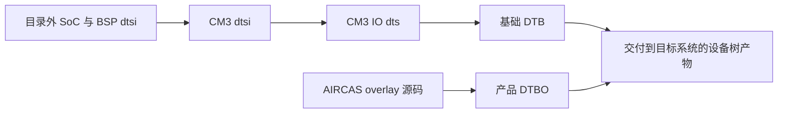

# 04 设备树与 overlay：把接线变成可消费的资源关系

上一章确定了外设接在哪里、由谁供电。这一章解决紧接着的问题：同一颗 RK3566 可以接不同屏幕和底板，Linux 怎么知道眼前这一块板子的实际接法？本项目用设备树描述这些差异，再由驱动读取描述并操作硬件。

本章主线是：**确认板型与接线 → 找到基础设备树 → 叠加产品配置 → 形成最终节点与依赖 → 驱动消费属性** 。本章引用的源码和包内结构均属于静态证据；当前实板加载了哪份 DTB、哪些 DTBO，仍须按[部署生效检查](10_部署生效检查.md)确认。

## 4.1 为什么接线不能只写在驱动里

GT9XX 驱动需要知道触摸芯片的 I2C 地址、复位脚、中断脚和供电来源，但这些信息随底板变化。若全部写死在 C 文件中，换一个 GPIO 就要修改和重新构建驱动，也难以让不同产品共用一份内核。

设备树将“板上有什么、连接到哪里”交给数据描述。驱动保留“如何复位 GT9XX、读取寄存器、报告触点”的操作逻辑。两者之间的约定叫 **binding（绑定约定）** ：不只是属性名，还包括数据单位、取值含义、资源引用和异常处理要求。

**通用原理：** 设备树是描述，不是按行执行的脚本。把电源节点写在触摸节点前面，不会自动保证电源先初始化。真正建立依赖的是 `tp-supply` 等引用，以及驱动申请资源时的返回值。资源提供者尚未就绪时，符合框架约定的驱动可以返回延迟探测错误，等待以后再尝试；源码若吞掉错误，描述正确也可能无法正确初始化。

## 4.2 三层描述各自保存什么

### 4.2.1 从 SoC 到核心板，再到产品

**源码事实：** [CM3 基础文件](../../src/rk3566-radxa-cm3.dtsi)包含 `rk3566.dtsi`、`rk3568-linux.dtsi`，并描述核心板上的供电、存储、总线和相关外设配置；后两份 SoC/BSP 文件不在当前目录。`.dtsi` 是供其他设备树包含的源码片段，不是交给引导程序直接加载的二进制。

[CM3 IO 板文件](../../src/rk3566-radxa-cm3-io.dts)第 10 行包含上述 CM3 文件，在它的基础上添加 IO 板资源和覆盖项。`.dts` 是基础 DTB 的源码入口；**DTB** 是编译后的设备树二进制。文件名含 CM3，并不能证明它已经准确描述自定义底板的全部接线。

[AIRCAS 产品 overlay](../../设备树包/aircas-compact-GCS_overlay.dts)用 `/plugin/;` 声明自己是叠加配置：启用 DSI0、I2C1、I2C3、PWM5，添加 panel、backlight、GT9XX、电池和充电检测节点，并选择显示路由。**DTBO** 是 overlay 编译后的二进制。它依赖基础 DTB 中已有的控制器和标签，不能独立代替完整基础设备树。

以下仅画**编译与交付关系** ，不表示设备初始化的先后顺序：

交付后，还需要从这些产物选择基础 DTB 与产品 DTBO，完成引用解析和属性合并，使内核看到最终设备树。本目录没有足够的引导程序与启动配置，不能断定实际由 U-Boot、某个镜像构建步骤或运行时 overlay API 完成。Linux 支持运行时 overlay，也不代表本项目实际采用了这一方式；这部分初始化时序留到下一章讨论。

### 4.2.2 看见副本，先确定它的身份

**源码事实：** `src/` 与 `设备树包/` 中同名 CM3 `.dtsi` 和 IO `.dts` 的当前内容相同；`src/` 中对应 `.txt` 也是副本。相同内容可以帮助核对，但没有版本控制或构建入口证明哪份是日后应修改的正式来源。

[带 `_v1` 的文件](../../设备树包/rk3566-radxa-cm3-io_v1.dts)直接从 regulator 节点开始，缺少完整设备树入口及其外层结构，应按历史片段阅读。后缀 `_v1` 不是可以直接编译并启动的证明。

**包内事实：** 普通 overlay 包中的 `aircas-compact-GCS.dts` 与工作区产品 overlay 按行归一化后内容一致；PWM 变体包新增的 `aircas-compact-GCS-pwm.dts` 改变了亮度表。两个包的包名与版本相同，仍不能混作同一份配置。基础 DTB 与当前 IO DTS 则存在实质差异，例如 HDMI、SDMMC0 的启用状态；它们的对照见[构建与交付](02_BSP构建与交付.md)。

学习设备树时必须给出一组明确对象：**哪块硬件 + 哪份基础 DTB + 哪个 overlay + 哪个内核驱动** 。只记录某一个 `.dts` 文件名，无法还原整套运行配置。

## 4.3 用 GT9XX 把一条接线翻译完整

### 4.3.1 先从资源关系读节点

产品 overlay 第 391～409 行将 GT9XX 放在 `&i2c1` 下。其意义是“通过 I2C1 控制器访问这个从设备”，不是“先执行 I2C1，再执行第 397 行”。节点 `gt9xx@14` 中的 `@14` 是单位地址标识；驱动和总线实际使用 `reg = <0x14>`。这个地址是当前产品描述的值，不应把另一块 GT9XX 板的地址直接搬来。

| 接线或适配问题 | overlay 中的实际表达 | 接下来由谁使用 |
|---|---|---|
| I2C1 是否用于本产品 | `&i2c1 { status = "okay"; pinctrl-0 = <&i2c1_xfer>; }` | I2C 控制器与 pinctrl 框架建立总线及引脚功能 |
| 总线上哪颗芯片 | `compatible = "goodix,gt9xx"`、`reg = <0x14>` | I2C 设备匹配机制与触摸驱动 |
| 触点就绪如何通知 CPU | `touch-gpio = <&gpio0 RK_PC5 IRQ_TYPE_LEVEL_HIGH>` | 本地旧驱动读 GPIO 并据此申请 IRQ |
| 芯片复位接哪里 | `reset-gpio = <&gpio0 RK_PC6 GPIO_ACTIVE_HIGH>` | 本地旧驱动获取复位脚并执行自身复位流程 |
| 引脚工作在什么功能 | `pinctrl-0 = <&gt9xx_gpio>` | `gt9xx_gpio` 将 C5/C6 配成 GPIO，并设置上下拉 |
| 谁给触摸供电 | `tp-supply = <&vcc_lcd_tp>` | 驱动申请名为 `tp` 的 regulator |
| 尺寸及产品选择参数 | `max-x = <1280>`、`max-y = <800>`、`tp-size = <9112>` | 只有读取这些属性且支持对应取值的驱动才会消费 |

`&gpio0`、`&vcc_lcd_tp` 这种引用经编译和组合后形成 **phandle** ，可以理解为设备树内部定位另一个节点的引用。`RK_PC5` 是 GPIO bank 内的引脚编码；`pinctrl` 决定引脚复用、电气配置，GPIO 描述则告诉消费者使用哪根线以及它的语义，两者不能互相代替。

这里 `touch-gpio` 最后一格用了 IRQ 触发类型宏，而不是一般的 GPIO 有效电平宏。**源码事实：** 旧驱动通过 `of_get_named_gpio_flags()` 读出它，存入 `ts->irq_flags`，随后传给 IRQ 申请函数。这是这份厂商代码的具体约定；不能因属性名字带 `gpio`，就自动套用另一分支的标准 GPIO/IRQ 属性组合。

### 4.3.2 再让驱动读取这些信息

本例只追踪[云奥目录旧分支的 `goodix_ts_probe()`](<../../云奥-270nit-6inch/mipi_touch (1)/mipi_touch/gt9xx.c>)，入口约第 2630 行。它与产品 overlay 的属性命名较接近，但不代表这份本地源码就是交付内核的完整来源。

**源码事实：** 该函数的主要执行顺序如下：

1. 检查 I2C adapter 是否支持普通 I2C 传输，分配 `goodix_ts_data` 设备上下文，并取得 `client->dev.of_node`。缺失能力或节点时，设备无法沿正常路径继续。
2. 读取 `tp-size`，按已实现的取值设置配置选择与坐标变换标志。代码列出的取值为 89、101、911、970、910，未见 9112 分支。
3. 用 `devm_regulator_get(..., "tp")` 查找 `tp-supply` 指向的供电资源，调用 `regulator_enable()`，再等待 20 ms。获取失败会返回错误；使能失败目前只记日志后继续，因此“函数继续执行”不等于触摸供电已经成功。
4. 读取 `touch-gpio`、`reset-gpio`、可选的 `power-gpio`，并检查 `max-x/max-y`。当前文件中将尺寸值赋给 `abs_x_max/abs_y_max` 的语句被注释，不能只看设备树属性就认定 input 范围采用了它们。
5. 初始化 `work` 和 IRQ 自旋锁，保存 I2C client 数据，再通过 `gtp_request_io_port()` 请求 GPIO、执行复位；之后测试 I2C、读取版本、初始化触摸配置。
6. `gtp_request_input_dev()` 创建 input 设备、设置事件能力和坐标范围，并调用 `input_register_device()`；随后请求 IRQ，必要时进入其轮询分支。触点运行流程见[触摸与 input](07_触摸与input.md)。

`probe` 运行在允许睡眠的任务上下文中，因而可以申请可能睡眠的资源、进行 I2C 传输和等待上电。它注册的 IRQ 回调则进入另一条运行路径；初始化阶段允许的动作，不应无条件搬进任意中断或定时器回调。

这份旧源码的 `gtp_request_input_dev()` 出错后，`probe` 仍主要记录日志并继续后续步骤。这提醒我们：还需要检查每个阶段的错误处理，而不是用一句“probe 被调用了”证明 input 接口已经注册。

### 4.3.3 属性名相同不够，芯片名相同也不够

**源码事实：** [7 英寸供应商 V2.8.7 分支](../../阿美林-1000nit-7inch/GT9XX通用调试包/gt9xx.c)的 `gtp_parse_dt()` 读取 `irq-gpios`、`reset-gpios`、`touchscreen-size-x/y`、`goodix,*`；供电初始化申请的是 `vdd_ana` 和 `vcc_i2c`。产品 overlay 的 `touch-gpio/reset-gpio/max-x/max-y/tp-supply` 不能自动满足这套契约。

两份代码的匹配表都出现 `goodix,gt9xx`，只说明匹配入口相同，不说明属性解析、坐标算法、配置组或错误处理相同。替换驱动时仅保留 `compatible`，仍可能走入匹配成功但 GPIO 无效、供电缺失或尺寸退回默认值的路径。

**包内事实：** 内核符号中有 `goodix_ts_probe`、`goodix_ts_work_func` 和 `gtp_dat_gt9112`。这支持“打包内核包含进一步适配的旧驱动家族”这一判断，不能还原缺失的补丁，也不能证明本地旧 C 文件对 9112 的行为。完整版本对应关系属于待确认事项。

## 4.4 叠加成功也不代表资源没有冲突

overlay 通过 `&dsi0` 等标签修改基础节点。基础 DTB 需要有可解析的标签符号，或 overlay 改用明确目标路径。**包内事实：** 现有基础 DTB 带有相关 `__symbols__`，但“存在同名符号”仍不能证明硬件版本和引脚占用匹配。标签解析与设备功能正确是两层检查。[Linux overlay 文档](https://www.kernel.org/doc/html/v6.1/devicetree/overlay-notes.html)用于理解通用组合机制，不作为本项目加载阶段的证明。

产品 overlay 的 `metadata.exclusive` 列出 `dsi0`、`vp0`、`video_phy0`、`pwm5`，是提供给 overlay 管理工具的资源提示，不是内核互斥锁，也未列尽所有 GPIO。真正的冲突还需检查合并后的 pinctrl 和消费者。

一个实际条件是 **GPIO1_D5** 。当前 IO DTS 启用 `sdmmc0`，选择 `sdmmc0_bus4`；产品 overlay 又把 GPIO1_D5 作为屏幕电源控制。包内基础 DTB 的 SDMMC0 已禁用，其 bus4 引脚数据包含 GPIO1_D5。因而：

- 使用现有禁用 SDMMC0 的基础 DTB，是一种资源分配状态。
- 若按当前 IO DTS 重建并继续启用 SDMMC0，再叠加屏幕配置，会重新遇到同脚多用途问题。
- 仅确认 overlay 能编译，不能证明该脚的 pinmux 申请、SD 卡功能或屏幕供电能够共存。

这项结论属于**源码与包内配置组合后的静态风险** ，不是本次现场复现。不同底板原理图还有 GPIO3_C1、GPIO3_B4 的用途变化，应先回到[硬件资源与供电](03_硬件资源与供电.md)选定板型，不能只依据文件日期选择“最新”配置。

另一个边界是极性。overlay 的触摸 fixed regulator 同时使用 `GPIO_ACTIVE_LOW` 和 `enable-active-high`。fixed-regulator 的历史 GPIO 绑定有专门的使能极性规则，不能用字面“低”和“高”直接宣布它一定错误或一定正确。需要对应 BSP 解析器、实际 MOS 电路和电平证据共同判断；[v6.1 绑定说明](https://raw.githubusercontent.com/torvalds/linux/v6.1/Documentation/devicetree/bindings/regulator/fixed-regulator.yaml)只提供通用参考。

## 4.5 五层证据逐层回答五个问题

| 层级 | 它能证明什么 | 还不能证明什么 |
|---|---|---|
| 节点存在 | 在所检查的源码、包内 DTB 或运行时设备树中找到了描述；必须指出是哪一种 | 该节点启用、驱动存在、硬件在线 |
| 节点启用 | `status` 及父总线关系允许该设备参与枚举 | pinctrl、电源及总线建立成功 |
| 驱动被编译 | 内核配置或模块文件包含相应能力；`y` 与 `m` 的装载方式不同 | 当前启动内核就是该包、设备已经绑定 |
| 驱动绑定成功 | 运行时设备和 driver 建立关系，正常探测流程达到可绑定状态 | 采样、显示及所有异常路径正确 |
| 上层接口可用 | 标准接口能提供符合预期的模式、事件或状态 | 桌面映射、应用消费、长期稳定性均已验证 |

这五层不是用一个日志关键字就能跨越的证明链。例如内核配置有 GT9XX，运行树却没有启用 I2C1，触摸仍不会出现；出现 input 设备后，GPIO 中断错误又可能导致没有事件；有坐标事件后，旋转叠加仍可能使点击位置错误。

**待确认事项：** 最终使用的基础 DTB/DTBO、合并时机、运行内核、绑定驱动和实板资源状态尚需实机证据。本章未编译、安装、加载或修改任何设备树。

## 4.6 自查：能否从描述推回实际行为

1. **为什么 `tp-supply = <&vcc_lcd_tp>` 比把电源节点写在前面更关键？**
   回答要点：它建立消费者到供电提供者的关系；驱动按 `tp` 名称获取资源；初始化能否继续由资源获取和错误返回决定，文本顺序不构成执行顺序。
2. **`goodix,gt9xx` 匹配成功后触摸仍不工作，最先应追问什么？**
   回答要点：当前是哪一支驱动，它读取哪些属性；GPIO、供电和地址是否满足该分支；是否执行了 I2C 测试并注册 input；不要直接从匹配跳到坐标算法。
3. **overlay 中写了 1280×800，为什么不能保证 input 也是这一范围？**
   回答要点：属性需要驱动读取并应用；本地旧代码中的直接赋值被注释，后续配置初始化也可能影响范围；还要区分 input 坐标、panel 原生模式和桌面方向。
4. **已有基础 DTB 能启动，能否用当前同名 DTS 原样重建替代？**
   回答要点：必须比较最终节点、引脚资源和包版本。当前文件与交付 DTB 在 SDMMC0 等处不同，文件名一致不足以证明产物等价。

本章输出的是一张可供驱动消费的硬件依赖图。下一章[驱动匹配与初始化](05_驱动匹配与初始化.md)继续解释：内核如何建立资源提供者、总线与设备实例，以及一次探测为什么可能等待、失败或只完成了一部分工作。
