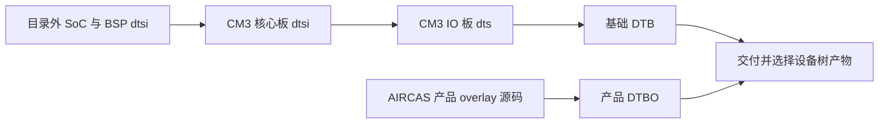

# 04 设备树与 overlay：把硬件连接交给驱动

上一章已经把核心板、底板和外设之间的供电及信号关系连起来。接下来的问题是：同一颗 RK3566 可以接不同屏幕、触摸芯片和电源电路，内核凭什么知道这次接的是哪一种？本项目用设备树保存这些板级差异，让驱动从中取得地址、引脚、电源和连接关系。

理解这一层，应先把一条真实接线翻译成资源描述，再看这些描述如何组成最终设备树，最后追踪驱动怎样消费它。这样才能区分“文件写对了”和“设备真正可用”。本章以工作区源码和已读取的包内成员为静态依据；实际启动使用的组合仍须按[第 10 章](10_部署生效检查.md)确认。

## 4.1 从一个触摸设备理解设备树的作用

### 4.1.1 驱动知道芯片协议，但不知道底板接线

GT9XX 触摸驱动可以知道怎样复位芯片、读取触点寄存器和上报事件，却不应该假定每块底板都使用同一根中断线。如果把 I2C 地址、GPIO 和供电全部写死在 C 文件中，换一根线就要修改驱动，不同产品也难以共用内核。

设备树把两类信息分开：板级描述回答“器件在哪里、资源来自谁”，驱动回答“取得这些资源后如何操作器件”。二者的约定称为 **binding（绑定约定）**。它包括属性名、数据格式、单位、可选性和资源含义；`compatible` 相同并不足以证明两份代码遵守同一套约定。

以 [AIRCAS 产品 overlay](../../设备树包/aircas-compact-GCS_overlay.dts)第 391～409 行为例，`gt9xx@14` 位于 `&i2c1` 下。这个父子关系描述“触摸芯片连接在 I2C1 总线上”，`reg = <0x14>` 描述从设备地址。节点名称中的 `@14` 用于表达单位地址，不能代替 `reg`，也不是驱动的执行序号。

先读这一段实际结构。下面只摘取原节点的部分属性，用于解释语法，不是完整可编译文件：

```dts
&i2c1 {
    status = "okay";
    #address-cells = <1>;
    #size-cells = <0>;
    gt9xx: gt9xx@14 {
        compatible = "goodix,gt9xx";
        reg = <0x14>;
        tp-supply = <&vcc_lcd_tp>;
    };
};
```

花括号组织节点及其子节点，分号结束属性或节点；`gt9xx:` 是便于其他描述引用的标签，`gt9xx@14` 才是节点名。`<...>` 中是数值单元或节点引用，不是 C 数组或指针运算。这里父总线用 `#address-cells = <1>` 和 `#size-cells = <0>` 规定子节点的 `reg` 只包含一个地址单元、不带长度，所以 `<0x14>` 表达 I2C 地址，而非一段内存的起点和大小。[Linux 设备树使用说明](https://www.kernel.org/doc/html/v6.1/devicetree/usage-model.html)

### 4.1.2 把接线逐项翻译为资源关系

| 硬件侧需要回答的问题 | 当前产品节点的表达 | 描述交给谁 |
| --- | --- | --- |
| 哪个控制器承担通信 | `&i2c1`、`status = "okay"`、`i2c1_xfer` | I2C 控制器和引脚控制框架 |
| 总线上访问哪颗器件 | `compatible = "goodix,gt9xx"`、`reg = <0x14>` | I2C 设备匹配机制及 GT9XX 驱动 |
| 触点就绪如何通知 CPU | `touch-gpio = <&gpio0 RK_PC5 IRQ_TYPE_LEVEL_HIGH>` | 读取该厂商属性的旧 GT9XX 分支 |
| 复位控制接到哪里 | `reset-gpio = <&gpio0 RK_PC6 GPIO_ACTIVE_HIGH>` | 旧分支的 GPIO 申请和复位流程 |
| C5/C6 是否确实作为 GPIO | `pinctrl-0 = <&gt9xx_gpio>` | pinctrl 配置复用、上下拉等状态 |
| 触摸电源由谁提供 | `tp-supply = <&vcc_lcd_tp>` | 按名称 `tp` 获取 regulator 的消费者 |
| 尺寸和产品分支如何选择 | `max-x = <1280>`、`max-y = <800>`、`tp-size = <9112>` | 明确读取且使用这些值的驱动代码 |

**pinctrl** 是引脚功能和电气状态的管理机制。它决定引脚是 GPIO、I2C 还是其他复用功能；GPIO 属性则让消费者找到具体控制线。只有 GPIO 编号正确、pinmux 却被其他外设占用时，仍不能按预期操作这根线。

`&gpio0` 和 `&vcc_lcd_tp` 在源码中是标签引用，组合后通过 **phandle** 关联到目标节点。可以把 phandle 理解为设备树内部的节点编号；它不是 C 内存地址，也不是 Linux GPIO 编号。这里 `tp-supply` 指向同文件定义的 `vcc_lcd_tp: vcc-lcd-tp`，触摸节点不负责自己创建供电驱动，而是声明需要使用那个供电提供者。

这里还有一项厂商分支约定：`touch-gpio` 最后一格写的是 IRQ 触发类型宏。旧源码通过 `of_get_named_gpio_flags()` 取出它，保存为 `ts->irq_flags`，再传给 IRQ 申请函数。因此，不能看见属性名中有 `gpio`，就按另一套标准绑定把最后一格重新解释为普通 GPIO 有效电平。这一写法的消费者必须与描述配套。

## 4.2 从基础描述到产品描述：最终节点是怎样形成的

### 4.2.1 每一层只承担自己知道的硬件差异

[CM3 基础文件](../../src/rk3566-radxa-cm3.dtsi)包含 `rk3566.dtsi` 和 `rk3568-linux.dtsi`，再补充 CM3 核心板的供电、存储、总线等描述。前两份 SoC/BSP 文件不在当前仓库，因此现有材料不足以独立重建全部设备树依赖。`.dtsi` 是供其他源码包含的描述片段，不能直接作为引导程序加载的设备树二进制。

[CM3 IO 板入口](../../src/rk3566-radxa-cm3-io.dts)在第 10 行包含 CM3 文件，再增加 IO 板配置。`.dts` 是基础设备树的源码入口，编译结果称为 **DTB**。基础描述将 SoC 和板上资源组织在一起，但文件名带有 CM3，并不能证明它已对应当前自定义底板的全部连接。

产品 overlay 以 `/plugin/;` 声明叠加配置，在基础树上启用 DSI0、I2C1、I2C3、PWM5，加入 panel、backlight、GT9XX、电池和充电检测，并选择显示路线。overlay 的编译结果称为 **DTBO**。它复用基础树中的控制器和资源，只保存产品差异，所以不能独立代替基础 DTB。

以下图只表示**构建与交付关系**；不表达设备初始化顺序，完整的包与 RootFS 关系见[第 2 章](02_BSP构建与交付.md)。



这种分层减少了多个产品重复维护 SoC 描述的成本，代价是产品配置必须依赖正确的基础版本。基础树改变标签、资源启用状态或 pinctrl，overlay 即使没有改动，也可能得到不同结果。

### 4.2.2 合并处理引用和属性，不按行执行硬件操作

`&dsi0` 表示修改基础树中标签为 `dsi0` 的目标节点。按标签定位的 overlay 需要可解析的基础符号和引用修正信息；其他 overlay 也可以通过明确路径指定目标。当前交付基础 DTB 含有相关 `__symbols__`，这支持标签引用解析，但并不证明硬件组合正确。

合并后的设备树才是后续驱动读取的描述。例如产品将基础节点的 `status` 改成 `okay`，并为其增加从设备；节点原有而未被覆盖的属性仍参与最终结果。因此必须检查最终树，不能只把两个文件各读一遍，就默认它们之间没有遗留关系。

可以用本项目 I2C3 的变化理解“覆盖”：已读取的包内基础 DTB 将它设为 disabled，产品 overlay 把同一个控制器改为 okay，并增加 `cw2015@62`。结果是修改并扩充一个节点，不是创建两套 I2C3。未覆盖的基础属性仍保留；若叠加多个 overlay 又改动同一属性，还要按实际应用次序检查最终值。

这里采用的是设备树及 overlay 的通用原理，可参阅 [Linux v6.1 overlay 说明](https://www.kernel.org/doc/html/v6.1/devicetree/overlay-notes.html)。本项目缺少完整引导程序和实际启动配置，尚不能确定最终组合由哪个启动阶段完成。系统支持运行时 overlay，也不等于本项目实际通过运行时 API 加载。

设备树更不是初始化脚本。把电源节点写在触摸节点前面，不会自动让电源先就绪；真正有意义的是 `tp-supply` 依赖，以及消费者申请该资源时获得的结果。提供者尚未就绪时，遵守框架约定的驱动可以返回延迟探测错误，等待以后重试。描述正确但错误码被吞掉，仍可能得到错误的初始化行为，这正是下一章要继续展开的问题。

### 4.2.3 同名文件和同版本安装包不构成来源证明

当前 `src/` 与 `设备树包/` 中同名 CM3 `.dtsi`、IO `.dts` 内容相同，`src/` 对应 `.txt` 也是副本。仓库已有 Git 记录，可以跟踪后续修改；但这些副本内容相同，并不能补出早期内核构建时采用的正式源文件、源码提交和补丁集合。

[带 `_v1` 的文件](../../设备树包/rk3566-radxa-cm3-io_v1.dts)直接从 regulator 节点开始，缺少完整入口及外层结构，应按历史片段阅读。后缀 `_v1` 不能证明它是一份可直接编译替换的基础 DTS。

包内核对得到的是更具体的关系：普通 overlay 包中的 `usr/src/radxa-overlays-0.2.4/arch/arm64/boot/dts/rockchip/overlays/aircas-compact-GCS.dts` 与工作区产品文件按行一致；PWM 变体包另外包含 `aircas-compact-GCS-pwm.dts`，其中亮度表不同。两包均使用 `radxa-overlays-dkms 0.2.4` 身份，包名与版本不足以区分内容。原包路径、哈希和成员位置统一见[关键资料阅读索引](13_关键资料阅读索引.md)。

基础 DTB 与当前 IO DTS 则存在 HDMI、SDMMC0 等启用状态差异。学习或排障时，需要选定“实际硬件 + 基础 DTB + 产品 DTBO + 内核驱动”这一组对象；某一个同名源码文件不足以代表整套系统。

## 4.3 驱动怎样把节点变成可用资源

### 4.3.1 沿旧 GT9XX 分支追踪属性消费

下面只采用[云奥目录旧分支的 `goodix_ts_probe()`](<../../云奥-270nit-6inch/mipi_touch (1)/mipi_touch/gt9xx.c>)，入口约第 2630 行。它的属性名称与产品 overlay 较接近，可用来具体解释描述如何交给驱动；这不证明它就是交付内核采用的完整源码。

首先，I2C 核心把设备实例交给匹配驱动，`probe` 检查 adapter 是否支持所需 I2C 传输，分配 `goodix_ts_data` 上下文，并取得 `client->dev.of_node`。从这里开始，驱动才能读取这个设备自己的属性，而不是在全局文本中搜索一个名字。

随后，驱动读取 `tp-size` 并选择已实现的配置及坐标标志；再用 `devm_regulator_get(..., "tp")` 查找 `tp-supply` 指向的电源，调用 `regulator_enable()` 并等待 20 ms。资源由 regulator 框架提供，驱动只持有消费者句柄。获取失败会返回相应错误，包括可用于延迟探测的错误；当前代码的使能失败却只记录日志后继续，所以“已经走过 enable 调用”不能证明芯片实际有电。

接着读取 `touch-gpio`、`reset-gpio`、可选 `power-gpio` 和尺寸属性，初始化 work、IRQ 自旋锁及 I2C client 数据，再通过 `gtp_request_io_port()` 请求 GPIO、执行复位。只有供电、引脚和总线满足条件，后面的 I2C 测试、版本读取、配置初始化才有成功基础。

最后，`gtp_request_input_dev()` 分配 input 设备、设置事件能力和坐标范围，并调用 `input_register_device()`；随后申请 IRQ，必要时走该分支的轮询后备路径。到这里，描述中的资源才被转换为可供运行链路使用的设备对象和标准接口。IRQ 到触点上报的执行过程放在[第 7 章](07_触摸与input.md)，不与此处的初始化阶段混合。

`probe` 在可睡眠的任务上下文中执行，能够完成可能等待的资源申请、I2C 传输和上电延时。IRQ、定时器与 work 则各有自己的上下文约束。设备树只提供参数，不会替驱动把某个耗时操作自动转移到安全上下文；这一职责仍在代码中。

### 4.3.2 读到了属性，不等于属性已经决定行为

本地旧源码存在三个需要保留条件的观察点：

- `tp-size` 分支列出 89、101、911、970、910，未见 9112。产品写入 9112，不代表本文件实现了该型号的配置选择。
- `max-x/max-y` 有读取和检查，但将值赋给 `abs_x_max/abs_y_max` 的语句被注释。最终 input 范围还要沿配置初始化及后续赋值追踪，不能仅凭 overlay 的 1280×800 下结论。
- `gtp_request_input_dev()` 等部分步骤出错后，`probe` 主要记日志并继续。某个入口返回或后续 IRQ 申请发生，不足以证明前面的接口注册已经成功。

这些是当前可见 C 文件中的源码事实。交付内核的 `System.map` 出现 `goodix_ts_probe`、`goodix_ts_work_func` 和 `gtp_dat_gt9112`，支持它含有进一步适配的旧驱动家族；符号不能还原缺失的补丁、函数正文及错误处理。不能把包里的 9112 符号反向当成本地旧文件已实现 9112 的证明。

### 4.3.3 更换驱动分支必须重新检查整套约定

[7 英寸资料中的 V2.8.7 分支](../../阿美林-1000nit-7inch/GT9XX通用调试包/gt9xx.c)通过 `gtp_parse_dt()` 读取 `irq-gpios`、`reset-gpios`、`touchscreen-size-x/y` 和 `goodix,*`；其供电申请使用 `vdd_ana`、`vcc_i2c`。当前产品中的 `touch-gpio/reset-gpio/max-x/max-y/tp-supply` 不会自动转换为这些名称。

两份驱动的匹配表都有 `goodix,gt9xx`，意味着设备可能到达匹配入口，却不保证 GPIO、供电、配置和坐标资源满足后续要求。因此，更换分支必须一起比较属性契约、配置组、错误路径和注册接口；只修改 compatible 或复制一段中断函数，无法完成适配。

## 4.4 最终树还必须满足资源独占和电气约束

### 4.4.1 合并成功不代表 GPIO 可以同时供多个功能使用

产品 overlay 的 `metadata.exclusive` 列出 `dsi0`、`vp0`、`video_phy0`、`pwm5`。这些是供 overlay 管理工具使用的资源提示，不是内核互斥锁，也没有列尽全部 GPIO。真正是否冲突，要看最终启用的消费者和 pinctrl。

GPIO1_D5 就是一个有明确条件的例子：当前 IO DTS 启用 `sdmmc0` 并选择 `sdmmc0_bus4`；产品 overlay 又将 GPIO1_D5 用作屏幕电源控制。包内基础 DTB 的 bus4 引脚数据包含这个引脚，但其 SDMMC0 已禁用。因此，使用现有交付基础 DTB 与按当前 IO DTS 重建，是两种不同的资源状态。

若按当前源码重建并保留 SDMMC0 启用，再叠加屏幕配置，就可能重新出现同脚多用途问题。此时编译成功只说明语法和引用可处理，不能证明 SD 卡与屏幕电源能共存。这个判断是源码和包内配置组合后的静态风险，本任务没有现场复现。GPIO3_C1、GPIO3_B4 在不同底板图中也有用途变化，应先回到[第 3 章](03_硬件资源与供电.md)选定实物对应的原理图。

### 4.4.2 逻辑有效值、SoC 电平和电路结果要分开

产品中的触摸 fixed regulator 同时写了 `GPIO_ACTIVE_LOW` 和 `enable-active-high`。这类历史绑定对使能极性有专门规则，不能只把“低”和“高”两个词相比较，就宣布配置一定错误或一定正确。应先核对对应 BSP 的 fixed-regulator 解析方式，再推导 SoC 引脚电平，最后结合底板的三极管和 MOS 电路判断负载是否有电。

[上游 v6.1 fixed-regulator 绑定](https://raw.githubusercontent.com/torvalds/linux/v6.1/Documentation/devicetree/bindings/regulator/fixed-regulator.yaml)可用于理解通用规则；它不能替代缺失的项目版本源码和波形证据。同样，GPIO descriptor 的逻辑“有效”与旧整数 GPIO API 的原始高低电平不是可以混用的表述。[显示与背光](06_显示与背光.md)会在面板复位和 PWM 链路中继续使用这一区分。

## 4.5 用五个问题检查描述是否真正走到上层

| 检查层级 | 已获得的证据 | 还缺少什么 |
| --- | --- | --- |
| 节点存在 | 在某份源码、包内 DTB 或运行树找到了描述，且说明了对象 | 节点启用、资源就绪及硬件在线 |
| 节点启用 | 节点及父总线状态允许参与设备枚举 | pinctrl、电源和总线实际建立成功 |
| 驱动被编译 | 内核配置或模块中具有对应代码；区分 `y` 与 `m` | 本次启动使用这份内核，驱动已接管设备 |
| 驱动绑定成功 | 运行设备与 driver 建立关系 | 全部接口注册、通信和异常恢复正确 |
| 上层接口可用 | 标准接口产生符合预期的模式、事件或状态 | 桌面映射、应用消费和长期可靠性 |

这些层级提供的是逐步增强的证据，不是保证所有驱动实现都严格完整的流水线。GT9XX 配置为 `y`，但 I2C1 未启用时，设备仍不会正常出现；input 接口存在而没有中断或有效触点时，上层仍收不到操作；原始坐标正确，桌面旋转叠加也可能造成点击错位。

本章的输出，是理解最终硬件描述所需的资源来源、版本条件和消费关系。仓库有可分析的设备树源码和交付产物，但还缺当前实板究竟加载了哪组基础 DTB/DTBO、何时合并、运行哪份内核及怎样绑定的证据。下一章[驱动匹配与初始化](05_驱动匹配与初始化.md)继续说明资源提供者、总线与消费者如何建立，以及初始化为什么会等待、失败或只完成一部分。

## 4.6 自查：能否从描述推回实际行为

### 4.6.1 问题

1. 为什么 `tp-supply = <&vcc_lcd_tp>` 比把电源节点写在触摸节点前面更关键？
2. 两份驱动都匹配 `goodix,gt9xx`，更换分支时还必须核对哪些内容？
3. overlay 写入 1280×800 和 `tp-size=9112`，为什么不能据此确认本地旧驱动采用了这些设置？
4. 同名 DTB 能启动，为什么仍不能直接把当前同名 DTS 重建后替换它？
5. 已有 driver 链接和 input 设备，接下来还应如何证明触摸链路可用？

### 4.6.2 回答要点

1. supply 引用建立消费者与供电提供者的关系，驱动按 `tp` 获取资源；顺序由资源依赖和错误返回推动，文本先后不是执行时序。
2. 核对属性名、GPIO/IRQ 语义、电源名称、配置组、尺寸变换、错误处理及接口注册。相同匹配字符串只覆盖入口，不覆盖完整行为。
3. 旧源码缺少 9112 分支，尺寸直接赋值又被注释；还要追踪后续初始化。包内 9112 符号只能提示实现另有差异，不能补成本地源码事实。
4. 基础源码与包内产物在 SDMMC0、HDMI 等状态上不同，可能改变资源占用和显示拓扑。必须比较最终树、引脚和实际硬件，文件名不能证明等价。
5. 检查原始事件中的按下、移动、释放及同步，再核对坐标方向和桌面消费；注册存在不等于通信持续正确，更不等于长期可靠。
