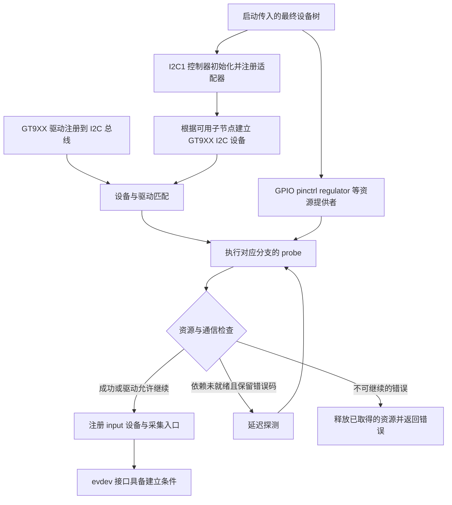

# 05 驱动匹配与初始化：把设备树中的描述变成可用接口

上一章得到的是最终设备树：它描述哪些器件接在哪条总线上，使用哪些供电、引脚和参数。本章继续解释 Linux 怎样找到负责这些器件的代码，以及为什么设备树里已经有触摸节点，桌面仍然可能收不到触摸事件。

这里以本地旧版 GT9XX 驱动为主要实例。它能够把“供电与接线—资源申请—I2C 通信—input 注册”连成一条可读的初始化路径；V2.8.7 作为独立分支对照。包内内核与这两个源码目录之间的完整对应关系尚未建立，不能将本章源码路径直接宣布为当前实板运行路径。

## 1. 从硬件描述到接口，需要跨过五道门

驱动可以理解为一段负责器件协议的软件：Linux 知道如何安排总线和管理设备，但不知道某颗触摸芯片的状态寄存器、复位时序和触点格式。GT9XX 驱动补上这一段，并把结果交给 input 子系统统一表达。

| 阶段 | 已经说明什么 | 还不能说明什么 |
|---|---|---|
| 节点存在 | 最终树中有对应硬件描述 | 父总线或本节点可能仍未启用 |
| 节点启用 | 节点允许参与设备创建，父级也需可用 | 对应控制器和器件驱动可能未注册 |
| 驱动被编译 | 内核或模块含有处理代码 | 模块可能未加载，匹配或 probe 可能失败 |
| 驱动绑定成功 | 驱动接受了该设备，初始化回调返回成功 | 驱动可能容忍部分失败，运行时仍可能没有有效数据 |
| 上层接口可用 | 接口出现，并能产生或接受符合预期的数据 | 桌面选择、坐标映射、应用交互和长期稳定性仍需验证 |

**内核通用原理：** `probe` 是匹配后由总线/驱动框架调用的初始化回调，在可睡眠的任务上下文执行。返回 0 表示驱动接受设备；负错误码表示初始化失败；依赖资源尚未就绪时可以返回 `-EPROBE_DEFER`，交由框架稍后重试。这不是“DTS 从第一行执行到最后一行”。见 [Linux 6.1 驱动模型](https://www.kernel.org/doc/html/v6.1/driver-api/driver-model/driver.html)。

下面只画上电后的初始化依赖，不包含编译产物和运行时触点采集。

图中的资源依赖表示“使用之前必须可获得”，不承诺每次启动都有唯一固定的 probe 排序。提供者可能先完成，也可能使消费者经历延迟探测；准确的启动先后需要目标内核和日志。

## 2. 编译、注册与匹配各解决一个问题

### 2.1 先有代码，后有设备绑定

**源码事实：** 6 英寸资料中的 [旧版 Makefile](<../../云奥-270nit-6inch/mipi_touch (1)/mipi_touch/Makefile>) 将 `goodix_gt9xx.o` 列为 `obj-y`，由 `gt9xx.o`、`gt9xx_update.o` 组成，`goodix_tool.o` 的组合项被注释。这说明该片段希望将驱动编入父级构建；父目录是否被完整内核构建系统纳入，还取决于未提供的上级 Makefile/Kconfig。

旧版 [gt9xx.c](<../../云奥-270nit-6inch/mipi_touch (1)/mipi_touch/gt9xx.c>) 第 3204—3245 行通过 `module_init(goodix_ts_init)` 进入初始化：先创建全局单线程 `goodix_wq`，再用 `i2c_add_driver()` 注册 `goodix_ts_driver`。`module_init` 在内建和模块构建下接入不同装载时机，不能仅看这个宏判断它一定是外部 `.ko`。

**源码事实：** 7 英寸资料中的 [V2.8.7 Kconfig](../../阿美林-1000nit-7inch/GT9XX通用调试包/Kconfig) 声明 `TOUCHSCREEN_GT9XX` 为依赖 I2C 的三态选项；[Makefile](../../阿美林-1000nit-7inch/GT9XX通用调试包/Makefile) 以该选项决定 `gt9xx_core.o` 是否构建，组合 `gt9xx.c`、`gt9xx_update.c`、`goodix_tool.c`。其 `gtp_init()` 直接注册 I2C 驱动，没有旧版那条全局采集 workqueue 创建步骤。

理解 `y/m/n` 的意义，可以解释一个常见现象：`lsmod` 看不到驱动并不等于代码没有运行。内建驱动不需要以可卸载模块出现；相反，磁盘上有 `.ko` 也不代表它已经装载或绑定。

还要区分“便于阅读的驱动目录”和“可独立构建的完整工程”。旧版 [gt9xx.h](<../../云奥-270nit-6inch/mipi_touch (1)/mipi_touch/gt9xx.h>) 第 37 行包含 `../tp_suspend.h`，但本地对应位置没有这个文件；本目录也没有完整父级内核构建体系。已有源文件能支持分析调用链，不能据此承诺在当前目录执行 make 就能重建交付驱动。

### 2.2 同一个 compatible，不等于同一份属性约定

**源码事实：** 两套驱动的匹配表都包含 `goodix,gt9xx`：旧版第 3182—3193 行，V2.8.7 第 2605—2625 行。产品 [overlay](../../设备树包/aircas-compact-GCS_overlay.dts) 第 397—408 行也使用这个字符串，因此“字符串可匹配”只是第一层条件。

实际属性接口明显不同：

| 需要解决的事情 | 产品 overlay | 旧版本地代码读取 | V2.8.7 本地代码读取 |
|---|---|---|---|
| I2C 位置 | I2C1 子节点，`reg = <0x14>` | 通过 `i2c_client` 取得总线和地址 | 同样通过 `i2c_client` |
| 中断引脚 | `touch-gpio`，GPIO0_C5 | `touch-gpio` | `irq-gpios`，另读 `irq-flags` |
| 复位引脚 | `reset-gpio`，GPIO0_C6 | `reset-gpio` | `reset-gpios` |
| 电源 | `tp-supply` | 请求名为 `tp` 的 regulator | 请求 `vdd_ana`、`vcc_i2c` 两路 regulator |
| 坐标范围 | `max-x = 1280`、`max-y = 800` | 要求属性存在，但赋给 `abs_*` 的两行已注释 | `touchscreen-size-x/y`，缺失时使用分支默认值 |
| 产品配置选择 | `tp-size = 9112` | 本地代码只显式处理 89、101、911、970、910 | 使用 `goodix,*` 配置属性，没有这组 `tp-size` 分派 |

`reg` 是总线地址，不是芯片内部寄存器地址。这里的 `0x14` 表示 Linux 向哪一个 I2C 从设备通信；后面读取的 `0x814E` 才是触点状态在器件内部的位置。

这张表说明：即使 `compatible` 命中，换一套 GT9XX 源码也可能使 GPIO、供电和坐标参数失效。`tp-size = 9112` 在旧本地分支中没有命中专用分支，并不自动导致 probe 返回错误；它会使相关配置和变换保持其他初始化路径给出的值，实际结果需继续追踪。

## 3. 沿旧版 probe 走一遍资源取得和接口建立

本节的函数均来自 [旧版 gt9xx.c](<../../云奥-270nit-6inch/mipi_touch (1)/mipi_touch/gt9xx.c>)，主入口为第 2630 行 `goodix_ts_probe()`。这里的 `ts` 是这个设备的私有状态，保存 I2C 客户端、输入设备、GPIO、采集任务、坐标范围及工作状态。

### 3.1 检查总线能力，分配状态，读取板级参数

驱动首先检查 `I2C_FUNC_I2C`，确认适配器能完成所需 I2C 传输；再用 `kzalloc(..., GFP_KERNEL)` 分配清零的 `ts`。随后要求有设备树节点和 `tp-size`，并据其值选择坐标交换、镜像等分支。

这里的清零有实际意义：后续某些字段没有赋值时会保持 0，但“保持 0”不等于“正确默认值”。例如没有命中产品分支时，必须继续查看全局初值、配置组选择和芯片配置，而不能只检查属性名拼写。

驱动第 2733—2744 行要求 `max-x/max-y` 存在，却注释了 `ts->abs_x_max = val` 与 `ts->abs_y_max = val`。所以这份代码中，修改两个 DTS 数值并不能直接证明 input 的坐标上限随之变化。第 1609—1613 行会从触摸配置缓冲区提取范围；固定配置路径还会通过 `gtp_get_info()` 读取器件信息。

### 3.2 电源资源来自设备树引用，操作效果来自具体电路

`devm_regulator_get(..., "tp")` 根据 `tp-supply` 找到电源提供者，然后 `regulator_enable()` 请求使能，接着等待 20 ms。它取得的是 Linux 电源资源，不是驱动直接知道某个 MOS 管的结构。

如果供电节点引用了 GPIO 控制的固定稳压器，那么 GT9XX 请求使能，固定稳压器驱动再控制 GPIO，底板电路最终决定供电是否真的接通。逻辑“使能”与管脚物理高低应结合 regulator 属性和原理图核对，不能仅用触摸驱动中的函数名推导。

**源码事实：** 获取 regulator 失败时，这个分支原样返回 `PTR_ERR()`，因此能保留 `-EPROBE_DEFER`；但 `regulator_enable()` 失败后只打印错误，仍继续等待并走后续初始化。出现后续 I2C 失败时，不能据日志末尾只归因为 I2C 控制器。

### 3.3 GPIO 不只用于运行时中断，还参与选址与复位

取得 `touch-gpio/reset-gpio` 后，驱动初始化 `work` 和 `irq_lock`，并以 `i2c_set_clientdata()` 将 `ts` 关联到 I2C 设备。`gtp_request_io_port()` 请求 GPIO，随后调用 `gtp_reset_guitar()`。

**源码事实：** 第 1104—1134 行的复位过程先拉低 RST，等待，再根据 `client->addr == 0x14` 驱动 INT 电平，随后释放复位并将相关引脚转回输入。INT 因而有两个阶段的职责：启动时参与地址选择，运行时向 SoC 通知触点状态。

这一过程解释了为什么“GPIO 方向配置正确”仍然不够：若 RST/INT 接线互换、上拉电源未建立，或 pinctrl 被其他功能占用，Linux 可以创建 `0x14` 的软件设备，但芯片可能没有在这个地址响应。

还要留意旧接口的语义：这份代码使用整数 GPIO 和 `gpio_direction_output` 一类操作，不应直接套用 GPIO descriptor 接口自动解释 `ACTIVE_LOW` 的规则。旧代码还把 `touch-gpio` 的 flags 装入 `irq_flags` 再传给 IRQ 申请；应按这段实现检查，而不能把 GPIO 极性标记与 IRQ 触发类型视为同一概念。

### 3.4 先验证通信，再配置芯片，最后注册输入能力

GPIO/复位之后，驱动识别 GT9xx/GT9xxF 分支，进行 `gtp_i2c_test()`，读取版本，再运行 `gtp_init_panel()`。这里的 `panel` 是触摸控制器配置的历史命名，不能误认为它在初始化 DSI 液晶面板。

触摸配置决定扫描矩阵、分辨率等器件参数。旧分支会选择配置组、检查 sensor ID 和配置版本，构造校验和，或在固定配置分支读取芯片现有参数。配置存在、校验和成立、I2C 写入成功、触摸覆盖正常，是四个不同的验证层级。

接着 `gtp_request_input_dev()` 设置支持的事件、坐标范围和 input 名称，并调用 `input_register_device()`。`gtp_request_irq()` 再取得 IRQ；申请不成功时，这份旧代码会启动 hrtimer 轮询。两条路径最终都把采集工作交给 `goodix_wq`，具体运行时行为见第 07 章。

**源码事实：** 本地旧版实际使用 `devm_request_threaded_irq(..., NULL, goodix_ts_irq_handler, ... IRQF_ONESHOT)`，第 1933—1938 行的 `request_irq()` 已被注释。应描述为“IRQ 回调投递 workqueue”，不能把这份现有文件中的回调说成必定运行于硬中断上下文。

`input_register_device()` 之后，input 核心及 evdev 可以建立 `/dev/input/event*` 接口；具体编号动态分配。接口不是 GT9XX 源码直接硬编码创建的文件，桌面也不应依赖某个固定的 `event0`。

## 4. 初始化成功和资源生命周期要一起看

### 4.1 延迟探测必须保留真正的错误

**内核通用原理：** 资源提供者还没有注册时，消费者往往需要稍后重试。必须将相应错误一直传回 probe，框架才知道这是“以后再试”，而不是“已成功”或“永久不支持”。`devm_*` 的主要收益是把受管理资源绑定到设备生命周期，减少失败和解绑时手工回收的遗漏；它不会自动修正逻辑错误或替代所有硬件关闭步骤。见 [Linux 6.1 Devres](https://www.kernel.org/doc/html/v6.1/driver-api/driver-model/devres.html)。

**源码事实：** V2.8.7 的 `gtp_power_init()` 第 1951—1966 行在 regulator 获取错误后先把指针改成 `NULL`，再对它调用 `PTR_ERR()`，最后总是返回 0。原始错误及可能的延迟探测信息因而丢失。这一判断针对该供应商文件；不能据此宣称当前包内驱动已发生相同故障。

### 4.2 旧版的失败路径并不等于完整回滚

旧版有显式 `goto` 释放路径，但存在需要理解的边界：

| 源码位置与条件 | 会发生什么 | 学习时应得出的判断 |
|---|---|---|
| 分配 `ts` 后缺少节点/必需属性，直接 return | 普通 `kzalloc` 状态没有在该分支释放 | 失败路径也要画资源账本，不能只看正常尾部 |
| `gtp_init_panel()` 返回错误 | 记录错误、调整中断类型后继续 | 后面 probe 成功不证明配置下发成功 |
| `gtp_request_input_dev()` 返回错误 | 记录错误后仍进入 IRQ 申请 | 应进一步检查采集入口是否可能使用未注册或无效 input 状态 |
| 移除设备时 `kfree(ts)` | 本地 remove 未先 `cancel_work_sync(&ts->work)` | 必须评估排队/执行中的工作是否已停，不可只关闭 IRQ |
| IRQ 以 devm 申请，remove 又直接 `free_irq()` | 管理式与手工式回收混用 | 要核对目标内核生命周期，避免重复回收或告警 |

这些是**源码静态风险** ，不是现场复现记录，也不是本次要修改的代码。其共同原因是初始化并非一组互不相关的调用：先取得的资源决定后面能做什么，后面已启动的任务也决定前面资源能否释放。

### 4.3 V2.8.7 的正常初始化链应独立阅读

V2.8.7 的 [gt9xx.c](../../阿美林-1000nit-7inch/GT9XX通用调试包/gt9xx.c) 第 1993—2175 行为：`gtp_probe()` 分配设备与平台参数 → `gtp_parse_dt()` → 电源获取与上电 → pinctrl 初始化 → GPIO 申请与复位 → I2C 检测和固件信息 → 触摸配置 → input 注册 → IRQ/轮询建立 → 电源管理与属性接口 → ESD 初始化 → 允许数据上报。

其 [gt9xx.h](../../阿美林-1000nit-7inch/GT9XX通用调试包/gt9xx.h) 第 82—107 行把设备树解析结果放入 `goodix_ts_platform_data`；第 149 行起的 `goodix_ts_data` 保存运行对象、资源句柄和状态。两者分别回答“这块板要怎么配置”和“这个设备现在处于什么状态”。例如 `esd_protect` 是配置意图，`ts_esd.esd_on` 才是当前是否安排 ESD 检查的状态，二者都不能替代真实芯片通信结果。

它在 input 注册、IRQ 申请等错误上设有不同的回退标签，不能把这些标签嫁接到旧版流程中。它也会容忍 `gtp_init_panel()` 失败；`init_wr_node()` 的返回值在 probe 中没有检查。因此“新分支结构更完整”不等于“所有初始化和清理路径已经可靠”。

`gtp_work_control_enable()` 在本分支只是设置或清除 `WORK_THREAD_ENABLED` 状态位。它不是取消 IRQ 线程、等待当前 I2C 事务完成的完整同步屏障，不能仅凭函数名推断已经排空全部正在执行的工作。

## 5. 把代码与交付物、实板分别对应起来

**包内事实：** [交付内核包](../../debs/linux-image-6.1.84-12-rk2410-nocsf_6.1.84-12_arm64.deb) 的 `data.tar.*` 中，`boot/config-6.1.84-12-rk2410-nocsf` 包含 `CONFIG_TOUCHSCREEN_GT9XX=y`、`CONFIG_TOUCHSCREEN_GOODIX=m`、`CONFIG_INPUT_EVDEV=y`，并明确未设置 `CONFIG_CHROME_PLATFORMS`。`boot/System.map-6.1.84-12-rk2410-nocsf` 含 `goodix_ts_probe`、`goodix_ts_work_func`、`gtp_dat_gt9112`。这些事实可定位到包内成员，而不是来自实板 `uname` 或运行日志。

`config-*` 可以证明构建选项取值，`System.map-*` 可以证明链接产物含某些符号；它们不能证明供应商目录里的函数体就是该符号对应的实现。完整对应还需要内核提交、补丁集、构建配置和产物标识。包中 `GOODIX=m` 与 `GT9XX=y` 是不同配置项，也不能据其中一个名字推断所有 Goodix 驱动共用同一套属性。

例如，旧版源码符号是 `goodix_ts_probe/goodix_ts_work_func`，V2.8.7 是 `gtp_probe/gtp_work_func/gtp_get_points`。符号族适合缩小版本范围，却不足以证明旧目录的 GPIO 属性、配置组和错误处理已经原样进入安装包。包内核实位置见 [关键资料阅读索引](13_关键资料阅读索引.md)。

**待确认事项：** 当前实板的最终树、运行内核、驱动绑定链接和事件能力尚未采集。本章没有执行加载/卸载驱动、修改设备树或触发芯片复位。部署后可按第 10 章依次核实：最终节点 → I2C 设备 → driver 链接 → input 能力 → 连续触点事件，而不是用一个日志中的 “success” 结束判断。

## 6. 自查：能否从一个现象追到所处阶段

**问：DTS 中 `status = "okay"`，为什么可能没有 `/dev/input/event*`？**

回答要点：这只放行硬件描述。还需父 I2C 控制器可用、设备实例创建、正确驱动注册并匹配、资源和通信成功、input 注册及 evdev 支持。先找缺失的第一层，避免跳过供电而直接查桌面。

**问：把 `compatible` 改成已有驱动支持的字符串，就能完成移植吗？**

回答要点：字符串只决定候选处理者；还要核对属性名、电源名、GPIO 时序、配置协议、坐标和错误处理。两套 GT9XX 都匹配同一字符串，恰好说明匹配不等于接口约定相同。

**问：采用 devm 是否就不需要 remove 和错误清理？**

回答要点：它处理受管理资源的生命周期，不负责替你停止所有后台工作或决定硬件应处于何种状态；普通分配、regulator 使能次数、排队任务、proc/sysfs 入口仍需各自核对。

**追问：如果 probe 返回 0、input 设备也存在，触摸却失效，下一步看什么？**

回答要点：转到运行时链路，检查 IRQ 是否变化、采集上下文是否运行、I2C 是否完整返回、状态是否有效、触点是否上报；再检查桌面如何消费事件。下一章先完成显示与背光，随后第 07 章完整展开这条输入链。

---

上一章：[04 设备树与 overlay](04_设备树与overlay.md) · 下一章：[06 显示与背光](06_显示与背光.md) · [返回总览](README.md)
