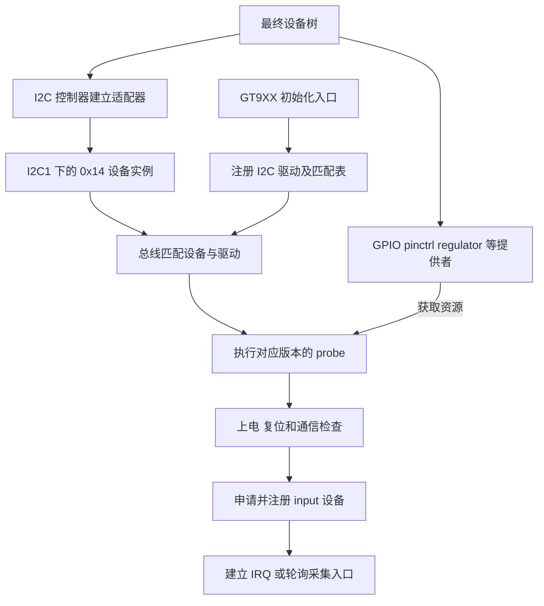

# 05 驱动匹配与初始化：从设备描述到输入设备

上一章把接线转换为设备树中的依赖关系。以触摸为例，产品 overlay 已经说明：芯片位于 I2C1 的地址 `0x14`，使用 GPIO0_C5 接收中断、GPIO0_C6 复位，通过 `tp-supply` 取得电源。但此时 Linux 得到的仍是一份描述。要让手指操作最终变成输入事件，还必须有人取得这些资源、与芯片通信，并向 input 子系统注册能力。

本章沿这次初始化往下走。正常路径以云奥资料中的本地 V2.2 GT9XX 为实例，之后再对照阿美林 V2.8.7。两者都是现有源码，均不能直接等同于交付包中经过修改的完整驱动；包内证据放在 5.5 节统一核对。

## 5.1 在总线上建立设备与驱动的对应关系

### 5.1.1 同一颗芯片在软件中有三个不同对象

设备树中的节点回答“板上有什么”。I2C 控制器驱动建立总线后，内核才能根据可用的子节点创建器件对象。这里的 `reg = <0x14>` 是 I2C 从设备地址，不是触摸芯片内部寄存器地址；后续的 `0x814E` 才属于芯片寄存器协议。

软件中负责这条总线传输的对象称为 I2C adapter（适配器）；触摸对应的 client 则保存目标器件地址。按设备树创建 client，依据的是描述，并不要求先读到芯片应答。因此，即使触摸断电，也可能看到 `0x14` 的软件对象；后续实际传输收到有效应答，才开始证明物理通信成立。这是设备树方式建立 I2C 对象的通用机制，不是本次实板枚举记录。[Linux I2C 设备实例说明](https://www.kernel.org/doc/html/v6.1/i2c/instantiating-devices.html)

理解初始化时，先把三个对象分开：

| 对象 | 谁创建或填写 | 保存什么，供谁使用 |
| --- | --- | --- |
| `i2c_client` | I2C 核心依据总线与设备描述建立 | 器件地址、所属适配器、设备树节点；传给驱动的 probe |
| `goodix_ts_data`，代码常用变量名 `ts` | GT9XX 驱动分配 | GPIO、regulator、坐标范围、采集任务和状态；初始化与运行函数共同使用 |
| `input_dev` | GT9XX 驱动申请并注册 | 设备名称、事件类型和坐标能力；交给 input 核心及事件处理器 |

这三个对象不是三颗硬件。它们分别解决总线寻址、芯片私有状态和统一输入表达。`i2c_set_clientdata(client, ts)` 把前两个对象关联起来；后续函数拿到 `client` 时，可以找回同一设备的运行状态。

下面是**启动后的初始化关系图**。设备创建与驱动注册是两条输入，只有两侧都存在并匹配，才会进入对应驱动的 probe。

图中箭头表达依赖和交接，不承诺所有提供者按某个固定顺序初始化，也没有画成“设备树按行执行”。资源未就绪与通信失败怎样处理，须结合 5.3 节的返回值与清理路径。

### 5.1.2 编译选择、驱动注册和设备匹配各有作用

源码首先要进入内核构建。旧版 [Makefile](<../../云奥-270nit-6inch/mipi_touch (1)/mipi_touch/Makefile>) 将 `goodix_gt9xx.o` 列为 `obj-y`，由 `gt9xx.o` 和 `gt9xx_update.o` 组成；`goodix_tool.o` 的组合项被注释。这个片段表达了内建意图，但父级是否纳入该目录，还需完整内核构建系统。

进入运行阶段后，[旧版 gt9xx.c](<../../云奥-270nit-6inch/mipi_touch (1)/mipi_touch/gt9xx.c>) 的 `goodix_ts_init()` 先创建单线程 `goodix_wq`，再用 `i2c_add_driver()` 注册 `goodix_ts_driver`，位置在第 3204—3245 行。`module_init()` 既能接入内建初始化，也能接入模块装载，不能看到这个宏就认定最终一定生成独立 `.ko`。

匹配时，I2C 核心使用驱动声明的匹配信息。旧版 `goodix_ts_dt_ids` 中包含 `goodix,gt9xx`，与 [产品 overlay](../../设备树包/aircas-compact-GCS_overlay.dts) 第 397—408 行一致。匹配命中后，框架才调用 `goodix_ts_probe()`，让芯片驱动验证和建立工作条件。

对 C 代码而言，这次交接通过函数指针完成：`goodix_ts_driver` 的 `.probe = goodix_ts_probe` 把初始化回调交给总线框架。`goodix_ts_init()` 注册的是这份驱动描述，并不需要自己逐个调用每台设备的 probe。

**编译说明代码具备进入系统的条件，注册说明框架知道这个驱动，绑定才说明它接受了某个设备。** 所以 `lsmod` 看不到内建驱动并不异常；有模块文件，也不证明它已装载或接受设备。

本目录还缺少独立重建条件：旧 [gt9xx.h](<../../云奥-270nit-6inch/mipi_touch (1)/mipi_touch/gt9xx.h>) 第 37 行引用的 `../tp_suspend.h` 在对应位置不存在，上级内核工程也未提供。这里能够分析调用链，不能承诺在供应商目录执行 make 就能重建交付驱动。

## 5.2 沿旧版 probe 建立一次完整的工作条件

本节均对应本地 V2.2 的 `goodix_ts_probe()`，入口在旧 `gt9xx.c` 第 2630 行。probe 运行在允许睡眠的任务上下文，因此可以等待供电稳定、访问 I2C 或使用允许等待内存回收的 `GFP_KERNEL` 分配。这里“睡眠”指当前任务可以暂时让出 CPU 等待条件，并非让触摸芯片进入休眠。probe 是初始化回调，不是触摸发生时的中断处理函数；这一内核机制可参阅 [Linux 6.1 驱动模型](https://www.kernel.org/doc/html/v6.1/driver-api/driver-model/driver.html)。

### 5.2.1 取得状态和供电，才能操作芯片

正常推进顺序如下：

1. **检查总线能力。** `i2c_check_functionality(..., I2C_FUNC_I2C)` 确认适配器支持所需传输。失败时返回 `-ENODEV`，此时还没有进入芯片寄存器通信。
2. **分配设备状态。** `kzalloc()` 建立清零的 `ts`，随后读取设备树和 `tp-size`。产品分支决定配置组和坐标交换/镜像参数；清零只是初值，并不保证未配置字段恰好适合硬件。
3. **请求电源资源。** `devm_regulator_get(..., "tp")` 按 `tp-supply` 找到供电提供者；`regulator_enable()` 请求使能，之后等待 20 ms。
4. **读取 GPIO 与尺寸属性。** 驱动记录 INT、RST 等资源，初始化 `ts->work` 和 `irq_lock`，再把 `ts` 关联到 `client`，为复位和后续回调提供上下文。

这次电源申请还跨越一层：GT9XX 驱动表达“需要供电”，固定稳压器驱动根据节点控制 GPIO，底板电路决定芯片电源是否接通。因此 `regulator_enable()` 的逻辑请求、GPIO 物理电平和实测电压不是同一种证据，电路推导应回看第 03 章。

旧代码第 2716—2727 行在获取 regulator 失败时原样返回错误；但使能失败只记录日志，仍继续等待和初始化。这个差异解释了为何后面报 I2C 错误时，还应向前检查供电阶段。

读这里的 C 代码还要识别内核的“错误指针”约定：`regulator_get` 一类接口既可能返回资源指针，也可能返回编码了负错误码的指针。`IS_ERR()` 检查后一种情况，`PTR_ERR()` 再取回错误码；它们不是简单的 NULL 检查。若先把错误指针改成 NULL，错误码就丢失了，5.4 节的新分支恰有这个问题。[Linux v6.1 错误指针定义](https://raw.githubusercontent.com/torvalds/linux/v6.1/include/linux/err.h)

### 5.2.2 INT 在初始化和运行时承担不同职责

`gtp_request_io_port()` 申请 RST、INT，并调用 `gtp_reset_guitar()`。该复位函数第 1104—1134 行不是简单翻转一个脚：

1. 拉低 RST 并等待，让芯片进入复位阶段。
2. 根据 `client->addr == 0x14` 设置 INT 电平，参与芯片的地址选择。
3. 释放 RST、等待，再将相应 GPIO 切回输入；普通 GT9xx 还经过 INT 同步过程。

所以 INT 在启动阶段参与选址，运行阶段才主要用于通知新数据。如果 Linux 创建了 `0x14` 的设备对象，但复位期间芯片实际选择了另一个地址，软件节点仍然存在，通信却不会因此成功。

这里使用的是整数 GPIO API；`GTP_GPIO_OUTPUT` 宏最终调用 `gpio_direction_output()`。它不能直接套用 GPIO descriptor API 按 `ACTIVE_LOW` 转换逻辑值的解释。旧驱动还将 `touch-gpio` 的 flags 放入 `irq_flags` 传给 IRQ 申请，说明 GPIO 属性和中断触发必须按该分支实际代码一起核对。

### 5.2.3 通信、触摸配置和 input 能力逐项交接

复位之后，代码识别 GT9xx/GT9xxF 分支，再进行 `gtp_i2c_test()`、版本读取和 `gtp_init_panel()`。这里的 `panel` 是触摸配置函数的历史名称，它不负责前后章节讨论的 DSI 液晶初始化。

这里的 CFG 是触摸芯片使用的一段配置参数，例如坐标分辨率和中断触发设置；它既不是 Linux 的 `.config`，也不是待烧写的触摸固件。`gtp_init_panel()` 从产品配置表中选数据；如果只提供第一组，它采用组 0，否则读取芯片 sensor ID 选择对应组，再检查长度和配置版本。sensor ID 在这条路径里是选择触摸配置的依据，不能拿屏幕尺寸或 `tp-size` 的数字直接替代。

可更新路径将配置复制到缓冲区并计算校验和；固定配置路径读取器件现有信息后返回。这些动作要分层理解：选择了某组数据，不等于成功下发；校验和成立，只说明数据满足相应校验规则，不证明扫描矩阵和坐标范围适合实物。

这里有两个直接影响后续输入的源码条件：

- `tp-size = <9112>` 在产品 overlay 中存在，但旧本地代码只显式处理 89、101、911、970、910。没有匹配专用分支时不会自动返回错误，而会保留其他初始配置路径的结果。
- 第 2733—2744 行要求 `max-x/max-y` 存在，却注释了赋给 `abs_x_max/abs_y_max` 的两行。范围会继续由配置缓冲区或 `gtp_get_info()` 获取，再可能在 input 注册时交换轴。因此改了 DTS 数值并不直接证明 input 范围改变。

正常路径随后由 `gtp_request_input_dev()` 申请 `input_dev`，设置事件类型、坐标范围和设备名，再调用 `input_register_device()`。这些能力描述告诉消费者“将会收到什么事件、坐标采用多大范围”，并没有产生一帧真实触点。input 核心将设备连接到适用的事件处理器；evdev 负责向用户空间暴露 `/dev/input/event*`。这些节点不是 GT9XX 在源码中手工创建的固定文件。

随后 `gtp_request_irq()` 用 `gpio_to_irq(ts->irq_pin)` 找到该 GPIO 对应的 Linux IRQ 编号，再申请采集入口；GPIO0_C5 的管脚身份与这个 IRQ 编号不是同一套编号。当前旧源码实际调用 `devm_request_threaded_irq(..., NULL, goodix_ts_irq_handler, ... IRQF_ONESHOT)`；原 `request_irq()` 调用已注释。IRQ 回调还会把任务投递到 `goodix_wq`，申请失败则启用轮询。只有上述申请和注册成功，才能得到本节预期的输出：**输入能力已登记，采集路径可以开始工作**。是否持续获得正确事件，由第 07 章继续判断。

## 5.3 错误返回和资源寿命决定初始化是否可靠

### 5.3.1 延迟探测不是重新执行设备树

资源提供者可能晚于消费者就绪。内核约定允许 probe 返回 `-EPROBE_DEFER`，表示依赖暂时不可用，框架之后再尝试。前提是驱动保留这个错误，而不是转换为成功或无关错误码。

旧版从 `devm_regulator_get()` 原样返回 `PTR_ERR()`，保留了这一机会。但“稍后再试”仍要求本次尝试取得的资源被正确处理，否则反复探测会累积泄漏或遗留状态。设备树引用建立依赖，错误返回把这种依赖落实到执行过程中。

### 5.3.2 资源回收要考虑已经启动的工作

对初始化做一次简单的资源账本，比只看末尾的 return 更容易理解失败路径：

| 已取得的对象或状态 | 后续谁还会使用 | 失败/退出时要处理的问题 |
| --- | --- | --- |
| 普通 `kzalloc` 的 `ts` | probe、IRQ 回调、work 和休眠回调 | 所有使用者停止后才可释放，早退不能遗漏 |
| regulator 句柄与使能请求 | 供电操作及恢复过程 | 句柄生命周期与使能次数是两件事 |
| GPIO 和 IRQ | 复位、选址、触摸通知 | 停止事件来源，并采用匹配的资源释放方式 |
| `input_dev` | 采集路径和 input 核心 | 申请、注册、注销应与是否已注册一致 |
| 队列中的 `ts->work` | 工作线程 | 禁用新 IRQ 不保证旧任务已执行完 |

`devm_*` 把受管理资源绑定到设备生命周期，能减少手工回收遗漏；它不会自动排空所有后台任务，也不负责补全硬件关闭策略。参阅 [Linux 6.1 Devres](https://www.kernel.org/doc/html/v6.1/driver-api/driver-model/devres.html)。

可以用一段交错执行理解为什么要等待：IRQ 已把 `ts->work` 排入队列，退出路径随后禁止新中断并释放 `ts`，而工作线程这时才开始运行。它可能沿保存的任务对象继续访问已释放的状态。停止事件来源只防止新的工作，等待在途工作结束才保护已有访问，需要把停止、等待和释放按这个依赖安排。

回到旧源码，可以看到几处成立条件明确的静态边界：分配 `ts` 后缺少必需属性会直接返回，没有在该分支释放普通分配；触摸配置或 input 注册失败后部分路径仅记日志继续；remove 在释放 `ts` 前没有先调用 `cancel_work_sync(&ts->work)`，还对 devm 申请的 IRQ 手工 `free_irq()`。这些发现要求核查早退、在途工作和托管回收的配合，不能升级为当前实板已复现故障。

因此，`probe` 返回 0 所能证明的首先是“驱动接受了设备”。当分支选择继续容忍错误时，还要逐项验证供电、配置和输入数据，不能只搜索一条成功日志。

## 5.4 V2.8.7：保留目标，重新核对属性和初始化路径

### 5.4.1 相同匹配字符串可以对应不同属性约定

7 英寸供应商分支的 [Kconfig](../../阿美林-1000nit-7inch/GT9XX通用调试包/Kconfig) 将 `TOUCHSCREEN_GT9XX` 设为依赖 I2C 的三态配置；[Makefile](../../阿美林-1000nit-7inch/GT9XX通用调试包/Makefile) 将核心、更新和工具代码组合为 `gt9xx_core.o`。其 `gtp_init()` 注册 I2C 驱动，没有旧分支那一步全局采集 workqueue 创建。

两套匹配表都包含 `goodix,gt9xx`，但驱动读取的属性并不相同：

| 资源或配置 | 产品 overlay / 旧版本地代码 | V2.8.7 本地代码 |
| --- | --- | --- |
| 中断 | `touch-gpio`，flags 进入 IRQ 申请 | `irq-gpios`，另读 `irq-flags` |
| 复位 | `reset-gpio` | `reset-gpios` |
| 供电 | `tp-supply`，获取名为 `tp` 的资源 | 获取名为 `vdd_ana`、`vcc_i2c` 的资源 |
| 坐标范围 | `max-x/max-y`；旧代码的直接赋值已注释 | `touchscreen-size-x/y`，缺失时设分支默认值 |
| 产品与功能选择 | `tp-size` 及旧代码配置组 | `goodix,*` 属性控制变换、ESD、更新等 |

这些差异来自 [V2.8.7 gt9xx.c](../../阿美林-1000nit-7inch/GT9XX通用调试包/gt9xx.c) 的 `gtp_parse_dt()` 与 `gtp_power_init()`。只替换 C 文件而沿用原 overlay，可能仍匹配成功，却没有取得原本期望的 GPIO、电源和范围。

### 5.4.2 单独追踪新分支，不拼接旧调用链

V2.8.7 的正常初始化可以按三个阶段读：

1. `gtp_probe()` 分配 `ts` 和 `pdata`，解析设备树，取得电源和 pinctrl，申请 GPIO。
2. 完成上电与复位后，检测 I2C、读取固件信息、初始化触摸配置，再注册 input。
3. 建立 IRQ/轮询，接入电源管理、属性接口和 ESD，设置初始化完成与允许上报状态；随后建立工具入口，并按配置启动自动更新。

[头文件](../../阿美林-1000nit-7inch/GT9XX通用调试包/gt9xx.h) 中的 `goodix_ts_platform_data` 保存板级配置，`goodix_ts_data` 保存运行对象与状态。例如 `esd_protect` 表达是否配置这项功能，`ts_esd.esd_on` 表示当前是否安排检查；两者都不是芯片健康的实测结果。

本分支对 input 注册、IRQ 申请等失败采用回退标签，但仍存在需要看函数体的地方。`gtp_power_init()` 第 1951—1966 行先将错误指针改为 NULL，再对 NULL 取 `PTR_ERR()`，最后总是返回 0，原错误及可能的延迟探测信息被丢失。`gtp_init_panel()` 失败也可继续，`init_wr_node()` 的结果没有在 probe 中检查。

这些是该供应商文件的源码事实。它们既不能证明交付包使用了相同实现，也不能用“有回退标签”概括为所有失败都能完整回滚。运行时线程、轮询和恢复状态的影响留到第 07 章，在真实采集路径中继续解释。

## 5.5 怎样判断本章解释对应到了交付物和实板

[交付内核包](../../debs/linux-image-6.1.84-12-rk2410-nocsf_6.1.84-12_arm64.deb) 提供了两类直接可读的包内证据：

- `boot/config-6.1.84-12-rk2410-nocsf`：`GT9XX=y`、`GOODIX=m`、`INPUT_EVDEV=y`，且未设置 `CONFIG_CHROME_PLATFORMS`。这里前三项是相应 `CONFIG_TOUCHSCREEN_*` 与 `CONFIG_INPUT_EVDEV` 的缩写。
- `boot/System.map-6.1.84-12-rk2410-nocsf`：含 `goodix_ts_probe`、`goodix_ts_work_func` 和 `gtp_dat_gt9112` 等符号。

它们把范围缩小到某个构建配置和符号族，却不提供对应函数体、补丁集和全部配置数据。尤其包内出现本地旧分支没有的 `gtp_dat_gt9112`，进一步说明仍需配套修改版源码，而不是凭函数名宣布逐字对应。`GOODIX` 与 `GT9XX` 也是两个不同编译项，不应把它们视为同一驱动名字的两种写法。

完成一次实板对应，需要沿第 10 章检查：本次运行内核 → 最终设备树 → I2C 设备及 driver 绑定 → input 能力 → 实际触点事件。节点存在、节点启用、驱动被编译、绑定成功和接口可用之间的区别，上一章已经建立；本章用 probe 解释了这些层级之间为什么可能中断。

本章进行的是源码与同哈希包内资料核对，没有加载驱动、修改配置或连接实板。完整内核源码、启动配置与当前运行证据的缺口，集中记录在 [第 13 章](13_关键资料阅读索引.md)。

## 5.6 自查与回答要点

### 5.6.1 自查题

1. 已经在最终树看到 I2C1 下 `0x14` 节点，但没有 input 设备，应怎样沿对象关系定位缺失步骤？
2. regulator 尚未准备好时，驱动为什么应保留 `-EPROBE_DEFER`？若把错误变成 0，后续可能出现什么误导？
3. 为什么释放 `ts` 前只禁用 IRQ 还不够？devm 可以替代等待工作结束吗？
4. 将旧 GT9XX 替换为 V2.8.7，保留同一个 `compatible` 后，还需要核对哪些内容？
5. 包内有 `goodix_ts_probe`，能否用本地旧文件解释包内所有行为？还缺哪一类证据？

### 5.6.2 回答要点

1. 先确认 I2C 控制器建立适配器与 client，再查驱动注册、匹配和 probe，继而查资源、通信、配置与 input 注册。没有 input 时不宜先进入桌面旋转排查。
2. 错误码让框架知道依赖是暂时未就绪，稍后可以再探测；转换为成功可能让无供电状态继续到通信阶段，使最后的 I2C 错误掩盖前面的依赖问题。
3. 已排队或正在运行的 work 仍可能访问 `ts`。需要按执行路径停止新事件、等待在途访问结束，再注销接口和释放状态；devm 管理资源寿命，不自动完成这些全部同步。
4. GPIO 属性名、电源资源名、参数读取、复位/地址选择、配置组、input 范围以及异常处理都要与板型对应。匹配字符串只选中了候选处理者。
5. 符号不能证明函数体、宏、调用者和补丁一致。需要对应提交、补丁、配置与产物关系；运行行为还需板端证据。

下一章先沿已建立的资源解释 [显示与背光](06_显示与背光.md)；之后 [触摸与 input](07_触摸与input.md) 接续本章注册好的输入设备，跟踪一帧事件如何产生。

[上一章：设备树与 overlay](04_设备树与overlay.md) · [返回总览](README.md)
