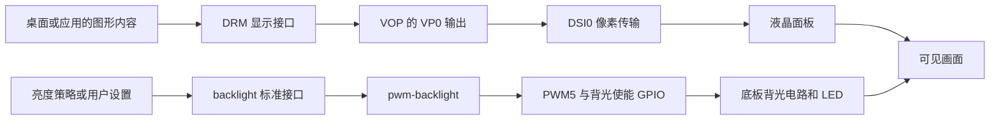

# 06 显示与背光：把像素送到面板，再让它可见

[驱动匹配与初始化](05_驱动匹配与初始化.md)解释了设备如何取得资源。这一章沿屏幕的实际工作关系继续：显示控制器提供像素，DSI 传输图像和命令，panel 驱动完成面板上电及初始化，背光驱动调节照明。它们最终汇合为可见画面，但不是同一条硬件通道。

本章主要对应 [AIRCAS overlay](../../设备树包/aircas-compact-GCS_overlay.dts)与阿美林 7 英寸 ILI9881C 初始化资料。6 英寸云奥资料是另一套屏幕方案；不能因为同样使用 MIPI 或 GT9XX，就混用面板序列、时序和触摸配置。完整 BSP 的 `panel-simple.c` 未提供，涉及其回调内部次序时，必须区分资料记录和通用原理。

## 6.1 同一块屏幕组件中的三条通道

显示输出解决“每个像素是什么颜色”，背光解决“是否有足够光线穿过液晶”，触摸输入解决“手指在哪里”。本项目中它们分别使用 DSI、PWM/GPIO 和 I2C/GPIO；触摸链路单独放在[下一章](07_触摸与input.md)。

以下仅画**运行时功能链路** ，不表示构建和启动顺序：



**通用原理：** DRM 是 Linux 管理显示设备、显示模式和缓冲区提交的子系统；它向桌面图形栈提供统一接口。VOP 是 Rockchip 的显示处理硬件，VP 是其输出端口。DSI 是面板侧串行显示通道，既承载视频数据，也可发送面板控制命令。

图中“桌面或应用”只指出消费位置。当前目录缺少完整桌面配置和地面站应用源码，不能据此补出应用绘制、视频解码、合成器或刷新线程的实际调用关系。

## 6.2 先把显示拓扑接通

### 6.2.1 路由决定哪个显示输出送往哪里

**源码事实：** overlay 第 438～458 行启用 `dsi0_in_vp0`、禁用 `dsi0_in_vp1`，启用 `video_phy0`、禁用 `video_phy1`，并设置：

```dts
&route_dsi0 {
    status = "okay";
    connect = <&vp0_out_dsi0>;
};
```

这表达了产品选择 VP0 → DSI0 的意图，同时将 HDMI 控制器及其 VP0 输入设为 disabled。单看 `dsi0 { status = "okay"; }` 不足以解释图像从哪个 VOP 输出进入 DSI，也不能保证另一条显示路线没有占用资源。

overlay 没有显式改写所有基础显示节点。例如当前基础 DTS 的 `route_hdmi` 为 okay，包内基础 DTB 中它是 disabled。控制器禁用通常会阻断对应链路，但诊断仍应读取最终设备树，不能假设任意基础版本叠加后都得到完全相同的显示图。

### 6.2.2 endpoint 连接的是显示数据端口

`panel_in_dsi` 与 `dsi_out_panel` 通过双向 `remote-endpoint` 相互引用，位置在 overlay 第 371、384 行附近。**endpoint** 是某个设备数据端口的连接描述，帮助显示框架从 DSI 输出找到 panel 输入。

它与 `power-supply = <&vcc_lcd_mipi>` 的用途不同：endpoint 表达图像连接，supply 表达能源依赖；`backlight = <&backlight>` 又引用独立背光设备。三类引用同时存在，才能描述“通过哪个接口送图、何时有电、由谁照亮”。

显示拓扑闭合仍是软件描述层证据。排线反接、差分对损坏、电源不足或面板未退出复位，并不会因为 endpoint 配对正确而消失。

## 6.3 面板初始化让芯片进入能接收图像的状态

### 6.3.1 panel 驱动从哪些资源开始

**源码事实：** `panel@0` 使用 `compatible = "simple-panel-dsi"`，并声明以下资源：

| 配置位置 | 作用 | 当前描述 |
|---|---|---|
| `power-supply` | 面板供电依赖 | `vcc_lcd_mipi`，GPIO1_D5 控制的 fixed regulator |
| `reset-gpios` | 复位控制 | GPIO3_C1，`GPIO_ACTIVE_LOW` |
| `backlight` | 背光设备引用 | `pwm-backlight` 节点 |
| `dsi,lanes`、`dsi,format` | 数据线数与像素格式 | 4 lane、RGB888 |
| `dsi,flags` | DSI 传输方式声明 | VIDEO、VIDEO_BURST、LPM、EOT_PACKET |
| `panel-init-sequence` | 面板寄存器与控制命令 | 当前 194 条字节记录 |
| `display-timings` | 一帧图像的扫描参数 | 800×1280、67.3 MHz PCLK |

这些属性属于该 BSP 的 panel 接口。不能直接假定任意主线内核都接受 `simple-panel-dsi` 和相同的序列格式。

这种“通用 panel 驱动 + 每款屏幕参数”的方式，适合将固定初始化表、供电与时序留在板级配置中，降低每换一块屏就复制一份驱动的成本。代价是参数格式、执行顺序和错误处理依赖 BSP 的实现；如果某块面板需要按读回状态分支、复杂重试或特殊电源恢复，单纯增加一张字节表未必足够，专用驱动能表达更多行为，但需要维护和验证相应代码。本项目资料尚不足以证明当前通用驱动的全部恢复能力。

**资料记录：** [CM3 编译记录](../../RADXA%20CM3地面站编译.docx)讨论 `panel_simple_prepare()`、`panel_simple_enable()`、`panel_simple_disable()`、`panel_simple_unprepare()` 及复位修改。**包内事实：** 符号可以支持相关 panel 代码存在；但目录缺少实际编译所用的实现，不能确认历史手改代码已进入这个交付包。

**通用原理：** panel 生命周期通常把“供电、复位、准备命令”和“开始显示、点亮背光”分阶段组织，关屏则按对应阶段退出。驱动需要在可等待的上下文中做 regulator 操作、发送 DSI 命令和满足芯片等待时间；这些动作不应等同于每帧都运行的像素刷新。

overlay 给出 `prepare/reset/init/enable` 延迟 20/5/5/120 ms，退出给出 `unprepare/disable` 延迟 120/50 ms。**源码事实只能证明这些参数存在** ；每个参数在实际 BSP 中位于哪次 GPIO 操作前后、失败后是否回滚，需要匹配版本的 panel 源码或板端证据。

### 6.3.2 复位逻辑值为何不能直接当成物理电平

当前面板复位声明 active-low，含义是低电平承担复位有效状态。若实际 BSP 使用 GPIO descriptor 的 `gpiod_*` 逻辑接口，逻辑 1 表示“有效”，通常对应物理低电平；逻辑 0 才对应物理高电平。若使用 raw 接口或旧整数 GPIO API，则必须重新看其语义。[Linux GPIO descriptor 说明](https://www.kernel.org/doc/html/v6.1/driver-api/gpio/consumer.html)是这里的通用依据。

因此不能把历史片段中的 `gpiod_direction_output(..., 1)` 直接解释成“拉高”。应先确认 API，再结合有效极性推导 SoC 脚电平，最后结合电路确认芯片 RST 脚实际看到什么。状态位被设置、延时函数已返回，都不能替代复位波形检查。

### 6.3.3 初始化表在配置什么

[BOE 原始初始化表](../../阿美林-1000nit-7inch/初始化序列/BOE_7WX_ILI9881C_V04_20210507.txt)用 `REGISTER` 和 `Delay` 表示写寄存器与等待。它先使用 `FF 98 81 03` 等命令切换寄存器页，再配置对应页的内容。

**资料记录：** 原表注释把主要配置分为 GIP、面板内部电压/偏置、Gamma 和标准显示控制几个部分。GIP 对应面板行扫描驱动的时序或映射；电压及偏置参数影响液晶驱动工作点；Gamma 表影响灰阶电压分配。这些是面板控制芯片需要的设置，不是向屏幕发送一张图片，也不是配置背光 PWM。

切换寄存器页很关键：同一个寄存器地址在不同页可能表示不同功能。因此不能看见序列中某处 `11 00` 就一律认作退出睡眠；必须结合此前的页选择。末尾切回 page 0 后的 `0x11`、`0x29` 才对应此处讨论的退出睡眠与打开显示。

对于各字节的精确电气含义，应回到匹配屏幕的供应商规格，不宜从命名猜测修改值。原表标注的电压是配置意图，仍不是当前实板测得的电压。

### 6.3.4 命令记录头与等待阶段

**资料记录：** 编译文档将当前 BSP 的记录格式解释为“数据类型、命令执行后延迟、payload 长度、payload”。例如：

```text
39 00 04 FF 98 81 03
15 78 02 29 00
```

第一行表示 DCS 长写，payload 为 4 字节，用于选择寄存器页；第二行是带一个参数的 DCS 短写，payload 为 `29 00`，`0x78` 表示 120 ms。这里的长度包含命令字节，不能只计算参数个数。`0x05` 则用于本序列退出部分的无参数短写。格式应由对应 BSP 解析器确认，不能把文本字节直接当作通用设备树标准。

当前材料之间存在一个可以定位的差异：

| 材料 | page 0 末尾顺序 | 能从文本确定的内容 |
|---|---|---|
| BOE 原表 | `0x11` → 等待 120 ms → `0x29` → `0x35` | 等待明确位于退出睡眠和打开显示之间 |
| 产品 overlay，第 337～339 行 | `15 00 02 11 00` → `15 78 02 29 00` → `15 00 02 35 00` | 延迟字段附在 `0x29` 记录上 |
| 独立 `panel_init_sequence.txt` | 同上，但又追加一次 `15 00 02 29 00` | 共有 195 条记录，重复打开显示命令 |

**成立条件与影响：** 若实际驱动按资料中的“命令执行后延迟”解释，当前 overlay 会把等待移到 `0x29` 之后，因而没有表达原表要求的 `0x11` 后等待。`enable-delay-ms = <120>` 属于另一阶段，不能仅凭数值相同认定已补足这两个命令之间的间隔。该差异可能影响冷启动或唤醒可靠性，但本任务没有现场复现，不能写成已确认黑屏根因。

已有编译记录的“屏幕初始化序列”小节还给出 `15 78 02 11 00` 这一转换示例，并解释先执行 `0x11`、再等待 120 ms。它支持等待位置的资料含义，却不能证明当前 overlay 已按该示例生成；正文记录与实际文件必须分别核对。

要判断实际影响，下一步应核对匹配 BSP 的序列解析器、正在使用的 DTBO 和启动/唤醒阶段的命令顺序。先增加一个任意总延时无法证明等待位置正确。本任务只解释差异，不修改原序列。

## 6.4 面板准备好以后，像素如何按节拍送入

### 6.4.1 分辨率不是全部时序

overlay 的 `hactive/vactive` 为 800×1280。**通用原理：** 一行除了有效像素，还包含同步和前后空白区；一帧同样包含行与行之间的垂直空白。像素时钟 PCLK 决定总扫描节拍，因此不能只用 800×1280 乘帧率计算时钟。

按当前源码计算：

- 每行总节拍：800 + 18 + 18 + 18 = 854。
- 每帧总行数：1280 + 4 + 10 + 20 = 1314。
- 理论帧率：67,300,000 ÷ 854 ÷ 1314 ≈ 59.97 Hz。

这是**配置计算值** ，不是测量结果。端点连通而时序不适配时，面板仍可能不锁定、闪烁或显示异常；修改有效分辨率也不能替代对空白区与同步极性的确认。

RGB888 意味着每像素 24 bit，4 条数据 lane 分担传输；用 `PCLK × 24 ÷ 4` 可估计约 403.8 Mbit/s/lane 的数据量级。视频模式、包开销、burst 调度与 PHY 约束会影响实际 lane rate，不能把这个估算当作已写入 PHY 的精确频率。源码的 `rockchip,lane-rate = <480>` 处于注释状态，只能说它未在此节点固定该参数。

### 6.4.2 横屏使用涉及三个坐标层

panel 配置 `rotation = <90>`，物理模式仍为 800×1280；触摸节点写 1280×800，7 英寸供应商 CFG 又编码 800×1280。这些数据处在不同层：面板原生扫描、显示方向和触摸坐标。

**待确认事项：** 实际图形栈是否消费 panel orientation、桌面是否另做旋转、触摸驱动是否已交换或反转坐标。不能从 `rotation=90` 推断 VOP 必定完成硬件旋转，也不能因为界面横过来了就再给触摸无条件交换 X/Y。应同时记录显示方向、input 范围与四角触点，按[触摸与 input](07_触摸与input.md)判断变换在哪一层生效。

## 6.5 背光链路独立决定画面是否被照亮

### 6.5.1 从亮度请求到 PWM 占空比

**源码事实：** backlight 节点使用 `pwm-backlight`，引用 PWM5 的通道 0，周期 50000 ns，即配置频率 20 kHz；GPIO4_B3 是背光使能脚。`post-pwm-on-delay-ms` 和 `pwm-off-delay-ms` 各为 10 ms，提供 PWM 与使能切换的等待参数。

**通用原理：** backlight 框架提供逻辑亮度接口，`pwm-backlight` 将该亮度映射为 PWM 状态，再交给 Rockchip PWM 控制器。应用不需要持续由 CPU 翻转 GPIO 来产生波形；周期产生由 PWM 硬件承担。PWM 提供控制信号，LED 所需电流来自底板背光电源电路。

`brightness-levels` 是一张“亮度索引 → 归一化驱动值”的表。上层请求的数值是索引，不一定就是占空比百分数。表的非线性分布可以照顾低亮区、驱动器有效范围和人眼感受，但会牺牲部分可区分的档位；普通表里的重复值就意味着相邻索引可能给出相同 PWM 值。

| 对象 | 表项数量与范围 | 默认值的解释 |
|---|---|---|
| 工作区 overlay / 普通包 | 256 项，首项 0，随后从 20 起逐步增加，末项 255 | 默认 200 是有效索引；对应表值为 200 |
| PWM 变体包新增 overlay | 197 项：0，随后 60～255 | 默认仍为 200，超过有效索引 0～196 |

后一项是**包内事实** ，并非当前工作区源码表的错误。上游 Linux v6.1 的 `pwm_bl.c` 对越界默认索引会警告并钳制到最大索引；这是[上游源码参考](https://raw.githubusercontent.com/torvalds/linux/v6.1/drivers/video/backlight/pwm_bl.c)，本目录缺少对应 BSP 文件，不能未经核对就断言交付内核会越界访问、崩溃或采用同样钳制行为。

### 6.5.2 三种“有效”要分别推导

1. **用户亮度有效值：** 非零亮度请求是否使背光处于打开状态，由 backlight 驱动及 blank/power 状态共同决定。
2. **PWM 波形有效极性：** `PWM_POLARITY_INVERTED` 改变一个周期中有效时间对应的物理电平；它不是“亮度数组倒序”的指令。
3. **实际背光电路响应：** GPIO 使能、光耦及 LED 驱动输入如何解释电平，决定 LED 电流和最终明暗。

**资料记录：** 较早的[底板原理图](../../原理图/SCH_RK3566底板V2_2025-10-21.pdf)显示背光 PWM 经过光耦等电路后进入背光驱动，GPIO4_B3 控制背光使能。对该方案，需要从 GPIO0_C4 的 PWM 波形一路追到驱动端；这不是根目录较新三页相机底板图的直接结论。

因此，源码注释“默认亮度 200，越小越亮”只能作为调试线索。实际方向必须结合有效极性、光耦输出和 LED 驱动响应验证。软件读到 `brightness=200` 说明请求状态，不能单独证明实际电流、光照强度或面板图像。

## 6.6 用现象区分失败发生在哪一段

| 现象 | 先定位的层级 | 检查依据与下一步判断 |
|---|---|---|
| 完全黑屏、无背光 | 背光供电、使能、PWM 与设备绑定 | 先确认实物供电和背光节点是否注册；有逻辑亮度但无光，应继续看 GPIO/PWM 及电路，不能先归因 DSI |
| 背光亮，但没有图像 | panel 供电复位、命令、显示路由、模式 | 背光通路至少有光学响应；继续核对运行树、DRM 状态、RST 和初始化等待，不能用背光亮证明 DSI 正常 |
| 有图但花屏、闪烁 | 模式、lane/像素格式、连接质量或面板参数 | 先比较完整时序与匹配屏幕配置，再区分稳定配置错误和信号完整性问题；不能只调 PCLK |
| 首次上电不稳定，重启后正常 | 电源爬升、复位、sleep-out 等待及遗留硬件状态 | 比较冷启动与软重启条件，核对命令延迟位置；重启成功不能证明首次上电流程正确 |
| 亮度档位反向或部分档位无变化 | 亮度表、PWM 极性和背光电路 | 读取实际最大索引与请求值，再测量相应 PWM；重复表项可解释部分档位相同，整体反向还需电路证据 |

**待执行验证：** 标准接口的具体路径与编号要先枚举：DRM 通常在 `/sys/class/drm/` 及 `/dev/dri/`，背光在 `/sys/class/backlight/`。它们是内核接口位置，不是本任务获得的板端目录快照。完整命令及输出解读放在[部署生效检查](10_部署生效检查.md)和[故障排查与验证](11_故障排查与验证.md)，本章没有安装工具、切换模式或实际点屏。

可以把验证顺序理解为逐步缩小范围：先确定加载对象，再确认接口和模式，再验证供电/复位/波形，最后结合真实图像与启动重复性。仅有其中某一层的成功不能替代其他层。

## 6.7 自查：能否解释“为什么亮了还不算完成”

1. **背光亮起，显示适配完成了多少？**
   回答要点：证明至少部分背光电路产生光；未证明面板供电复位、命令初始化、VOP/DSI 路由和像素时序正确，更未证明应用已经提交画面。
2. **为什么两个 120 ms 不能互相替代？**
   回答要点：约束的是两个事件之间的间隔；命令后延迟与 panel 生命周期延迟处于不同位置，需看实际解析器和调用顺序，而不是只比较延迟总和。
3. **默认亮度 200 是否表示 200/255 的亮度？**
   回答要点：先看它是索引，再查表、最大值及驱动换算，最后看 PWM 极性和电路。PWM 变体仅 197 项时，200 甚至不是有效索引。
4. **800×1280 与 1280×800 为什么可以同时出现，又为什么容易出错？**
   回答要点：前者可描述面板扫描，后者可描述横屏输入或应用坐标；必须确定旋转由哪层承担，避免方向属性、驱动变换和桌面映射重复叠加。
5. **发现初始化表差异后，怎样避免把静态风险写成故障结论？**
   回答要点：指出材料版本和具体字节，说明解析语义成立条件，核对实际交付物与加载配置，再用冷启动/唤醒和波形证据判断影响；本任务未做这些板端验证。

显示通道到这里把画面送到人眼；下一章[触摸与 input](07_触摸与input.md)沿相反方向解释人的操作如何通过 I2C、IRQ、坐标处理和 input 事件返回上层。
