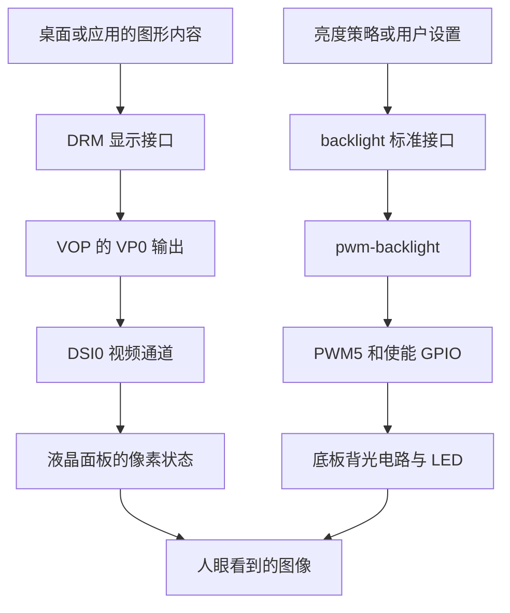

# 06 显示与背光：像素链路与照明链路怎样汇合

前两章说明了设备树怎样描述资源，以及驱动怎样取得资源。这一章把它们放回屏幕：显示硬件需要把正确的像素送进面板，panel 驱动需要让面板进入可以接收图像的状态，背光电路还要提供照明。三者配合，用户才看到正常画面。

本章主要分析 [AIRCAS overlay](../../设备树包/aircas-compact-GCS_overlay.dts)与阿美林 7 英寸 ILI9881C 资料。6 英寸云奥资料是另一套屏幕方案，不能因接口同为 MIPI 就混用初始化表、时序和触摸配置。当前仓库缺少交付 BSP 的 `panel-simple.c`，所以能够确认的是设备树参数、包内符号和历史记录；回调内部的完整执行顺序、恢复路径及当前实板结果仍属待确认事项。

## 6.1 先把同一屏幕组件的三条通道分开

显示输出回答“像素是什么颜色”，背光回答“液晶后面有没有足够的光”，触摸回答“手指按在什么位置”。本项目分别用 DSI、PWM/GPIO、I2C/GPIO 承担它们。排查时必须保持这三个边界：背光亮不能证明 DSI 正常，触摸有事件也不能证明面板初始化成功。

下面只画**运行时功能关系**。触摸输入在[第 7 章](07_触摸与input.md)单独展开，构建和启动步骤不放进这张图。



这里用到的通用概念是：**DRM** 是 Linux 管理显示设备、显示模式和图形缓冲区提交的子系统；**VOP** 是 Rockchip 显示处理硬件，**VP** 是它的输出端口；**DSI** 是面板侧的串行显示接口，既能传像素，也能传控制命令。它们分别解决上层统一接口、SoC 内部显示输出和面板传输的问题。

可以再把图中的像素箭头展开一层。按 [DRM 显示管线的通用模型](https://www.kernel.org/doc/html/v6.1/gpu/drm-kms.html)，图像首先以缓冲区内容存在于内存中；上层经显示接口选择要呈现的缓冲区和模式，显示控制器再读取像素、组织输出。对应到本章的硬件角色，VOP 按扫描节拍产生像素流，DSI 控制器把它组织为串行传输，物理层再通过差分信号送到面板。这不是 CPU 每显示一个像素就调用一次 panel 函数，也不是 DRM 把图像转成初始化命令表。

应用更新图像与显示硬件持续扫描还是两种频率。对于这里配置的视频模式，静止界面可以重复显示同一份内容，显示链仍按选定模式运行；换一张图主要改变后续使用的像素内容，不需要每帧重新上电或发送全部初始化表。DSI 的 RGB888 规定线路上的像素表达，也不能反推用户态缓冲区必定采用三字节紧排。具体缓冲区分配、合成和提交函数仍需项目图形栈与 BSP 源码确认。

“桌面或应用”只标出消费位置。现有目录没有完整图形栈配置和地面站应用源码，不能据此推导具体合成器、解码线程、图传窗口或应用绘制调用链。

## 6.2 像素有数据之前，先要有闭合的显示路线

### 6.2.1 VP0 怎样连接到 DSI0

在当前 overlay 第 438～458 行，产品启用 `dsi0_in_vp0`，禁用 `dsi0_in_vp1`，启用 `video_phy0`、禁用 `video_phy1`，并让 `route_dsi0` 指向 `vp0_out_dsi0`。这些配置表达的是 VP0 → DSI0 的产品选择。

仅把 `dsi0` 设为 `okay`，还没有回答图像从哪个 VOP 输出进入它。路由、控制器状态和物理层选择必须配套，才能让框架建立期望路径。当前产品同时禁用 HDMI 控制器及其 VP0 输入，用来排除另一条相关输出路线。

这一结论必须带上基础版本：当前 IO DTS 中 `route_hdmi` 为 okay，交付基础 DTB 中为 disabled，产品 overlay 没有显式覆盖这个节点。控制器禁用通常会阻断对应链路，但不同基础树叠加后仍可能留下不同的显示图。诊断应读最终设备树，而不是只根据产品文件推定所有基础节点状态。

### 6.2.2 endpoint、供电和背光引用分别解决不同连接

`panel_in_dsi` 与 `dsi_out_panel` 在 overlay 第 371、384 行附近通过 `remote-endpoint` 相互引用。**endpoint** 表示设备数据端口，显示框架据此建立 DSI 输出和 panel 输入之间的图像连接。

这个引用不提供电能。`power-supply = <&vcc_lcd_mipi>` 才描述面板使用哪个电源；`backlight = <&backlight>` 则把 panel 与独立背光设备关联起来。图像端口、供电和照明三种关系同时存在，是为了让不同框架各自取得正确资源，而不是把所有控制塞进一个 GPIO 操作中。

软件拓扑闭合之后，物理链路仍可能因为排线、差分对、供电或复位失败而没有图像。endpoint 成对只是描述层证据，下一步还要让面板芯片进入正确状态。

## 6.3 面板准备阶段：有电、正确复位，再接受配置

### 6.3.1 panel 驱动需要哪些资源

`panel@0` 采用 `compatible = "simple-panel-dsi"`。当前源码给出的资源和参数如下，它们共同构成该 BSP 的 panel 接口，不能默认任意主线内核都接受相同写法。

| 要解决的问题 | 当前描述 | 在后续过程中的作用 |
| --- | --- | --- |
| 逻辑电源从哪里来 | `power-supply = <&vcc_lcd_mipi>`，GPIO1_D5 控制 fixed regulator | panel 向 regulator 框架申请并使能电源 |
| 怎样控制复位 | GPIO3_C1，`GPIO_ACTIVE_LOW` | 按实际 GPIO API 与有效极性生成复位动作 |
| 照明由谁管理 | `backlight = <&backlight>` | 关联独立 backlight 设备 |
| DSI 如何传输 | 4 lane、RGB888；VIDEO、VIDEO_BURST、LPM、EOT_PACKET 标志 | 向 DSI 侧提供连接及传输配置 |
| 芯片内部怎样配置 | `panel-init-sequence`，当前 194 条记录 | 通过 DSI 发送寄存器与控制命令 |
| 如何扫描一帧 | `display-timings`，800×1280、67.3 MHz PCLK | 给显示链路提供模式参数 |

这里的 lane 是分担串行数据的通道，不是一条红线、一条绿线、一条蓝线。`VIDEO` 选择视频模式，`VIDEO_BURST` 描述视频突发传输方式，`LPM` 涉及低功耗传输选项；控制命令与连续视频的传输阶段仍要由 DSI 主机实现组织，不能从一个标志推定整条链始终以低速传输。[上游 DSI 头文件](https://raw.githubusercontent.com/torvalds/linux/v6.1/include/drm/drm_mipi_dsi.h)可用于理解这些通用术语。

还应注意宏名不一定直接等于最终行为。[普通 overlay 包](../../debs/radxa-overlays-dkms_0.2.4_all.deb)的 `usr/src/radxa-overlays-0.2.4/arch/arm64/boot/dts/rockchip/overlays/dt-bindings/display/drm_mipi_dsi_overlay.h` 在旧 `MIPI_DSI_MODE_EOT_PACKET` 未定义时，将它映射到 `MIPI_DSI_MODE_NO_EOT_PACKET`。EOT 涉及传输结束包，因此要结合实际内核头文件的宏展开和 DSI 驱动解释，不能只按当前 DTS 中的名称宣称已经开启或关闭了它；这也不构成已发生传输故障的证明。

通用 panel 驱动配合参数表，能让多款固定时序屏幕复用代码，避免每换面板就复制一个驱动。它也有边界：如果面板需要按读回状态分支、复杂重试或特殊断电恢复，仅增加字节表未必能表达完整行为。专用驱动能够组织这些逻辑，但会增加代码维护和验证成本。现有材料不能证明本 BSP 的通用实现具备哪些额外恢复机制。

### 6.3.2 等待属于哪个动作，必须看实际执行位置

[CM3 编译记录](<../../RADXA CM3地面站编译.docx>)讨论了 `panel_simple_prepare()`、`panel_simple_enable()`、`panel_simple_disable()`、`panel_simple_unprepare()` 及复位修改。交付内核的符号也支持相关 panel 代码存在；这两类证据仍不足以证明历史手改片段已经进入当前包。

按 panel 生命周期的通用原理，驱动把供电、复位和准备命令，与显示使能、关屏、断电等阶段组织起来。regulator、GPIO 的可睡眠访问、DSI 命令及延时应在允许等待的执行上下文中完成；这些工作发生于状态切换，不是每刷新一帧都重新复位面板。

当前 overlay 声明 `prepare/reset/init/enable` 延迟分别为 20/5/5/120 ms，`unprepare/disable` 延迟为 120/50 ms。能直接确认的是参数存在，不能仅凭名称补出完整调用时序。具体延时是在拉复位前还是释放后、命令失败后是否关闭电源、再次使能是否重新初始化，都需要匹配 BSP 源码或板端证据。

这也是“状态恢复”和“硬件恢复”的区别：软件置位 `prepared`、某次回调返回，最多反映代码走过的分支；若电源没有建立、命令未送达，面板仍可能没有恢复到可显示状态。

### 6.3.3 active-low 要通过 API 和电路才能落到物理电平

面板复位声明为 active-low，即复位有效对应低电平。如果实际驱动使用 GPIO descriptor 的逻辑接口，逻辑 1 表示“置为有效”，通常会让该引脚输出物理低电平；逻辑 0 表示解除有效，才对应高电平。raw 接口和旧整数 GPIO API 的解释需要分别核对。[Linux GPIO descriptor 文档](https://www.kernel.org/doc/html/v6.1/driver-api/gpio/consumer.html)给出了这一通用语义。

因此，不能把历史代码中的 `gpiod_direction_output(..., 1)` 直接翻译成“拉高复位脚”。正确推导顺序是：调用的是逻辑还是原始电平 API → 配置的有效极性是什么 → SoC 引脚输出什么 → 中间电路是否改变信号 → 面板 RST 实际看到什么。

当前较早底板图将 GPIO3_C1 用于屏幕复位，另一个底板方案却可能将其用于其他功能。确认 API 语义之前和之后，都不能跳过实物版本。电压测点及原理图对应见[第 3 章](03_硬件资源与供电.md)。

## 6.4 初始化序列配置的是面板芯片，不是屏幕图像

### 6.4.1 先选寄存器页，再写扫描、电压和灰阶参数

[BOE 原始初始化表](../../阿美林-1000nit-7inch/初始化序列/BOE_7WX_ILI9881C_V04_20210507.txt)使用 `REGISTER` 和 `Delay` 表示写寄存器与等待。它通过 `FF 98 81 03` 等命令切换寄存器页，再在对应页中配置具体参数。

原表注释给出的主要内容包括 GIP、内部电压及偏置、Gamma 和标准显示控制。GIP 对应面板行扫描驱动的时序或映射；电压和偏置决定液晶驱动的工作点；Gamma 调整不同灰阶使用的电压分配。这些设置让面板芯片按指定方式驱动液晶，与后续传入的每帧像素不同，也不负责底板背光 PWM。

页选择决定后续地址的意义。同一个地址在不同页可能代表不同寄存器，不能在整张表中搜索 `11 00` 后一律解释为退出睡眠。当前讨论的 `0x11`、`0x29`，是末尾切回 page 0 后的退出睡眠和打开显示命令。各参数的精确电气含义仍需匹配屏幕的供应商规格，不能凭注释或相近型号自行推导替代值。

### 6.4.2 记录头怎样把文本转换为 DSI 命令

编译记录把当前 BSP 使用的记录格式解释为“数据类型、命令执行后延迟、payload 长度、payload”。**DCS** 是显示命令集，payload 是命令及其参数组成的有效内容。可用两条实际记录理解格式：

```text
39 00 04 FF 98 81 03
15 78 02 29 00
```

第一条的 `0x39` 表示 DCS 长写，4 字节 payload 用于选择寄存器页；第二条的 `0x15` 表示带一个参数的 DCS 短写，payload 为 `29 00`，`0x78` 是 120 ms 延迟。长度包括命令字节，所以“一个参数”对应两个 payload 字节。退出序列中的 `0x05` 则表示无参数短写，例如 `05 00 01 28` 和 `05 00 01 10`。

按这一记录格式理解遍历过程：先取 3 字节头，再按长度取 payload，发送后按延迟字段等待，最后前进 `3 + payload长度` 字节读下一条。上面的第一条共 7 字节，第二条共 5 字节；如果只按固定行宽或参数个数前进，后续记录就会错位。读取前还应检查剩余长度是否足够。这里是依据资料格式解释解析器需要完成的工作，不是声称缺失的项目实现已经执行了这些校验。

这是历史记录对该 BSP 解析方式的说明，不是所有设备树都通用的字节标准。完整项目解析器缺失时，可以核对表的结构和资料含义，但不能冒充已跟踪了交付内核的每次发送和等待。

### 6.4.3 120 ms 等待位置是本项目需要重点复核的差异

现有材料的末尾可以直接逐项比较：

| 对象 | 切回 page 0 后的顺序 | 静态核对结果 |
| --- | --- | --- |
| BOE 原始表 | `0x11` → 等待 120 ms → `0x29` → `0x35` | 等待位于退出睡眠和打开显示之间 |
| 产品 overlay 第 337～339 行 | `15 00 02 11 00` → `15 78 02 29 00` → `15 00 02 35 00` | 延迟字段附在 `0x29` 记录上；整表 194 条 |
| [独立转换表](../../阿美林-1000nit-7inch/初始化序列/panel_init_sequence.txt) | 与上一行相似，另有一条 `15 00 02 29 00` | 多一次打开显示命令；整表 195 条 |

如果实际驱动遵循资料所述“执行这条命令后再等待”，当前 overlay 就把等待放在 `0x29` 之后，没有表达原表要求的 `0x11` 后等待。这是明确带条件的静态风险，可能影响冷启动或唤醒，尚不是实板黑屏的已证实原因。

为什么不能用 `enable-delay-ms = <120>` 抵消？因为面板要求的是两个具体事件之间的间隔，不是整个启动过程的延时总和。只有知道 enable 延迟与 `0x11/0x29` 的相对位置，才能判断它约束了哪一段；相同数字本身不能证明等价。

编译记录的“屏幕初始化序列”小节给出 `15 78 02 11 00` 示例，明确解释先退出睡眠再等 120 ms。这支持原表等待位置的含义，却不能证明当前文件已经采用该示例。下一步应核对实际启用 DTBO、匹配 BSP 解析器以及冷启动/唤醒命令顺序。本轮保留全部原件，不修改序列，也不虚构命令发送结果。

## 6.5 面板进入工作状态后，像素还必须按正确节拍送入

### 6.5.1 用完整扫描时序计算帧率

800×1280 只表示一帧的有效像素区。扫描一行还要经过同步和前后空白区，一帧也有垂直同步及空白行。**PCLK（像素时钟）** 决定这些总节拍的速度，因此不能只用有效分辨率乘帧率得到完整时钟关系。

当前 `display-timings` 给出的水平同步宽度、后沿、前沿均为 18，垂直对应为 4、10、20。按源码数值计算：

- 每行总节拍：`800 + 18 + 18 + 18 = 854`。
- 每帧总行数：`1280 + 4 + 10 + 20 = 1314`。
- 理论帧率：`67,300,000 / 854 / 1314 ≈ 59.97 Hz`。

这些是配置计算值，未经过实板测量。完整模式不匹配时，即使端点闭合、命令已发送，也可能不锁定、闪烁或花屏；改一个有效分辨率或时钟，不能替代对全部时序和同步极性的核对。

RGB888 每像素为 24 bit，4 条数据 lane 分担传输。用 `PCLK × 24 / 4` 估算，数据量级约为 403.8 Mbit/s/lane；实际还受视频模式、包开销、burst 调度和 PHY 约束影响，不能把它称为实测或实际写入 PHY 的精确速率。源码中的 `rockchip,lane-rate = <480>` 被注释，不能当成当前固定配置。

### 6.5.2 原生扫描、显示旋转和触摸坐标属于不同层

panel 声明 `rotation = <90>`，有效扫描仍为 800×1280；触摸节点写 1280×800，7 英寸供应商 CFG 又编码 800×1280。这些值可分别描述面板原生模式、横屏使用方向和控制器坐标空间，并不天然矛盾。

问题出在没有确认变换由谁执行：实际图形栈是否消费 panel orientation，桌面是否又设置旋转，触摸驱动是否已交换或翻转 X/Y，都还需运行证据。不能看到 `rotation=90` 就断定 VOP 做了硬件旋转，也不能看到桌面横过来后再无条件交换触摸坐标。

应同时记录显示方向、input 范围和四角触点，再沿[第 7 章](07_触摸与input.md)判断变换所在层。这样才能避免为修正显示方向，反而在触摸和桌面中叠加两次转换。

## 6.6 独立的背光链路怎样把亮度请求变成光

### 6.6.1 从标准接口到硬件 PWM

当前 backlight 节点采用 `pwm-backlight`，使用 PWM5 通道 0，周期 50000 ns，即配置频率 20 kHz；GPIO4_B3 控制背光使能。`post-pwm-on-delay-ms` 和 `pwm-off-delay-ms` 均为 10 ms，用来提供 PWM 与使能切换之间的等待参数。

按 backlight/PWM 框架的通用原理，上层提出亮度请求，backlight 驱动结合开关屏状态转换为 PWM 状态，再交给 Rockchip PWM 控制器。持续产生周期波形的是 PWM 硬件，CPU 不需要按 20 kHz 逐次翻转 GPIO；LED 所需电流来自底板背光电源电路，PWM 只是控制信号。

本项目缺少匹配 BSP 的 `pwm_bl.c`，因此不把通用回调顺序写成本项目实测调用栈。若背光注册、PWM 申请或电源操作失败，必须回到匹配驱动的错误返回与日志，而不能根据节点存在直接跳到占空比计算。

### 6.6.2 亮度索引、表值和占空比不是同一个量

`brightness-levels` 是“亮度索引 → 驱动值”的表，上层请求值先选择表项，再由驱动按周期和量程换算 PWM。非线性表能够避开低亮无效区、调整感知变化速度，也可能使多个索引对应同一输出。普通表里重复出现的 20 就说明相邻档位未必可区分。

| 已核对的对象 | 表项及有效索引 | 默认亮度的实际含义 |
| --- | --- | --- |
| 工作区 overlay 与普通包成员 | 256 项，首项 0，随后从 20 逐步增加至 255；索引 0～255 | 默认 200 是有效索引，所选表值也是 200 |
| PWM 变体包新增成员 | 197 项：0、60～255；索引 0～196 | 默认仍为 200，超出表的有效索引范围 |

PWM 变体的 197 项来自包内 `aircas-compact-GCS-pwm.dts`，不是工作区普通表的缺陷。两包的精确文件及成员见[资料索引](13_关键资料阅读索引.md)，不能仅凭相同版本号判断采用了哪张表。

以忽略最低占空比偏移等额外修正的通用换算为例，表值 200、量程 255 意味着约 `200/255` 的有效时间比例。结合本节点 50000 ns 周期，有效时间约为 `50000 × 200 / 255 ≈ 39216 ns`，剩余约 10784 ns；这是主机可复算的理想值，实际还受控制器量化与驱动处理影响。它不是“人眼亮度为最大值的 200/255”，电路、LED 和视觉响应都会改变最终效果。

[上游 Linux v6.1 的 `pwm_bl.c`](https://raw.githubusercontent.com/torvalds/linux/v6.1/drivers/video/backlight/pwm_bl.c)对越界默认索引先警告，再钳制到最大索引。这能说明一种明确的上游处理方式；项目对应文件缺失，不能据此断言交付 BSP 会崩溃、越界访问或采用完全相同处理。正确结论仍是“包内默认索引与表长度不一致，运行影响待核对”。

### 6.6.3 极性必须一直推到背光驱动输入端

当前 PWM 描述包含 `PWM_POLARITY_INVERTED`。它改变一个周期内有效时间对应的物理电平，并不是让亮度数组倒序。用户请求亮度是否有效、PWM 哪一段时间有效、LED 电路在哪种输入下发光，是三个需要衔接的判断。

继续使用上一节的理想算例：按 [Linux PWM 的通用极性约定](https://www.kernel.org/doc/html/v6.1/driver-api/pwm.html)，反相输出把有效时间对应为低电平，因而 SoC 端约有 39.216 µs 为低、10.784 µs 为高。示波器若显示的是“高电平占空比”，读数方向就可能与软件的有效时间比例相反；还没有经过光耦和 LED 驱动，不能立即把这个比例称为实际亮度。本例只解释时间与极性的关系，没有提供实测波形。

较早的[2025-10-21 底板图](../../原理图/SCH_RK3566底板V2_2025-10-21.pdf)中，GPIO0_C4 输出的背光 PWM 经过光耦等电路进入背光驱动，GPIO4_B3 另行控制使能。对这个硬件方案，应从 SoC 引脚一路追到驱动输入与 LED 电流，不能仅看设备树极性就下结论；较新的三页相机底板图不自动继承这些连接。

源码注释“默认亮度 200，越小越亮”因此只能作为历史调试线索。实际方向应由表值、PWM 极性、中间电路和驱动输入响应共同验证。读到 `brightness=200` 只表示软件请求，不能独立证明占空比、光照强度或像素显示。

## 6.7 用分层证据区分“有光”“初始化过”和“有正确图像”

| 现象 | 先定位哪一段 | 检查依据与下一步判断 |
| --- | --- | --- |
| 完全黑屏且无背光 | 背光供电、使能、PWM 和绑定 | 有逻辑亮度却无光时继续查波形及电路；不能先归因于 DSI 初始化 |
| 背光亮但无图像 | panel 电源复位、命令、显示路由与模式 | 光学响应只证明部分背光通路有效；继续核对 DRM、RST 和命令等待 |
| 有图但花屏或闪烁 | 模式、lane、像素格式、面板参数及连接质量 | 先比较完整时序和屏幕版本，再区分稳定配置错误与信号完整性问题 |
| 冷启动不稳定，重启后正常 | 电源爬升、复位、退出睡眠等待及残留状态 | 冷启动和软重启的硬件初始条件不同；重启成功不能证明上电流程完整 |
| 亮度部分档位不变或方向相反 | 表项、PWM 极性和电路 | 重复表项可解释局部不变；整体反向要继续查实际有效电平和 LED 响应 |

运行时 DRM 的常见接口位于 `/sys/class/drm/`、`/dev/dri/`，背光位于 `/sys/class/backlight/`。这些是待检查的位置，不是本轮获得的板端目录快照。connector、模式及背光属性只能证明相应软件状态；驱动报告的 `actual_brightness` 也不是光学测量。

进一步验证应先确认加载对象，再看接口和模式，再将供电、复位及信号测量与真实图像对应起来。固定图样可检查方向和边缘，冷启动、关屏恢复等条件可检查状态切换，但它们各自只覆盖被执行的条件。[第 10 章](10_部署生效检查.md)给出检查入口，[第 11 章](11_故障排查与验证.md)负责按症状收敛。本轮没有点屏、改模式、改变亮度或执行这些实板验证。

显示链路把数据送到人眼；下一章沿相反方向，解释手指操作怎样通过中断、I2C 和 input 回到上层。

## 6.8 自查：能否沿两条链路解释现象

### 6.8.1 问题

1. 背光亮起，显示适配已经证明了哪些部分，还缺哪些证据？
2. 为什么 `0x11` 后等待 120 ms 与 `enable-delay-ms=120` 不能直接互相替代？
3. 默认亮度 200 经过哪些步骤才会成为实际光照？PWM 变体在第一步有什么风险？
4. 为什么 800×1280 和 1280×800 可以同时出现，又可能造成触摸错位？
5. 发现初始化表与原表不一致后，如何判断影响而不把静态差异直接写成故障根因？

### 6.8.2 回答要点

1. 至少部分背光电路有光学响应；仍需证明 panel 电源复位、命令、VOP/DSI 路线、完整模式及上层像素提交。背光和像素链要分别取证。
2. 等待约束具体事件之间的间隔。必须知道解析器是命令前还是命令后等待，以及生命周期延迟所在阶段，不能只把延时数字相加。
3. 先把 200 当索引查表，再换算 PWM 有效时间，再经极性、中间电路和 LED 响应得到光。PWM 变体有效索引仅 0～196，200 超界；实际处理取决于匹配驱动。
4. 原生扫描、显示方向和输入坐标处于不同层。要确认每层是否已经交换或翻转坐标，避免驱动与桌面重复转换。
5. 先锁定屏幕、原表、DTBO 和解析器，说明差异的成立条件，再比较冷启动、唤醒及实际时序证据。现有材料只支持静态风险，没有现场复现结论。
