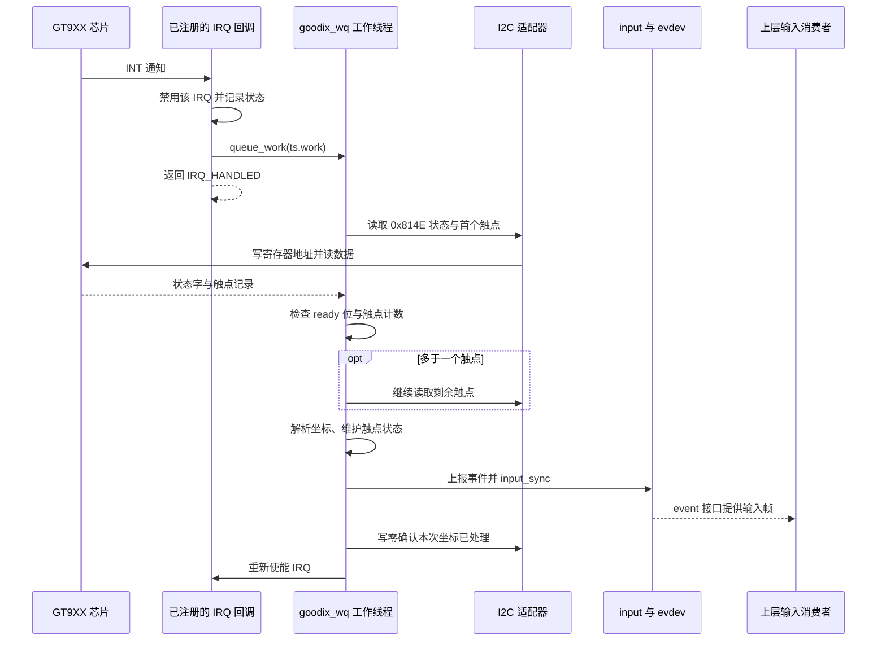

# 07 触摸与 input：从一次中断到桌面中的一次点击

显示链负责把像素送给面板，触摸链负责把手指位置送回 Linux。它们可以在同一块屏幕模组上，也可以共享机械方向和部分供电，但 DSI 像素数据与 I2C 触点数据是两条独立通道。背光亮、图像正常、触摸可用，需要分别建立证据。

本章承接第 05 章的驱动绑定和 input 注册，主线选用 **6 英寸资料内的 V2.2 本地分支：IRQ 回调 → 单线程 workqueue → I2C 采集 → input** 。随后单独展开 **7 英寸供应商 V2.8.7：线程化 IRQ → 直接采集** 。目录所在位置表示资料归属，不证明它已经用于某套交付系统。

## 1. 先明确触摸硬件发出的究竟是什么

**源码事实：** 产品 [overlay](../../设备树包/aircas-compact-GCS_overlay.dts) 第 391—408 行描述 GT9XX 在 I2C1，地址为 `0x14`；INT 连接 GPIO0_C5，RST 连接 GPIO0_C6，供电引用 `vcc_lcd_tp`。初始化时 INT 可以参与选择 I2C 地址；进入工作状态后，INT 告诉 SoC“有状态需要读取”。

中断本身不携带 X/Y 坐标。驱动收到通知后，还要向触摸芯片发送寄存器地址，从 I2C 读取状态和触点记录。GT9XX 驱动解析供应商格式，并通过 input API 上报标准事件；input 核心与 evdev 再将这些事件提供给用户空间。这样桌面无需知道芯片寄存器，但驱动仍必须正确处理芯片协议。

这决定了排查时的先后关系：IRQ 计数变化只证明通知到达；I2C 成功只证明一次通信；有效触点和同步帧出现才证明驱动已把本次数据送入 input；桌面正确点击还依赖上层设备选择、方向和映射。

## 2. 旧版本地主链：为什么先排队，再读取

以下图仅表示旧分支的**运行时流程** 。所有项目函数均来自 [旧版 gt9xx.c](<../../云奥-270nit-6inch/mipi_touch (1)/mipi_touch/gt9xx.c>)。



图中的正常末尾并不覆盖每一个早退分支。例如首次读取发生负错误时，代码重新使能 IRQ 并返回；原始状态为零时也存在直接返回路径。检查失败时必须回到实际分支，不能假定所有路径都会写确认字节。

### 2.1 这份旧代码也使用线程化 IRQ，但保留了额外 workqueue

`gtp_request_irq()` 第 1916—1918 行实际调用 `devm_request_threaded_irq()`，主处理函数参数是 `NULL`，线程处理函数是 `goodix_ts_irq_handler()`，带 `IRQF_ONESHOT`。曾经使用 `request_irq()` 的代码已经注释。

因此，这份文件中的 IRQ 回调本身已经在线程化 IRQ 上下文，但它并不直接读取触点。第 1066—1076 行先调用 `gtp_irq_disable()`，再 `queue_work(goodix_wq, &ts->work)`；真正读取发生在 `goodix_ts_work_func()`。不要把供应商原始设计习惯、注释和当前修改后的实现混成一个事实。

**内核通用原理：** 可睡眠上下文允许代码等待总线事务、调度出去或使用睡眠延迟。I2C 访问和复位中的 `msleep()` 不适合放入普通硬中断或持有自旋锁的原子上下文。工作线程或线程化 IRQ 可以承载这类工作，但仍应避免无界阻塞。参见 [Linux 延迟与睡眠机制](https://www.kernel.org/doc/html/v6.1/timers/timers-howto.html)。

旧设计用独立工作线程把采集串行化，也使 IRQ 路径短小；代价是多一次调度。`goodix_wq` 是全局单线程队列，某次 I2C 重试或复位占用时间较长时，后续工作也要等待。对同一个 `work_struct` 的重复排队还会合并已挂起的工作，因此它不是“每个硬件中断保存一份独立触点帧”的无损队列。

### 2.2 自旋锁保护的是 IRQ 状态，不是整个触摸事务

第 372—407 行用 `spin_lock_irqsave()` 保护 `irq_is_disable` 与禁用/使能 IRQ 的更新，防止重复修改该软件状态。锁的临界区很短，I2C 读取和复位不在里面。

这个锁不能证明“触摸、调试访问、固件升级及挂起之间全部互斥”。旧版还有全局 `i2c_connect_client`，工作函数中的 `pre_touch/pre_key` 也是静态变量；这些写法说明代码带有单设备使用假设。若要扩展多触摸设备，应首先核对状态是否属于各自的 `ts`，而不是只增加 DTS 节点。

### 2.3 IRQ 不可用时，旧定时器只负责投递工作

旧版 IRQ 申请失败会进入轮询：`goodix_ts_timer_handler()` 第 1045—1053 行调用 `queue_work()` 后重设定时器。`GTP_POLL_TIME` 为 10，表达式再加 6，所以名义间隔是 16 ms；首次启动另有 1 s 的等待。

16 ms 是调度参数，不保证每 16 ms 已完成一份有效触点采样。CPU 调度、I2C 排队和重试都会延后结果；使用轮询还会在无触点时持续读取。该路径的收益是 IRQ 不可用时仍有机会采集，代价是功耗、延迟和额外总线负载。

## 3. 从 I2C 字节到有效触点，不能跳过状态检查

### 3.1 一次读取包含写地址和读数据两个消息

旧 `gtp_i2c_read()` 第 157—215 行先准备 2 字节内部寄存器地址，再以第二个 I2C 消息读数据。因此 `i2c_transfer(..., 2)` 的完整成功返回值应为 **2 个消息** ，而不是“读了两个数据字节”。

工作函数首先从 `GTP_READ_COOR_ADDR` 即 `0x814E` 读状态和首个触点所需数据。第 793—801 行检查状态最高位 `0x80` 是否置位，并用低四位获取触点数；超过本分支 `GTP_MAX_TOUCH = 10` 就放弃本次处理。

“状态有效、触点数为 0”与“完全没有有效状态”不同。前者可以表达本帧手指全部抬起，需要释放之前的触点；后者表示这次没有可用帧，不能随意制造一个释放事件。若持续只读到无效帧，旧的按下状态可能迟迟等不到有效释放，现象可能表现为拖拽卡住。

### 3.2 每个触点有自己的 ID，坐标按低字节在前组合

**源码事实：** 第 936—948 行或 Type A 路径第 964—969 行按每点 8 字节步长解析：第一个字节低四位为 ID，接下来两字节为 X，再两字节为 Y，再两字节为宽度/接触量。表达式 `低字节 | 高字节 << 8` 把两个字节组合成整数。

| 数据内容 | 在本链路中的作用 | 不能直接推导的内容 |
|---|---|---|
| 状态有效位与触点数 | 决定这一帧是否值得解析、应读多少记录 | 不证明接线和坐标映射正确 |
| 触点 ID | 将同一根手指连续帧关联起来 | 不是 Linux 的设备编号或屏幕像素颜色 |
| X/Y | 芯片坐标系中的位置 | 不必天然等于旋转后桌面坐标 |
| 宽度/接触量 | 作为触摸面积类事件上报 | 不等于经校准的物理压力 |

多于一个触点时，旧代码第 808 行继续读取剩余记录，第 809 行立即复制缓冲区，**没有检查该次读取返回值** 。因此第一笔读取成功并不足以证明整帧数据完整。

### 3.3 重试能够提高成功机会，也会改变时延和错误表现

旧 `gtp_i2c_read()` 最多尝试 5 次，只有返回 2 才提前结束；用尽后可能执行复位，但最后返回原始 `ret`。工作函数首次读取却只判断 `ret < 0`。

于是存在条件性静态风险：I2C 适配器若连续返回 0 或 1 这种非负短传输，辅助函数已经认为失败并走恢复，而调用者仍可能继续解析。再叠加多触点续读未检查返回值，就不能用“没有负错误日志”证明当前触点数据可信。

复位还可能清除芯片中的当前状态、重新选择地址并产生延迟。它是一种恢复动作，不是成功证明；之后仍需看到通信完整返回、有效帧和持续输入事件。这里没有实板短传输或卡触摸的复现记录，只说明源码中成立的条件与可能影响。

## 4. 坐标变换与触点生命周期必须一起理解

### 4.1 先弄清坐标属于哪一层，再决定在哪里旋转

旧 `gtp_touch_down()` 第 422—457 行先根据 `gtp_change_x2y` 交换 X/Y，再按相应上限执行 `max - value` 镜像。原来围住部分镜像处理的产品判断已被注释，当前执行的是后面的独立镜像判断。

坐标范围不是只由 DTS 的 `max-x/max-y` 决定：第 05 章已经说明它们的赋值被注释，范围还经过触摸配置读取、`gtp_get_info()`、`gtp_request_input_dev()` 的轴范围交换。调坐标前必须把这几处串起来。

显示侧 `rotation = <90>`、触摸芯片原始坐标、驱动交换/镜像和桌面输入变换属于不同层。若两层各自旋转一次，可能产生二次旋转；若只交换坐标而不对应交换上报范围，可能出现方向正确但缩放异常。

采用驱动变换，可以让所有输入消费者得到统一方向，但驱动会带上产品朝向知识；采用桌面变换，容易适配不同输出布局，但依赖用户空间配置。当前哪一层已生效，需要最终树、input 范围和桌面设置共同证明。

### 4.2 本地旧驱动的 Type A 与 Type B 是条件编译关系

**源码事实：** [旧版 gt9xx.h](<../../云奥-270nit-6inch/mipi_touch (1)/mipi_touch/gt9xx.h>) 第 60—64 行只在 `CONFIG_CHROME_PLATFORMS` 下将 `GTP_ICS_SLOT_REPORT` 设为 1，否则为 0。不能因为源码里有 `input_mt_slot()` 就宣布当前一定使用 slot 协议。

**包内事实与条件推论：** 交付内核包的 `boot/config-6.1.84-12-rk2410-nocsf` 明确未设置 `CONFIG_CHROME_PLATFORMS`。如果把本地这份头文件原样用于该配置，它会选择 Type A；但包内 GT9XX 完整源码缺失，所以仍不能把这个条件推论升级为已确认的包内事件协议。运行设备的能力和事件流是另一个核实入口。

Type B 的 slot 可以理解为一个持续保存某个触点状态的位置。旧代码在此条件下遍历 ID 位图：本帧仍出现的 ID 更新坐标；新 ID 设置有效 tracking ID；缺失 ID 调用 `gtp_touch_up()`，写 `ABS_MT_TRACKING_ID = -1`，让上层知道该槽已释放。移动并不需要每一帧都重新“按下”，而是在同一有效触点上更新坐标。

Type A 路径逐点上报后调用 `input_mt_sync()` 分隔触点，最后以 `input_sync()` 结束整帧；全部抬起时上报 `BTN_TOUCH = 0`。它保留了较老的上报方式，不能把 Type B 的 slot 更新函数插进这条分支调用链。协议含义参考 [Linux 多点触摸协议](https://www.kernel.org/doc/html/v6.1/input/multi-touch-protocol.html)，实际采用哪条路径以对应构建配置和运行能力为准。

### 4.3 input_sync 结束一帧，evdev 把它交给用户空间

`input_report_abs()` 等调用更新事件；`input_sync()` 标记本轮事件集合的边界。用户空间因而能把一组 X/Y、触点状态和按键变化作为同一轮输入处理。它不是“立即显示点击动画”，也不负责等待桌面完成响应。

**内核通用原理：** evdev 是 input 对用户空间暴露的事件接口，通常位于 `/dev/input/event*`。桌面输入栈或直接读取事件的应用在这里接入，再进行输出映射、焦点分发与手势解释。

**待确认事项：** 本目录没有完整桌面输入配置和地面站应用源码，因此只能定位上层消费位置；不能写成已经通过某个 QGC 按钮完成点击联调。上层可能使用 X11、Wayland 或直接 input 消费方式，具体会话需在实际 RootFS 上确认。

旧工作函数正常末尾向 `0x814E` 写零，通知芯片本轮数据已处理，再重新使能 IRQ。`input_sync()` 成功执行与这笔确认写成功，是两个不同结果；若确认失败，后续可能重复通知、保留旧状态或按芯片机制继续变化，需要结合 IRQ 与 I2C 证据判断。

## 5. V2.8.7 独立链：线程化 IRQ 直接执行采集

本节只对应 [V2.8.7 gt9xx.c](../../阿美林-1000nit-7inch/GT9XX通用调试包/gt9xx.c)，不沿用旧版 `goodix_ts_work_func()`。

其 IRQ 路径为：`request_threaded_irq(..., NULL, gtp_irq_handler, ... IRQF_ONESHOT)` → `gtp_irq_handler()` → `gtp_work_func(ts)` → `gtp_get_points()` → `gtp_mt_slot_report()` 或 `gtp_type_a_report()` → `input_sync()`。直接在线程化 IRQ 中采集，省掉旧分支额外投递工作线程的一步；代价是采集和重试时间成为 IRQ 线程本轮处理时间。

`gtp_work_func()` 先检查 `PANEL_RESETTING` 与 `WORK_THREAD_ENABLED`，决定是否处理。`gtp_get_points()` 同样检查状态、计数和续读；与旧代码不同，它会检查多触点续读错误后退出。本分支 I2C 辅助函数只在完整传输后复制数据，失败重试之间 `usleep_range(2000, 2100)`，用尽重试后返回负错误 `-EAGAIN`。

触点先填入 `points[ID]`，其中 ID 被掩码限制为 0—15，数组长度为 `GTP_MAX_TOUCH_ID = 16`。不能仅看到以器件 ID 下标访问就武断写成数组越界。随后根据每槽 `status` 调用 `input_mt_report_slot_state(..., true/false)`，并上报本轮坐标和 `BTN_TOUCH`。默认是否采用 Type A 由 `goodix,type-a-report` 决定。

### 5.1 同名“work_func”不保证函数运行在工作队列

**源码事实：** V2.8.7 第 639—648 行的 `gtp_timer_handler()` 直接调用 `gtp_work_func()`；第 1595—1603 行在没有可用硬件 IRQ 的分支建立这个 hrtimer。它没有像旧版定时器那样先 `queue_work()`。

普通非线程化 hrtimer 回调不适合执行可睡眠操作，而其下游确实包含 I2C 事务、失败时的 `usleep_range()`，较长读取还可能使用 `GFP_KERNEL` 分配。因此，该 **无 IRQ 轮询分支** 存在执行上下文不匹配的静态风险。该风险不适用于把 V2.8.7 正常 IRQ 线程简单等同为 hrtimer 的说法，也不能证明包内驱动已在实板走到这里。

理解上的正确取舍是：定时器可以只触发一次采集意图，把需要睡眠的访问交给工作线程；或使用已明确允许睡眠的执行机制。此处解释设计方向，本次不修改驱动。

### 5.2 状态位不能代替对正在执行工作的同步

本分支 `gtp_work_control_enable()` 第 283—291 行只改变一个位。清除此位可以让后续进入 `gtp_work_func()` 的调用退出，但已经通过入口检查的线程可能仍在 I2C 事务中。它不能被解释为“等待所有采集结束”。

`ts->lock` 虽然被初始化，当前采集路径并未围绕整次 I2C 事务使用它；ESD 的 mutex 主要保护 ESD 开关与取消操作。I2C 适配器对单笔总线访问的串行安排，也不等于“复位—配置—读取—确认”整组操作具有事务一致性。

因此分析更新、ESD、休眠和触摸同时发生时，应找谁停用了入口、谁等待在途工作、谁保护了多步序列，而不是数一数源码里出现了多少个锁或状态位。

## 6. 恢复、固件和调试入口：它们怎样影响正常输入

### 6.1 挂起与恢复包含硬件状态和软件状态两层

V2.8.7 的 `gtp_suspend()` 会检查固件更新状态，设置 `SLEEP_MODE`，关闭 ESD/上报，再选择手势待机、断电或睡眠命令。`gtp_resume()` 尝试唤醒、上电、复位或通信检查，最后重新允许上报。

**源码事实：** 第 2331—2337 行即使恢复返回错误，也会打印告警后清除 `SLEEP_MODE` 并设置上报允许位；只有成功分支重新开启 ESD。因此“软件已标为 awake”不证明芯片已经回应，也不能将允许上报的日志当作恢复完成证据。

应分别确认：供电/复位状态恢复 → I2C 测试成功 → 连续有效触点 → 桌面重新消费。只验证 suspend/resume 函数走完，不能覆盖这四层。

### 6.2 ESD 检查和固件更新不是普通触点读取

旧版头文件将 `GTP_ESD_PROTECT/GTP_AUTO_UPDATE/GTP_CREATE_WR_NODE` 设为 0，说明这些条件路径在该宏配置下不启用；但旧 probe 仍单独创建配置 proc 入口，不能因此概括为“没有任何调试写入口”。旧头文件还启用了 GT9xxF 兼容分支，是否触发取决于识别结果，不能把其中的备份/时钟处理当成普通 GT911 每帧行为。

V2.8.7 用 `goodix,esd-protect` 控制周期延迟工作：检查芯片看门狗相关寄存器，异常时尝试断电、上电、复位和重发配置。定时器/延迟工作提供检查机会，不能证明每次恢复有效，也不保证对供电波动、接线错误或器件损伤有效。

V2.8.7 [gt9xx_update.c](../../阿美林-1000nit-7inch/GT9XX通用调试包/gt9xx_update.c) 第 1901—2068 行先检查条件、设置 `FW_UPDATE_RUNNING`，取得固件文件，然后停上报/ESD、进入烧写模式、按阶段重试烧写，退出后释放固件并恢复软件入口。`request_firmware` 请求的触摸固件与 Linux 内核镜像是两种不同产物。

阶段重试和清理出口提升了可恢复性，但不等于原子更新或断电回滚。更新成功日志、芯片版本读取、更新后配置和正常触点仍应分别检查；本任务没有执行任何固件更新。

### 6.3 调试接口绕过了桌面输入抽象，应作为独立边界理解

V2.8.7 的 probe 无条件调用 `init_wr_node()`；[goodix_tool.c](../../阿美林-1000nit-7inch/GT9XX通用调试包/goodix_tool.c) 第 201 行以 `0666` 建立 proc 入口。写处理第 299 行起使用全局命令结构读取用户命令，并可发起底层访问。

源码中可以确认命令头在检查用户总长度之前被复制，部分字段虽有上限检查，地址长度与缓冲区偏移仍需要整体核对。这类入口的权限、输入长度校验和与正常采集的并发关系，是交付前应确认的边界；不能把它当成地面站应用必须使用的标准触摸接口，也不能据静态代码虚构已发生的攻击或故障。

## 7. 用可解释的检查逐层定位，而不是同时改多处坐标

以下均为**待执行的板端检查示例** ，本次没有执行，也没有附带实测输出。读取路径存在与否本身就是判断的一部分，设备编号应现场识别。

| 现象 | 首先定位哪一层 | 依据与下一步 |
|---|---|---|
| 没有触摸 input 设备 | 驱动初始化与接口注册 | 看绑定、probe 错误和供电依赖；尚不进入桌面旋转排查 |
| 有设备，触摸时 IRQ 计数不变 | INT 接线、触发、运行状态 | 先核对是否实际使用轮询，再看引脚占用、睡眠/更新状态；不能直接宣判芯片损坏 |
| IRQ 变化，持续 I2C 错误 | 采集与供电/总线 | 核对地址选择、RST 时序、电源及总线；重试日志只能说明尝试过 |
| 事件连续，但方向/比例错误 | CFG 范围、驱动变换或桌面映射 | 对比原始范围与四角事件；一次只确定一层变换 |
| 单指正常，多指异常或抬起卡住 | 帧完整性和触点状态 | 核对续读返回值、ID、有效零触点帧、释放事件及确认写 |
| 休眠后失效 | 软件恢复与硬件恢复之间 | 检查恢复返回错误后是否仍打开上报位，再看真实 I2C 和事件恢复 |

```sh
# 识别 input 设备名称、能力和对应 event 节点，避免假定 event 编号固定。
cat /proc/bus/input/devices

# 观察触摸前后计数是否变化；若驱动使用轮询，没有对应 IRQ 增长并不矛盾。
cat /proc/interrupts

# 仅在目标系统已经提供 evtest 时，读取刚识别出的设备；将 eventN 替换为实际编号。
evtest /dev/input/eventN
```

第一个输出若只有其他键盘鼠标，应返回初始化链；第二个若有对应 IRQ 且随触摸增长，只推进到“通知到达”；第三个应检查坐标轴范围、同步帧和抬起事件。正确 input 事件仍不能证明桌面映射正确，必须继续观察所用桌面/应用的实际响应。不要为完成文档安装工具或向 I2C 器件写测试数据。

## 8. 自查与讲解要点

**问：一次触摸为什么不是中断函数直接给桌面一个 X/Y？**

回答要点：INT 只是通知，坐标要通过可能睡眠的 I2C 事务取得，再经过状态检查、变换和触点生命周期维护，最后由 input/evdev 向上层交付。

**问：为什么两套驱动都用线程化 IRQ，还要分别讲？**

回答要点：旧本地分支再投递全局单线程 workqueue；V2.8.7 直接在 IRQ 线程读取。上下文、调度开销、轮询路径和错误检查不同，同名概念不代表同一调用链。

**问：驱动把上报允许位置 1，就证明触摸恢复了吗？**

回答要点：只证明软件允许后续处理；仍需通信成功、有效状态、触点释放与上层事件。V2.8.7 恢复失败后仍允许上报，正好展示这两类状态的区别。

**追问：如果原始事件四角都正确，界面点击仍偏移，应继续改驱动吗？**

回答要点：先检查桌面输出旋转、输入设备与显示器映射及应用坐标换算。驱动层证据已经成立时，继续修改驱动会让已有正确坐标遭到二次变换。

---

上一章：[06 显示与背光](06_显示与背光.md) · 下一章：[08 电量与外部供电](08_电量与外部供电.md) · [返回总览](README.md)
