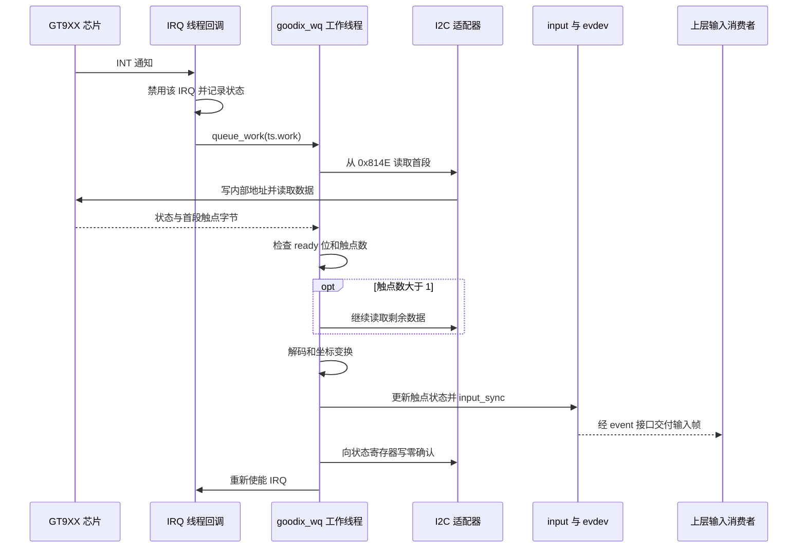

# 07 触摸与 input：把芯片数据转换成一帧输入事件

上一章的显示链把图像送到人眼；触摸链沿相反方向，把人的操作送回 Linux。两者可以装在同一个屏幕模组上，却使用不同通道：像素经过 DSI，触点经过 I2C，INT GPIO 只负责通知。能看见画面，不等于触摸采集已经建立。

第 05 章已经完成输入设备的初始化。本章从一次 INT 到达开始，主线采用本地 V2.2 的“IRQ 回调 → workqueue → I2C → input”，再独立对照 V2.8.7 的线程化 IRQ 路径。以下先说明正常数据怎样流动，再把排队、错误和恢复放回这条路径分析；源码分支的行为不直接代表当前实板。

## 7.1 一次触摸经过哪些对象

[产品 overlay](../../设备树包/aircas-compact-GCS_overlay.dts) 第 391—408 行把 GT9XX 放在 I2C1 的 `0x14`，以 GPIO0_C5 为 INT、GPIO0_C6 为 RST，供电来自 `vcc_lcd_tp`。启动时 INT 参与地址选择；正常工作时，它提示处理器去读取芯片状态。

中断不携带 X/Y。驱动必须通过 I2C 取得芯片格式的状态与触点，检查后转换成 input 事件。input 核心和 evdev 负责统一传递，桌面输入栈再决定事件属于哪个显示输出、窗口和控件。

| 数据经过的位置 | 数据形态 | 这一层完成什么 |
| --- | --- | --- |
| 芯片寄存器与 I2C | 状态字、每点 8 字节记录 | 提供芯片扫描得到的触点信息 |
| GT9XX 驱动缓冲区 | 字节数组、整数坐标、触点 ID 与前一帧状态 | 检查协议、完成变换，表达按下/移动/释放 |
| input / evdev | 标准事件和同步边界 | 向用户空间交付完整的一轮输入变化 |
| 桌面或应用 | 输出坐标、焦点和交互动作 | 决定一次输入最终触发什么行为 |

这几个完成条件逐层增强：IRQ 计数增长说明通知到达；完整 I2C 返回说明这笔通信完成；有效输入帧说明驱动交出了数据；正确点击还要验证桌面映射。故障定位应找到第一处证据中断的位置。

## 7.2 旧版采集：从 IRQ 回调转交工作线程

### 7.2.1 先看真实注册点，再判断执行上下文

本节函数来自 [旧版 gt9xx.c](<../../云奥-270nit-6inch/mipi_touch (1)/mipi_touch/gt9xx.c>)。第 1916 行实际使用 `devm_request_threaded_irq(..., NULL, goodix_ts_irq_handler, ... IRQF_ONESHOT)`，原 `request_irq()` 代码已被注释。因此，本地这个 IRQ 回调已经是线程化处理函数。

这个注册式中，NULL 表示不提供自己的硬中断处理函数，由框架的默认处理唤醒 IRQ 线程；`goodix_ts_irq_handler` 被放在可调度的线程里执行。`IRQF_ONESHOT` 使这条 IRQ 在线程处理期间保持屏蔽，避免尚未处理完又进入同一通知链；它不是“只接收一次触摸”。这是 Linux IRQ 接口的通用语义。[Linux 6.1 IRQ 接口](https://www.kernel.org/doc/html/v6.1/core-api/genericirq.html)

它仍不直接采集。第 1066—1076 行的 `goodix_ts_irq_handler()` 先用 `gtp_irq_disable()` 禁用该 IRQ，再 `queue_work(goodix_wq, &ts->work)`；真正读取发生在工作线程调用的 `goodix_ts_work_func()`。

这次显式禁用有自己的作用：IRQ 线程排队后很快返回，ONESHOT 对该线程的保护并不等待另一个 work 完成。旧代码于是把禁用状态维持到工作函数处理后，再由工作函数恢复 IRQ。它延长了“本轮数据尚未处理完，先不接受下一轮通知”的区间，但不让芯片停止扫描，也不保证保存每一帧。

任务怎样找回设备也可直接从 C 代码看出：probe 用 `INIT_WORK(&ts->work, goodix_ts_work_func)` 登记回调；工作线程随后把 `work` 指针交给它；函数第 612 行用 `container_of()` 从结构体成员地址找回所属 `ts`。因此后台访问的仍是初始化时同一份设备状态，而不是每次中断重新分配对象。

下面只画这个分支的**运行时正常路径**：



图中并未把每个错误都画成正常末尾。首次读取返回负错误或原始状态为零时，旧代码存在重新使能 IRQ 后直接返回的路径；不是所有早退都会执行写零确认。

### 7.2.2 可睡眠的访问决定了任务放在哪里

I2C 事务可能等待控制器和总线，恢复还可能调用 `msleep()`。这些操作要求允许睡眠的上下文，不能放进普通硬中断或持有自旋锁的原子区间。这是内核通用机制；线程化 IRQ 和工作线程都可承担相应访问，名称带 `work` 则不能单独证明上下文。[Linux 6.1 延迟与睡眠机制](https://www.kernel.org/doc/html/v6.1/timers/timers-howto.html)

旧分支保留独立工作线程，使采集按队列串行执行，但比 IRQ 线程直接读取多一次调度。全局 `goodix_wq` 只有一条工作线程，一次重试或复位占用时间较长，后面的工作就要等待。同一个 `work_struct` 已挂起时，重复排队也不会自动保存每个中断对应的一份独立硬件帧。

所以 workqueue 在这里保存的是“需要处理这台设备”的任务，不是无限长度的触摸录制缓存。排队机制是否足够，要结合芯片数据保留方式、确认时机和最坏采集时间判断。

### 7.2.3 锁和轮询各自覆盖到哪里

`gtp_irq_disable/enable()` 第 372—407 行用 `irq_lock` 保护 `irq_is_disable` 及 IRQ 状态更新，I2C 读取不在锁内。这个自旋锁防止重复禁用/使能的状态混乱，不提供“配置、读取、升级、复位全部互斥”的保证。

旧版 IRQ 申请失败会启用 hrtimer，即内核高精度定时器。它提供“到时间调用回调”的机会，本身不是一个允许任意睡眠的采集线程。定时器回调第 1045—1053 行只调用 `queue_work()`，再设置下一次到期时间；采集仍由工作线程承担。首次延迟为 1 s，之后表达式 `(GTP_POLL_TIME + 6)` 对应名义 16 ms。

轮询提供了没有 IRQ 时的另一种采集机会，代价是持续总线访问和调度开销。16 ms 也不是有效帧必定完成的间隔：队列等待、I2C 重试和复位都会延后结果。没有 IRQ 计数增长时，要先确认是否已走这条路径。

## 7.3 读取触点：先确认完整传输，再解释字节

### 7.3.1 I2C 消息数与数据字节数不同

旧 `gtp_i2c_read()` 第 157—215 行构造两个 I2C 消息：第一条写入 2 字节芯片内部地址，第二条从该地址读取数据。因此 `i2c_transfer(..., 2)` 完整成功应返回 **2 个消息**，不是两个坐标字节。

工作函数第一次调用传入长度 12，其中前 2 字节是请求地址 `81 4E`，实际返回的数据为 10 字节。缓冲区布局要按这个前缀理解：

| `point_data` 位置 | 内容 | 说明 |
| --- | --- | --- |
| 0—1 | 请求的内部地址 `81 4E` | 由软件预先填写，不是触点数据 |
| 2 | 状态字 | 最高位是数据就绪标志，低四位是触点数 |
| 3—10 | 第一条 8 字节触点记录 | 含 ID、X、Y、接触量等 |
| 11 | 后续数据的第一个字节 | 单触点时可到按键位置，多触点时已进入下一触点记录 |

当触点数大于 1，代码从 `0x814E + 10` 继续读取，将结果复制到 `point_data[12]` 起的位置。第一次读取已经带回下一条记录的开头，因此不能把缓冲区第 11 字节永久标成“按键字节”；它的用途依赖本帧触点数。

### 7.3.2 ready、数量和续读的顺序影响数据可信度

旧工作函数第 784—810 行的正常判断顺序是：

1. 原始状态为零时返回，不把它当作一帧有效释放。
2. 检查 `0x80` 就绪位；未就绪时不解析触点。
3. 从低四位取触点数，超过 `GTP_MAX_TOUCH = 10` 时拒绝本帧。
4. 多于一个触点时续读剩余记录，再进入坐标解析与上报。

例如状态 `0x80` 表示“有效帧、零触点”，可以用来结束之前的按下；`0x00` 表示这次没有可供处理的状态。两者若被混为一谈，就可能制造假释放，或在应该释放时保留旧状态。

这里已经存在一个静态缺口：第 808 行续读后，第 809 行立即复制缓冲区，没有检查该次返回值。因此“第一次读取成功”不能证明多点数据完整。这是本地旧代码的事实，是否在实板出现异常数据，还需运行证据。

### 7.3.3 用一条示例记录理解解码

下面是**教学构造的单触点记录**，不是芯片抓包或实测输出；仅演示旧代码的字段解释：

```text
状态：81
触点：01 2C 01 64 00 10 00 00
      ID  X低 X高 Y低 Y高 W低 W高 余下字节
```

`81` 的就绪位为 1、触点数为 1；ID 低四位为 1。X 按低字节在前计算为 `0x2C | (0x01 << 8) = 300`，Y 为 100，W 为 16。驱动将 W 用于触摸面积类事件，不能据此把它解释为已经校准的物理压力。

实际解析位于第 936—948 行的 slot 分支和第 964—969 行的 Type A 分支。两者共享芯片格式，却采用不同的标准事件组织方式，见 7.4 节。

### 7.3.4 重试、短传输和复位不能合并成“读取成功”

旧读函数最多尝试 5 次，只有返回 2 才提前成功；用尽后可以复位芯片，最后仍返回原始 `ret`。工作函数首次读取却只检查 `ret < 0`。

因此，如果适配器连续返回 0 或 1 这种非负短传输，辅助函数已经走到失败恢复，调用者却可能继续解析。这与多点续读未检查返回值共同说明：判断数据可信度，需要看**完整返回条件**，不能仅看有没有负错误日志。

重试有助于跨过瞬时错误，但增加时延；复位会改变芯片状态，可能丢失当时的触点，并重新经历选址和等待。复位完成不是通信恢复的证明。后面必须重新得到完整读取、有效状态和连续输入事件，才推进到恢复后的判断。

## 7.4 从坐标到按下、移动和释放

### 7.4.1 坐标必须连同范围一起变换

旧 `gtp_touch_down()` 第 422—457 行先按 `gtp_change_x2y` 交换 X/Y，再按标志执行 `max - value` 镜像。曾经围住部分镜像的产品判断已被注释，实际执行的是后面的独立镜像判断。

接续上面的教学坐标 `(300,100)`，假设配置要求交换轴、只镜像 X，且变换后的 X 上限为 1280：交换得到 `(100,300)`，再按源码公式得到 `(1180,300)`。这些开关和上限是算例假设，不代表当前 overlay 已选择这一组合。

范围本身也有来源：第 05 章说明，旧代码的 `max-x/max-y` 直接赋值已注释；CFG 或固定配置读取决定初始范围，input 注册时还会按交换轴标志交换上报范围。只改 DTS 两个数值，未必改变最终事件能力。

显示的 `rotation = <90>`、芯片原始坐标、驱动变换和桌面映射各处于不同层。驱动内变换让各输入消费者得到统一朝向，却把产品方向带进驱动；桌面变换便于适应不同输出布局，却依赖用户空间配置。应明确由哪一层承担每次变换，避免重复旋转或只换坐标而不换范围。

### 7.4.2 Type B 用 slot 保存触点的连续身份

Type B 的 slot 是一个可持续保存触点状态的位置，tracking ID 表达当前属于哪次接触。已有触点移动时，只需要更新同一 slot 的坐标；手指离开时，要使 slot 失效，不能仅停止发送位置。

旧 slot 分支第 894—957 行根据 ID 位图处理触点：当前帧存在的 ID 调用 `gtp_touch_down()` 更新；缺失的 ID 调用 `gtp_touch_up()`，写入 `ABS_MT_TRACKING_ID = -1`。工作函数保留 `pre_touch`，使有效零触点帧仍能进入释放处理。

这段算法还有一个正常推导的前提：它从槽 0 递增扫描到 9，处理当前记录后才推进到下一条记录，并没有先把任意顺序的记录全部整理成表。因而 ID 必须处于可处理范围，记录顺序也要与遍历相容；若记录先给 ID 3、再给 ID 1，读取到后者时循环已经越过槽 1。这里是在说明源码的输入假设，芯片协议是否保证这些条件还需配套资料或有效帧证据，不能写成已发生的丢点故障。

下面仍是**逻辑示例，不是 evtest 输出**：

| 有效帧 | 芯片报告 | Type B 应表达的状态变化 |
| --- | --- | --- |
| A | ID 1 位于 (100,50) | slot 1 建立接触并上报位置 |
| B | ID 1 移到 (120,55)，新增 ID 3 | slot 1 更新；slot 3 建立接触 |
| C | 只剩 ID 3 | slot 1 释放；slot 3 保持并更新 |
| D | 就绪位为 1，触点数为 0 | 释放剩余接触并结束本帧 |

这个过程解释了“抬起”为什么需要有效状态。若 I2C 错误或持续无效帧使释放处理始终没发生，上层可能仍保持之前的拖拽状态。它是需要按事件流验证的条件性结果，不能从错误日志直接断言已发生。

### 7.4.3 本地旧文件不一定编译为 slot 路径

[旧 gt9xx.h](<../../云奥-270nit-6inch/mipi_touch (1)/mipi_touch/gt9xx.h>) 第 60—64 行仅在 `CONFIG_CHROME_PLATFORMS` 下启用 `GTP_ICS_SLOT_REPORT`，否则采用 Type A。Type A 逐点上报，以 `input_mt_sync()` 分隔触点；旧代码在全部抬起时报告 `BTN_TOUCH = 0`，最后统一 `input_sync()`。不能将 Type B 的 slot 操作插入这条条件分支。

[交付内核包](../../debs/linux-image-6.1.84-12-rk2410-nocsf_6.1.84-12_arm64.deb) 的 `boot/config-6.1.84-12-rk2410-nocsf` 未设置 `CONFIG_CHROME_PLATFORMS`。如果使用当前这份头文件构建，会选择 Type A；但包内完整 GT9XX 源码缺失，所以这是条件推论，不能代替检查实板输入能力。

input 多点协议的通用含义可参阅 [Linux 6.1 多点触摸协议](https://www.kernel.org/doc/html/v6.1/input/multi-touch-protocol.html)。本地代码保留的协议分支与现代通用建议要分别看，不能因为上游主要使用 Type B，就抹去供应商代码实际存在的 Type A。

### 7.4.4 同步一帧与确认芯片是两个动作

`input_sync()` 给本轮事件标记同步边界，input/evdev 因而能向上层交付这一组变化。它不等待桌面绘制反馈，也不负责确认芯片寄存器。

旧工作函数正常末尾还要向 `0x814E` 写零，确认这轮坐标已经处理，然后重新使能 IRQ。若确认写失败，后续是否重复通知、保留旧状态或继续变化，要结合芯片状态与 IRQ 观察；不能因为 input 已同步就推断整轮硬件握手也成功。

用户空间从 `/dev/input/event*` 接入后，才进行显示输出映射、焦点和手势处理。本项目没有完整桌面配置或应用源码，因此这里只定位消费位置；不能补写成 QGC 或某地面站界面已经完成点击联调。

## 7.5 V2.8.7 的独立采集路径与差异

### 7.5.1 IRQ 线程直接读取，解析后集中报告

以下只对应 [V2.8.7 gt9xx.c](../../阿美林-1000nit-7inch/GT9XX通用调试包/gt9xx.c)：

`request_threaded_irq(..., NULL, gtp_irq_handler, ... IRQF_ONESHOT)` → `gtp_irq_handler()` → `gtp_work_func()` → `gtp_get_points()` → `gtp_mt_slot_report()` 或 `gtp_type_a_report()` → `input_sync()`。

这条路径没有旧版的第二次采集 workqueue 投递。少一次调度，但 I2C 和重试耗时会直接进入这轮 IRQ 线程的处理时间。它和旧分支各自能成立，不能用“新旧都用中断”省略差异。

`gtp_work_func()` 先检查 `PANEL_RESETTING` 和 `WORK_THREAD_ENABLED`。采集函数检查状态、计数和多点续读；与旧版不同，续读负错误会退出。I2C 辅助函数只有完整传输后才复制数据，重试间等待约 2 ms，用尽后返回 `-EAGAIN`。

硬件确认的位置也不同：V2.8.7 的 `gtp_get_points()` 在 `exit_get_point` 中向状态寄存器写零，然后才返回给报告函数。在非原始数据模式下，它在 input 上报前就尝试确认芯片，而旧分支的正常路径是在 `input_sync()` 后确认。该写入失败时新分支只记录错误，仍可返回有效状态继续上报，所以“用户看到了事件”仍不能单独证明芯片确认成功。

本分支先把记录填到 `points[ID]`，ID 掩码范围 0—15，数组长度为 16。随后依据每槽 `status` 调用 `input_mt_report_slot_state()`，统一上报坐标、接触状态与同步事件；`goodix,type-a-report` 决定是否改走 Type A。这里按 ID 索引本身不足以证明越界，应同时看掩码、数组与后续遍历范围。

### 7.5.2 无 IRQ 时，同名函数处于另一个上下文

V2.8.7 第 1595—1603 行在没有可用硬件 IRQ 的分支创建 hrtimer；IRQ 存在但申请失败则返回错误，不应一概写成“所有 IRQ 失败自动轮询”。其 `gtp_timer_handler()` 第 639—648 行直接调用 `gtp_work_func()`，没有先排队到工作线程。

普通非线程化 hrtimer 回调不适合进行可睡眠访问，下游却确实包含 I2C、失败时的 `usleep_range()`，较大读取还可能使用 `GFP_KERNEL` 分配。因此，这份源码的**无 IRQ 轮询分支**存在执行上下文不匹配的静态风险；正常 IRQ 线程不因这个发现就变成同类问题。

将定时器限制为“通知采集”，再由可睡眠线程处理，是一种可解释的设计选择。这里保留取舍和成立条件，不在文档任务中修改驱动，也不宣称包内实现已经走到该分支。

## 7.6 可靠性取决于在途工作和硬件状态

### 7.6.1 状态位并不等于同步屏障

V2.8.7 的 `gtp_work_control_enable()` 仅设置或清除 `WORK_THREAD_ENABLED`。清零能阻止后续经过入口检查的采集，却不会自动等待已经通过检查的线程结束。其 `ts->lock` 虽被初始化，正常采集路径没有用它包住完整事务；ESD mutex 主要保护 ESD 开关和取消操作。

旧分支的 `irq_lock` 也只保护 IRQ 状态。适配器可以串行安排单笔 I2C 访问，但“复位 → 配置 → 读取 → 确认”是一组操作，单笔串行不能证明整组不被其他路径打断。

两分支还保留全局客户端或静态上一帧状态，扩展多个同类设备前，应检查这些状态是否真正属于各自的 `ts`。锁多不代表覆盖充分，关键是哪个数据会被谁同时访问、何时等待在途访问结束。

### 7.6.2 挂起和恢复必须同时处理两类状态

V2.8.7 的 `gtp_suspend()` 先检查固件更新，设置睡眠位，关闭 ESD/上报，再选择手势待机、断电或睡眠命令。恢复时根据这条选择尝试唤醒、上电、复位和通信检查。

第 2331—2337 行存在明确边界：恢复出错时虽然打印告警，仍会清除 `SLEEP_MODE` 并允许上报，只有成功分支重启 ESD。因此软件已标成 awake，并不能证明芯片已回应。

应把恢复证据按顺序连接：电源与复位条件恢复 → 完整 I2C 访问 → 有效触点和释放 → 上层重新收到正确输入。函数返回、日志结束或标志位变化只能回答其中一部分。

### 7.6.3 ESD 和固件更新为什么要干预采集

旧头文件将 `GTP_ESD_PROTECT/GTP_AUTO_UPDATE/GTP_CREATE_WR_NODE` 设为 0，对应条件功能不启用；但 probe 仍单独创建配置 proc 入口，不能概括为没有任何维护写入口。

`GTP_COMPATIBLE_MODE=1` 还保留 GT9xxF 的特殊请求处理：识别为这类芯片且状态为零时，会先读取请求，再处理配置、复位或主时钟，位置在普通触点 ready 检查之前。备份参考请求的主体在第 734—750 行已注释，不能因为文件还定义了 `gtp_bak_ref_proc()` 就认定此处会调用它。这些是特殊芯片分支，不能拼入普通 GT911 的每帧采集路径。

V2.8.7 的 `goodix,esd-protect` 可启动周期延迟工作，检查看门狗相关状态，异常时尝试断电、上电、复位和重发配置。这些动作与正常采集都访问同一芯片，因此需要停止和恢复关系，而不仅是另外开一个定时任务。

[gt9xx_update.c](../../阿美林-1000nit-7inch/GT9XX通用调试包/gt9xx_update.c) 的 `gup_update_proc()` 第 1901 行起按以下阶段执行：检查条件并设置更新位 → 取得固件 → 停上报和 ESD → 进入更新模式并分阶段烧写/重试 → 离开更新模式、释放固件、重新允许工作。这里通过 `request_firmware()` 取得的是触摸固件，和 Linux 内核镜像是不同产物。

阶段重试和清理出口有助于恢复，但不等于断电原子回滚。更新成功标志、实际固件版本、配置适用性和有效触点仍需逐层验证；本任务没有执行更新。

### 7.6.4 调试接口位于标准输入之外

V2.8.7 probe 无条件调用 `init_wr_node()`。[goodix_tool.c](../../阿美林-1000nit-7inch/GT9XX通用调试包/goodix_tool.c) 第 201 行以 `0666` 创建 proc 入口，写处理从用户数据取得全局命令结构并可访问芯片。

源码可见命令头复制发生在检查用户总长度之前，部分字段有上限检查，但地址长度、偏移和共享命令状态还需一起核对。因此交付时要审查权限、输入边界及与采集的并发关系。这个入口不是桌面接收触摸所必需的标准接口，静态边界也不等于已经发生利用或现场故障。

## 7.7 用事件证据选择下一层

读到这里，排查可以沿刚才的正常链进行，而不必同时调整驱动、CFG 和桌面：

| 现象 | 当前首先怀疑的层级 | 检查后如何改变判断 |
| --- | --- | --- |
| 没有相应 input 设备 | 初始化与注册 | 回第 05 章查 client、绑定、资源和 probe，先不查桌面坐标 |
| 有设备，触摸时没有通知变化 | IRQ/轮询选择、引脚或工作状态 | 先确认采集模式，再查 INT、睡眠和更新状态 |
| 通知到达但 I2C 失败 | 供电、地址、复位、总线访问 | 向前查资源，不能只凭重试次数认定总线频率错误 |
| 单指正常，多点或抬起异常 | 续读完整性、有效帧与 ID 状态 | 查剩余字节、释放事件和确认写，区分数据丢失与桌面手势 |
| 原始坐标连续但界面偏移 | 上报范围或上层映射 | 先比四角和能力范围；原始坐标正确后再查桌面旋转 |
| 休眠后无响应 | 硬件恢复与软件允许上报脱节 | 查看恢复错误后是否仍放行，再验证通信和新事件 |

以下是在**目标 Linux 板已有工具下待执行的只读示例**，没有实测输出。先识别设备，再观察通知和事件：

```sh
# 从名称、能力和 Handlers 找到触摸对应的 event 节点。
cat /proc/bus/input/devices

# 比较触摸前后的对应 IRQ 计数；轮询模式不要求它增长。
cat /proc/interrupts

# 系统已有 evtest 时，将 eventN 替换为刚识别出的编号。
evtest /dev/input/eventN
```

第一步找不到设备，返回初始化链；第二步通知增长，只推进到通知已到达；第三步重点看范围、同步与释放。正确 input 事件仍不证明桌面已经正确消费，最后需要明确的屏幕操作验证。完整部署证据和故障实验组织见第 10、11 章，无需为写文档安装工具或探测写入器件。

## 7.8 自查与回答要点

### 7.8.1 自查题

1. IRQ 计数持续增长，为什么不能据此证明触摸正常？从通知到桌面还经过哪些判断？
2. 示例记录中的 X 为什么是 300？状态 `0x80` 和 `0x00` 对释放事件有什么不同？
3. 同一 ID 连续移动与一个手指抬起、另一个按下，Type B 分别怎样表达？旧分支是否一定采用 Type B？
4. 旧分支和 V2.8.7 都用了线程化 IRQ，为什么仍要分别分析调度路径？两者轮询有何差异？
5. 如果恢复函数已经清除了睡眠位，后续没有有效事件，还需要什么证据？
6. 原始 input 四角位置正确，界面点击偏移，应先改哪一层，为什么？

### 7.8.2 回答要点

1. IRQ 只通知去读数据；还需完整 I2C 返回、ready/count 校验、多点续读、坐标与状态处理、同步帧及上层消费。应找证据首先中断的位置。
2. `0x2C + (0x01 << 8) = 300`。有效零触点帧可以释放旧接触；原始零状态没有提供这样的有效帧，不能简单制造释放。
3. 移动更新同一 slot；结束接触要使其失效，新接触取得有效身份。旧宏受 `CONFIG_CHROME_PLATFORMS` 控制，包内配置与本地源码是否对应还需确认。
4. 旧回调再投递 workqueue，新分支在线程中直接读取；旧定时器只投递工作，新分支无 IRQ 的 hrtimer 直接调用可睡眠采集，须检查上下文。
5. 软件允许工作与硬件已恢复分开证明：供电/复位、完整通信、新有效帧及上层响应。错误后的状态位变化不能代替这些结果。
6. 先核桌面输出旋转、设备映射和应用坐标。继续改变已有正确数据的驱动变换，可能造成二次旋转或缩放。

触摸链交给上层的是输入事件；下一章 [电量与外部供电](08_电量与外部供电.md) 交给上层的是供电状态。两者都依赖正确采样和明确语义，但上层不能把一个软件状态直接当成全部硬件行为已经成立。

[上一章：显示与背光](06_显示与背光.md) · [返回总览](README.md)
