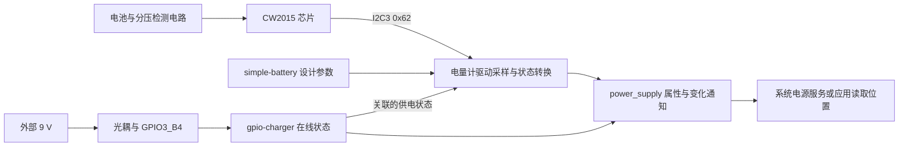

# 08 电量与外部供电：把测量、状态和充电电路分开

显示与触摸章节解决“用户怎样看见系统、怎样输入”。本章讨论系统怎样观察自己的供电。地面站上层需要电量与外部供电状态，但这些数据来自不同电路：电量计采样电池，GPIO 检测外部电源，充电芯片实际管理能量流。把三者混在一起，会误判“已插电”“正在充电”和“电量测量正确”。

本章以 [AIRCAS overlay](../../设备树包/aircas-compact-GCS_overlay.dts) 第 100–111、412–435 行及 [8 页底板原理图](../../原理图/SCH_RK3566底板V2_2025-10-21.pdf) 第 4 页为主。目录没有配套 `cw2015_battery.c` 完整源码；因此能够定位节点、供电关系和历史记录，不能据此补出当前内核的完整采样、滤波或恢复算法。

## 8.1 四个角色各解决一个问题

| 角色 | 本项目对应物 | 输入与输出 | 职责边界 |
| --- | --- | --- | --- |
| 电池参数描述 | `simple-battery` 节点 | 提供设计容量等静态参数 | 不采样，不直接显示当前剩余电量 |
| 电量计 | I2C3 的 CW2015 | 从电池检测电路得到测量/估计状态，驱动经 I2C 读取 | 不等同于充电控制器 |
| 外部供电检测 | `gpio-charger` 与 GPIO3_B4 | 将光耦输出转换为在线/离线状态 | 不直接设置充电电流或终止条件 |
| 充电电路 | 原理图中的 TP5100 及外围器件 | 外部输入向电池输送能量 | 实际充电受硬件设计约束，不由上述检测节点代替 |

**资料记录：** 第 4 页还画出 CH224K 的 PD 取电电路、TP5100 的充电通道、CW2015 的采样电路及均衡电路。这些角色在硬件上分开，在软件中也应保留边界。不能因为节点名为 `dc-charger` 就认定 Linux 正在闭环控制 TP5100。

`power_supply` 是 Linux 对电池和供电状态的统一接口。它让上层读取具有约定含义与单位的属性，而无需知道芯片 I2C 寄存器地址；驱动只暴露硬件和实现实际支持的属性，不保证每个电池都有电流、剩余时间或健康度。[Linux power_supply 接口说明](https://www.kernel.org/doc/html/v6.1/power/power_supply_class.html)

## 8.2 从采样接线走到设备树依赖

### CW2015 先获得供电和 I2C 通路

**资料记录：** 旧底板第 4 页 U8 为 `CW2015CHBD`，SDA/SCL 经串联电阻连接 GPIO1_A0/A1，并通过电阻上拉到 `VCC3.3CW`。电池总电压经 R37/R44 分压送入检测支路；`ALRT#` 接 GPIO3_A1。这说明电量采样、I2C 通信和告警是三个不同接口。

**源码事实：** overlay 开启 `i2c3`，选 `i2c3m0_xfer`，在总线下创建 `cw2015@62`，`compatible = "cellwise,cw2015"`、`reg = <0x62>`。这里的 `reg` 是 I2C 从设备地址，不是 SoC 寄存器基址。当前节点没有描述 ALRT 中断，因此不能把原理图上的告警连线写成已经启用的 Linux IRQ 路径。

**通用原理：** I2C 控制器驱动建立 adapter 后，设备模型才能把总线子节点变为 I2C client；匹配的芯片驱动随后进行 probe，读取属性、访问芯片并注册接口。控制器不存在、引脚复用错误、芯片无应答和芯片驱动缺失是四种不同问题。具体函数和错误处理需查配套 BSP 源码，本目录尚不具备这些证据。

**包内事实：** [交付内核包](../../debs/linux-image-6.1.84-12-rk2410-nocsf_6.1.84-12_arm64.deb) 的 `boot/config-6.1.84-12-rk2410-nocsf` 中，`CONFIG_BATTERY_CW2015=y`、`CONFIG_CHARGER_GPIO=y`，表示这两个驱动配置为编入内核；但同包基础 `rk3566-radxa-cm3-io.dtb` 的 I2C3 为 disabled。必须有正确的最终设备树开启总线及器件，不能把“驱动已编入”当成电池接口已经出现。

### 两个引用把“测量谁、受谁供电”连接起来

`monitored-battery = <&battery>` 引用静态电池参数；`power-supplies = <&mains_charger>` 关联外部供电对象。两者分别回答“这块电池的设计信息是什么”和“上游外部供电是否在线”，不是两条电池充电控制指令。

`simple-battery` 的 `charge-full-design-microamp-hours = <6000000>` 表示 6,000,000 µAh，即 6000 mAh 的设计容量。它不能证明实测容量达到 6000 mAh，也不意味着运行时 `capacity` 必须显示 100%。

## 8.3 profile、双节标志和刷新周期为什么不能互相替代

profile 是交给电量计方案使用的电池模型参数。本项目提供 64 字节 `cellwise,battery-profile`，用于描述对应电池的估算特性；它不是实时测量数组，也不应凭电池标称容量随意改其中几个字节。

**资料记录：** 编译文档将驱动位置记为 `drivers/power/supply/cw2015_battery.c`，并摘录 `device_property_read_u8_array(dev, "cellwise,battery-profile", ...)`。它说明这项属性设计为由驱动按字节数组读取；不能由这一行摘录推导出完整 probe 顺序、写芯片时机、失败重试次数或 profile 持久化方式。

**资料记录复核：** [`RADXA CM3地面站编译.docx`](../../RADXA%20CM3地面站编译.docx) 的“四、开启电池电量检测(CW2015)”同时保存了两套模型：

| 资料对象 | 识别特征 | 与当前 overlay 的关系 |
| --- | --- | --- |
| 2S 4000 mAh 模型 | 以 `15 7E 9E 47 26 14` 开始 | 不是当前使用的 64 字节序列 |
| 远东 FEB 6AH 模型 | 以 `15 7E 90 3A 19 15` 开始 | 本次逐字节比对与 overlay 第 423–430 行一致 |

因此不能再把当前配置解释为“6000 mAh 声明配了 4000 mAh 模型”。能够确认的是模型文本与 6AH 资料相符；实际安装电芯的型号、串并联形式、老化程度以及是否重新标定，仍为待确认事项。原文提到的容量实测属于历史记录，不能转成当前实板结果。

`cellwise,dual-cell = <1>` 与资料中的两节串联和分压检测方案对应。**待确认事项：** 配套驱动怎样处理该扩展属性、何处转换电压、对报告值乘以什么系数，需要完整驱动源码或运行证据。不能仅根据属性名字给出未经核实的转换函数和固定倍率调用链。

`cellwise,monitor-interval-ms = <5000>` 声明 5 秒监测间隔。即使驱动采用周期采样，它也只规定请求的刷新节奏，不保证用户每次读取都触发新 I2C 事务。工作队列调度、I2C 重试和数据缓存都可能使观察到的更新时间不同；具体使用 delayed work、timer 还是其他机制，本目录无法由完整源码确认。

## 8.4 外部在线检测如何进入同一状态体系

旧底板第 4 页中，9 V 经限流电阻驱动 U23 光耦，输出侧关联 3.3 V 和 GPIO3_B4 下拉。按该图连接，外部输入存在时，检测线趋向高电平。overlay 对应 `gpios = <&gpio3 RK_PB4 GPIO_ACTIVE_HIGH>` 和 `charger-type = "mains"`。

这里的 `mains` 是软件供电类型，不是在声明 GPIO 上存在市电电压。SoC 读取的是经过光耦与低压侧电路处理后的信号。

**通用原理对照：** 上游 Linux 6.1 `gpio-charger` 驱动在读取 ONLINE 属性时取得 GPIO 逻辑值，并可通过 GPIO IRQ 通知状态变化；它管理的是供电状态对象。[上游 gpio-charger.c](https://raw.githubusercontent.com/torvalds/linux/v6.1/drivers/power/supply/gpio-charger.c) 该实现用于解释接口含义，不能证明本项目 BSP 的线程函数、IRQ 触发方式和防抖细节完全相同。

运行时的概念数据流如下。图中“驱动采样/通知”是接口职责图，不是缺失 CW2015 源码的函数调用图。



实际充电电流从外部电源经 TP5100 进入电池，不沿图中 I2C/GPIO 数据箭头流动。`online=1` 只能证明驱动把检测状态解释为外部供电在线；它不能证明电池有充电电流、充电参数正确或电池已充满。

## 8.5 执行上下文、缓存和失败恢复该怎样理解

I2C 传输可能等待总线和控制器完成，许多驱动还需睡眠等待重试，因此采样要放在允许睡眠的上下文中。若使用中断，硬中断通常只负责确认/调度，后续在线程或工作队列执行；这是设计要求，不是本项目已确认采用某条具体路径。

稳定的采样链需要区分至少三类状态：最后一次成功值、当前通信是否成功、对外报告的供电状态。通信失败后保留旧值可减少界面跳变，却可能使用户误以为电量仍在更新；立即报告失败更诚实，但上层必须能处理暂时不可用。选择哪种策略要看配套驱动，本目录没有足够代码断言。

同样，重试只能改善瞬时 I2C 错误；它不能修复错误分压、错误 profile 或电池型号不符。软件把“初始化完成”标志置位也不证明后续每次测量有效。恢复证据应包括错误结束后重新成功的通信、合理的数据变化，以及上层获得更新，而不只是工作项重新排队。

采用标准 power_supply 接口的收益是统一单位和状态语义，上层不必与 I2C 寄存器绑定；代价是驱动必须准确表达“测到什么”和“推断了什么”。增加自定义属性虽方便，但会增加上层版本耦合，应先确认标准属性是否已能表达需要的信息。

## 8.6 从接口读取到故障判断

以下命令为 **待在目标 Linux 板执行的只读检查** ；本次未执行，也没有附模拟实测输出。先枚举所有供电对象，避免预设对象一定名为 `cw2015-battery`。

```sh
# 检查驱动实际注册了哪些供电对象，以及它们提供哪些属性。
for supply in /sys/class/power_supply/*; do
    [ -d "$supply" ] || continue
    printf '\n%s\n' "$supply"
    cat "$supply/uevent"
done
```

解读时先看 `POWER_SUPPLY_TYPE` 与对象身份，再看属性。`capacity` 通常是百分比，`voltage_now` 通常以 µV 表示，`charge_full_design` 是设计容量；某项缺失表示当前驱动没有暴露它，不可填成 0。单位和状态约定见前述 power_supply 文档。

| 现象 | 先归属哪层 | 检查依据 | 下一步如何改变判断 |
| --- | --- | --- | --- |
| 完全没有电池对象 | DT、绑定或注册层 | 最终 DT 中 I2C3/0x62 节点、驱动绑定链接、启动日志 | 若节点缺失先查部署；节点有而 probe 报错再查依赖和 I2C |
| 对象存在但电压明显不合理 | 采样比例、单位或驱动转换层 | 分压电路、实际电池电压、dual-cell 解析、属性单位 | 先核单位和缩放；不要直接更换 profile 掩盖电压错误 |
| 电压合理但百分比跳变或偏差大 | 模型、采样有效性和电池特性 | 完整 profile、实际电池型号、负载变化时的连续记录 | 区分模型不匹配、负载压降与通信失败后旧值停留 |
| 插拔电源但 online 不变 | 检测电路、GPIO、板型或状态刷新 | GPIO3_B4 物理电平、最终极性、对象 uevent/日志 | 物理未变先查电路；物理变而软件不变再查驱动/IRQ |
| online 为 1 但电池不充电 | 实际充电通道 | TP5100 输入、电池端、电流与硬件状态 | 保留软件在线结论，转查硬件充电条件 |

如需看初始化失败，先从现有日志中定位 CW2015、I2C 和供电相关条目。没有日志输出不能直接证明没有错误，可能只是驱动没有相应日志。也不要把扫描 I2C 总线当成默认首步：驱动已绑定时，优先通过标准接口与现有日志检查，额外探测需先确认器件访问约束。

## 8.7 本章验证边界与自查

本次确认了 DTS 节点、原理图连接和 Word 模型文本；没有证明某块当前实板已经成功绑定 CW2015、按 5 秒准确刷新或得到合格电量误差。后续验证应依次取得：正确板型与电池信息 → 正确运行 DT/驱动 → 在线检测随插拔变化 → 电压与参考测量相符 → 电量随受控使用合理变化。最后一步才涉及估算表现，前几步不能替代它。

**问：`simple-battery` 是否应该创建一个负责采样的电池线程？**
回答要点：它首先是静态电池信息节点；采样由电量计驱动及硬件承担，节点引用不等于创建一个独立运行算法。

**问：6000 mAh、64 字节 profile 和 5 秒间隔分别解决什么问题？**
回答要点：设计容量描述电池标称规模，profile 对应电池模型，间隔描述监测节奏；三者不能互相补偿，也不证明当前测量准确。

**问：为什么看到 `online=1` 仍不能回答“电池正在充电”？**
回答要点：它来自外部供电检测，充电能量经过独立硬件；还需充电通道、电流和电池条件证据。

**问：如果对象存在但数值停止变化，为什么不马上修改 I2C 频率？**
回答要点：先区分缓存、采样任务是否继续、通信错误以及硬件值是否本就稳定。只有证据指向总线时序，频率才是相关变量。

接下来 [第 9 章](09_温控与风扇.md) 仍从传感器开始，但会增加“根据观测值选择执行器状态”的反馈控制，进一步区分软件状态和物理效果。
