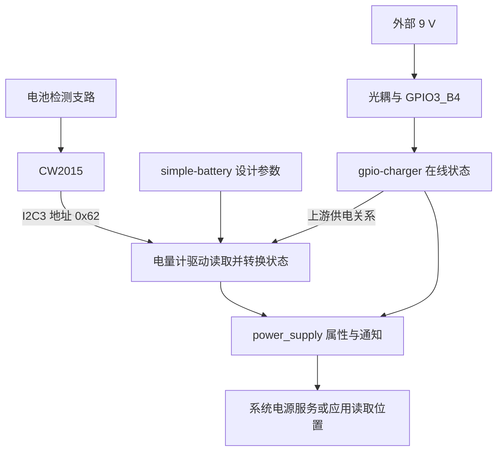

# 08 电量与外部供电：从电池测量到上层状态

前两章已经说明用户怎样看见画面、怎样输入。移动地面端还要知道自己能工作多久、外部电源是否接入。界面上可能只有一个电池图标，背后却包含电池测量、模型估计、外部输入检测和实际充电电路。先分清这些信息的来源，才知道一个异常百分比该到哪里查。

本章先沿 CW2015 的测量链走到 Linux 接口，再连接外部供电检测。主要依据是 [产品 overlay](../../设备树包/aircas-compact-GCS_overlay.dts) 和 [8 页底板原理图](../../原理图/SCH_RK3566底板V2_2025-10-21.pdf) 第 4 页。当前目录没有完整配套 `cw2015_battery.c`，所以采样线程、滤波和恢复细节会明确保留在通用机制与待确认范围内。

## 8.1 一个电池图标需要哪些互不等价的信息

以“电量 60%，已接电源”作为说明用的界面状态。“60%”应来自电量计的测量与估计结果，“已接电源”应来自外部输入检测，而设计容量只是描述这是什么电池。真正有没有电流流进电池，还由充电电路和电池当时的条件决定。这里的数值只是例子，没有对应本次实测。

旧底板第 4 页正是把这些工作分开实现的。U8 CW2015 连接电池检测支路，并通过 I2C 与 SoC 通信；9 V 输入经 U23 光耦形成 GPIO 检测信号；TP5100 及外围器件负责实际充电通道，CH224K 参与 PD 取电，图中另有均衡电路。它们属于图纸记录的硬件方案，不能因为设备树节点叫 `dc-charger` 就认定 Linux 在闭环控制 TP5100。

上层不应直接读取每个芯片的私有寄存器，因此 Linux 用 `power_supply` 表示电池和供电对象。驱动把能够提供的数据转换为约定的属性与单位，系统电源服务或应用在这里读取。某个驱动没有暴露电流或剩余时间时，不能由接口名称自行补出这些能力。[Linux power_supply 接口说明](https://www.kernel.org/doc/html/v6.1/power/power_supply_class.html)

## 8.2 CW2015 怎样成为一个可以读取的设备

### 8.2.1 从电池检测支路到 I2C 地址

电量计首先需要看见电池的电气状态。原理图中，R44 把电池正极 `VCC_PB+` 接到 CW2015 的 CELL 检测端，R37 从 CELL 接地，两者均为 200 kΩ。忽略检测端负载时，`VCELL ≈ V电池 × R37 / (R44 + R37) = V电池 / 2`，把两节总电压降到单节量级。例如总电压为 7.6 V 时，检测端约为 3.8 V；这是按图计算的例子，不是实测。

芯片的 VDD 供电另由 `VCC3.3CW` 经 R45 提供。SDA/SCL 经串联电阻接 GPIO1_A0/A1，并上拉到 `VCC3.3CW`；`ALRT#` 告警线接 GPIO3_A1。因此“芯片有电”“检测端电压正确”“I2C 能通信”是三个条件。即使 I2C 能读到寄存器，分压电阻错装仍可能让读数失真；告警线接上了，也不代表软件启用了它。

overlay 第 412–435 行选择 I2C3 的 M0 引脚组，将总线设为 `okay`，并在下面声明 `cw2015@62`。`reg = <0x62>` 是 I2C 从设备地址，`compatible = "cellwise,cw2015"` 用来匹配能理解该芯片的驱动。当前节点没有描述 ALRT 中断，因此不能把图纸上的告警线写成已经运行的 Linux IRQ 采样链。

这里承接第 5 章的初始化过程：I2C 控制器先成为可用总线，内核再根据子节点建立 client，匹配的 CW2015 驱动才有机会执行 probe。探测函数需要读取配置、访问芯片并注册状态接口。控制器没有建立、地址不符、器件没有应答和驱动不存在，会在不同位置阻断这条过程。

### 8.2.2 编译进内核并不自动开启总线

[交付内核包](../../debs/linux-image-6.1.84-12-rk2410-nocsf_6.1.84-12_arm64.deb) 的 `boot/config-6.1.84-12-rk2410-nocsf` 中，`CONFIG_BATTERY_CW2015=y` 和 `CONFIG_CHARGER_GPIO=y` 表明这两个驱动被配置为内建。但该包基础 `usr/lib/linux-image-6.1.84-12-rk2410-nocsf/rockchip/rk3566-radxa-cm3-io.dtb` 中，I2C3 仍为 disabled。

这组包内事实说明驱动能力与设备启用是两件事。正确的产品 overlay 要在最终树中开启总线并加入器件，随后还要真正匹配并完成初始化，才能出现供电对象。缺少接口时，先沿这条依赖链查，修改设计容量不会让一个尚未存在的 I2C 设备开始工作。

## 8.3 驱动需要知道的电池信息来自哪里

### 8.3.1 设计容量与电池模型各解决一个问题

芯片即使能通信，也不等于电量估计适合当前电池。系统既需要静态设计信息，也需要模型参数。前者说明电池标称规模，后者用于解释该类电池的估算特性，两者不能互相替代。作为理解模型用途的一般原理，端电压与剩余电量并非简单线性关系，负载变化也会影响端电压；不能把某次电压读数直接按满充电压的比例换成百分比。本项目记录了电池建模参数，但没有给出足以重建芯片估算算法的材料。

overlay 第 100–103 行的 `simple-battery` 声明 `charge-full-design-microamp-hours = <6000000>`，即 6000 mAh。它是设计容量元数据，不进行采样，也不证明当前可用容量为 6000 mAh。CW2015 节点通过 `monitored-battery = <&battery>` 找到这份描述。

同一节点的 `cellwise,battery-profile` 是 64 字节模型参数，不是 64 次实时采样。在 [编译记录](../../RADXA%20CM3地面站编译.docx) 的“四、开启电池电量检测(CW2015)”中，可以找到驱动路径 `drivers/power/supply/cw2015_battery.c` 和读取数组的摘录 `device_property_read_u8_array()`。这能说明属性的预期消费者，不能凭一行摘录补出完整 probe、写芯片时机和持久化方式。

Word 同时保存两套 profile，本次核对了完整字节序列：

| 模型记录 | 起始字节，用于快速识别 | 与当前 overlay 的关系 |
| --- | --- | --- |
| 2S 4000 mAh | `15 7E 9E 47 26 14` | 与当前 64 字节序列不同 |
| 远东 FEB 6AH | `15 7E 90 3A 19 15` | 64 字节与 overlay 第 423–430 行全部一致 |

因此当前源码的设计容量和模型记录都指向 6 Ah 这一组材料，不能说成“6000 mAh 配了 4000 mAh 模型”。但参数文本对应，只证明资料配对成立；实际电芯型号、串并联形式和老化程度仍需确认。历史文档中的容量实测不能直接当作今天这块电池的结果。

### 8.3.2 双节标志决定解释方式，刷新间隔决定观察节奏

`cellwise,dual-cell = <1>` 与资料中的两节串联、分压检测方案对应。前面的算例说明为什么要区分“CELL 检测值”和“整包电压”：同一块电池可能分别对应约 3.8 V 与 7.6 V。对外报告哪一种、怎样还原，取决于配套驱动是否读取该属性以及如何处理它。本目录缺少完整驱动，不能仅凭名字就指定某个换算函数或固定倍率调用链。两节串联改变总电压，并不会让同一支路流过的 Ah 自动翻倍，也不能据此把 6000 mAh 改成 12000 mAh。

`cellwise,monitor-interval-ms = <5000>` 则声明 5 秒监测间隔。它描述期望的刷新节奏，既不校正电压比例，也不替换 profile。即使驱动采用周期采样，用户读取接口时也可能得到最近一次缓存值，而不是现场发起一笔新 I2C 事务。

把这三项信息分开后，故障原因才容易区分：电压倍率不对优先核对采样和转换；电压合理但百分比不合理再核模型和电池；显示长时间不更新则需检查采样是否继续及缓存是否陈旧。

## 8.4 从采样到接口，需要考虑等待、缓存和恢复

下面说明的是理解接口所需的通用机制，不能据此认定缺失的 CW2015 源码一定用了某个线程或工作队列。I2C 操作需要等待控制器完成传输，重试还可能引入睡眠，所以采样要在允许等待的执行上下文中进行。若由中断触发，通常也要把可睡眠的部分交给合适线程处理。

一次采样成功后，驱动才能把芯片数据转换为 power_supply 属性。这里至少有三项独立状态：最后一次成功值、最近通信是否成功、对外报告的电池/供电状态。保存旧值可以减少界面跳变，却可能掩盖采样已经停滞；直接返回暂时不可用能表达失败，但上层必须容忍短时缺失。具体采用哪种策略，需要匹配驱动源码确认。

可以用一个假设的缓存方案检验理解：0 秒采样成功，5 秒传输失败但保留旧值，6 秒用户读取属性得到的仍可能是 0 秒数据。读 sysfs 成功，只证明这次接口返回成功，不能证明 5 秒那次 I2C 成功。这个例子解释为何排查时需要时间和通信依据，并不认定目标 CW2015 驱动采用此策略。

这也解释了恢复时应观察什么。工作项再次排队或“初始化完成”标志恢复，只表示软件准备继续执行；真正恢复还要有成功通信、可解释的新数据和上层可见更新。重试能处理瞬时总线错误，却不能修正错误分压、错误 profile 或换了型号的电池。

选用标准接口使上层与芯片寄存器解耦，但驱动必须准确区分测量值、估计值和状态。增加私有属性可以表达特殊需求，也会提高上层与驱动版本的耦合，适配时应先确认标准属性是否足够。

## 8.5 外部电源在线如何与电量信息会合

电量计报告电池状态时，还可能需要知道外部电源是否存在。旧底板第 4 页中，9 V 经限流电阻驱动 U23 光耦，低压侧通过 3.3 V 及下拉网络形成 GPIO3_B4 的检测信号。按图连接，外部输入存在时检测线趋向高电平。

overlay 的 `mains_charger` 节点用 `gpio-charger` 表示这个检测器，声明 GPIO3_B4 高有效。`charger-type = "mains"` 是软件供电类型，SoC 管脚接触的是光耦低压侧信号。CW2015 节点再用 `power-supplies = <&mains_charger>` 关联这个上游供电对象。

用上游 Linux 6.1 对照一次插电事件：若 GPIO IRQ 申请成功，检测线边沿使 `gpio_charger_irq()` 调用 `power_supply_changed()`；后者投递工作，由框架通知相关消费者及用户空间。用户读取 ONLINE 时，`gpio_charger_get_property()` 再取得 GPIO 逻辑值。也就是说，IRQ 通知“状态可能变了”，属性读取回答“现在是什么”；中断回调并不负责向 CW2015 发起 I2C 采样。[上游 gpio-charger.c](https://raw.githubusercontent.com/torvalds/linux/v6.1/drivers/power/supply/gpio-charger.c)、[power_supply_core.c 的状态通知](https://raw.githubusercontent.com/torvalds/linux/v6.1/drivers/power/supply/power_supply_core.c)

框架可按供电关系调用消费者提供的 `external_power_changed` 回调，但消费者是否实现回调、怎样刷新电池状态，仍取决于具体驱动。当前 overlay 只给检测 GPIO，没有给该节点配置充电状态输入或限流控制 GPIO；不能从 `power-supplies` 这个引用补出实际充电控制。上述通知顺序是上游对照，本项目的 IRQ、防抖与 CW2015 更新策略仍须核配套源码。

以下是运行时的信息关系图。驱动框中的文字表示职责，不是未经核实的 CW2015 函数调用链。



实际充电能量另经 TP5100 到达电池，不沿图中的 I2C/GPIO 信息箭头传递。因此 `online=1` 说明检测结果被解释为外部供电在线；是否有充电电流、是否达到终止条件，还要看实际充电电路和电池状态。

## 8.6 从接口读数决定下一步检查

以下为目标 Linux 板上的后续只读示例，本次未执行，不附模拟输出。先枚举供电对象，避免将系统中其他电池驱动的属性认成 CW2015。

```sh
# 查看实际注册的对象及其暴露属性，不假定对象名称。
for supply in /sys/class/power_supply/*; do
    [ -r "$supply/uevent" ] || continue
    printf '\n%s\n' "$supply"
    cat "$supply/uevent"
done
```

输出首先用于识别对象的 TYPE，再结合设备绑定来源确定是谁提供数据。`capacity` 按接口约定表示百分比，`voltage_now` 以 µV 表示，`charge_full_design` 以 µAh 表示设计容量；例如 `7600000 µV = 7.6 V`。这个换算示例不是板端输出，属性是否暴露及数值语义仍由绑定驱动决定，缺少属性不能当成数值 0。单位约定见前述 power_supply 文档。

例如发现电压显示不合理，先确认读的是 CW2015，再统一单位，并对照电池端与检测支路。若电压层已经不成立，调整 profile 并不能修复采样比例；若电压可信而百分比异常，才继续核实际电池与完整模型来源。若 `online` 不随插拔变化，则先观察 GPIO3_B4 物理电平：物理电平未变，问题在检测电路前后；电平已变而属性未变，再查极性、驱动和状态刷新。

接口完全没有出现时，应回到 I2C3、0x62、驱动绑定与 probe 日志；接口存在却停止更新时，应区分真实值稳定、缓存、通信失败和采样任务停滞。初轮检查优先使用标准接口及现有日志，避免未经确认便用总线扫描或寄存器访问绕过驱动状态。第 11 章将这些判断串成完整排查过程。

## 8.7 证据范围与设计取舍

本章的源码事实是节点、引用、64 字节 profile 和监测参数；包内事实是驱动配置与基础 I2C3 状态；资料记录是图纸电路、模型来源及历史操作。当前板是否绑定、按何种周期刷新、估计误差如何，仍为待确认事项。通用机制只能解释所需条件，不能补成目标 BSP 已存在的实现。

后续验证依次取得正确板型与电池身份、运行 DT/驱动对应、在线检测变化、电压与参考测量相符，以及受控使用时的电量变化。比较电压不能独自证明 profile 正确；完整模型与电芯来源比对也只证明对象对应，估计准确度仍需运行数据。

## 8.8 自查问题

1. `simple-battery`、CW2015、`gpio-charger` 和 TP5100 为什么要分成四个角色？
2. 6000 mAh、64 字节 profile 和 5000 ms 各自影响什么，能否互相补偿？
3. 属性存在但十分钟没有变化，怎样区分“电量稳定”和“采样停止”？
4. 检测到 `online=1` 后，什么证据仍然缺失，为什么？

## 8.9 回答要点

1. 它们分别负责静态参数、测量估计、外部在线检测和实际充电能量通道。区分后才能确定某个属性的来源以及软件控制边界。
2. 容量是设计元数据，profile 对应电池模型，间隔约束监测节奏。错误分压不能靠 profile 修正，错误模型也不能靠提高刷新频率变正确。
3. 核对对象和时间，结合受控条件变化、通信/采样日志及新数据判断。旧缓存可持续读出，单次读取成功或值不变都不是采样任务正常的充分证据。
4. 还缺电池端电流、充电通道与电池条件证据。ONLINE 来自输入检测，不直接测量能量是否进入电池。

下一章 [温控与风扇](09_温控与风扇.md) 从同样的“先观察状态”开始，再加入策略和执行器，解释一个控制请求怎样最终产生物理响应。
