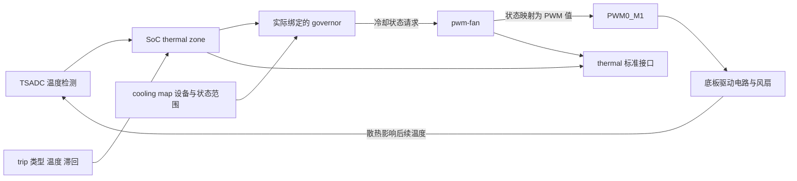

# 09 温控与风扇：从温度观测到冷却动作

上一章的电量计主要向上层报告状态。温控进一步形成反馈：内核观察温度，策略选择冷却强度，驱动改变风扇输出，风量影响后续温度。理解这条链，关键是把“阈值已配置”“策略已运行”“PWM 已输出”“风扇已转动”“温度被有效控制”分成不同证据。

本章以当前 [CM3 DTSI](../../src/rk3566-radxa-cm3.dtsi)、[IO 板 DTS](../../src/rk3566-radxa-cm3-io.dts)、交付内核包中的配置和基础 DTB，以及 [8 页底板原理图](../../原理图/SCH_RK3566底板V2_2025-10-21.pdf) 第 8 页为依据。本目录没有完整 thermal、TSADC 和 pwm-fan 源码；下文需要说明框架行为时，会标为通用原理或上游实现对照。

## 9.1 先读控制关系，不先把两个温度写成开关条件

TSADC 是芯片温度检测控制器。thermal zone 表示需要管理的温度区域；trip 是具有温度值、类型等属性的控制点；governor 是根据温度和控制配置选择动作的策略；cooling device 是能执行冷却动作的设备，例如风扇或参与降频的处理器。

本项目的配置意图是让 SoC 温度管理关联风扇。运行时职责图如下，其中实际是否形成闭环仍需运行证据。



这张图只画运行时反馈，不含内核编译、安装包生成或 DTBO 合并。传感器并不直接读取设备树里的 60°C 后自行写 PWM；动作经过 thermal 设备关系和具体策略。

## 9.2 本地源码与交付 DTB 分别提供什么信息

**源码事实：** DTSI 第 561–563 行将 `tsadc` 设为 `okay`。IO DTS 第 86–91 行定义 `fan0: pwm-fan`；第 216–219 行启用 `pwm0` 并选择 `pwm0m1_pins`；第 242–262 行给 SoC thermal 添加风扇映射并覆盖 `threshold` 为 60000。

其中 `threshold`、`target` 和更底层的 thermal zone 来自被包含的 SoC 文件，本目录没有保存完整定义。因此不能只读本地 IO DTS 就声称掌握了全部 trip、采样周期和 pinmux。

**包内事实：** 本次离线读取 [`linux-image-6.1.84-12-rk2410-nocsf_6.1.84-12_arm64.deb`](../../debs/linux-image-6.1.84-12-rk2410-nocsf_6.1.84-12_arm64.deb) 的以下成员，补充了该交付物的静态信息：

- `boot/config-6.1.84-12-rk2410-nocsf`：默认 governor 配置为 `CONFIG_THERMAL_DEFAULT_GOV_POWER_ALLOCATOR=y`，Rockchip PWM 和 Rockchip thermal 配置为 `y`，`CONFIG_SENSORS_PWM_FAN=m`。
- `usr/lib/linux-image-6.1.84-12-rk2410-nocsf/rockchip/rk3566-radxa-cm3-io.dtb`：保存最终展开后的 thermal、pwm-fan 与 PWM0 引脚信息。
- `lib/modules/6.1.84-12-rk2410-nocsf/kernel/drivers/hwmon/pwm-fan.ko.xz`：风扇模块文件。它与编入内核的控制器驱动不同，还需要运行环境完成正确加载和绑定。

| 项目 | 本地声明或包内数值 | 应怎样理解 |
| --- | --- | --- |
| threshold | 包内 60000 m°C、`passive`、滞回 2000 m°C | 控制点配置；不是独立风扇开关程序 |
| target | 包内 85000 m°C、`passive`、滞回 2000 m°C | 策略参考的另一控制点；不是“到此关闭风扇” |
| soc-crit | 包内 115000 m°C、`critical` | 严重过热保护配置；本次没有实测触发保护 |
| 轮询间隔 | 包内 `polling-delay=1000`、`polling-delay-passive=20` | 单位 ms 的策略更新配置；不是风扇电气 PWM 周期 |
| sustainable-power | 本地与包内为 5000 | 以 mW 表示的持续功率参数；不是风扇额定 5 W |
| 风扇冷却表 | `0 64 128 192 255` | 五个冷却状态对应的 PWM 控制值 |
| PWM | PWM0、通道 0、周期 10000 ns、flags 0 | 请求约 100 kHz 的普通极性 PWM |
| pinmux | 包内 PWM0_M1 引脚为 bank 0、pin 23、function 2 | 对应 GPIO0_C7 的 PWM 复用功能 |

**资料记录：** [`RADXA CM3地面站编译.docx`](../../RADXA%20CM3地面站编译.docx) 的风扇章节曾写目标 75°C，后面的内核 6.1 适配记录又写 85°C。上表的 85°C 依据包内 DTB，不是把两段历史说明合并。当前板实际加载哪个 DT、是否覆盖策略，仍需查运行系统。

## 9.3 从传感器初始化到冷却设备绑定

资源建立可拆成两侧，二者不要求严格按 DTS 书写顺序完成。

这份交付包把 pwm-fan 做成模块，因此“DT 有 fan0”与“驱动代码已进入运行内核”之间还有模块加载环节。通常设备的匹配信息可触发用户空间模块管理机制加载，但本项目 RootFS 的具体规则和当前模块状态没有在本次得到运行验证。模块路径必须与正在运行的内核版本配套；文件存在也不证明已成功插入和执行 probe。

传感器一侧，TSADC 控制器驱动需要匹配、获取控制器资源并向 thermal 框架提供温度读数。thermal zone 把传感器、trip 与策略关联起来。风扇一侧，PWM 控制器先提供 PWM 资源，pwm-fan 驱动根据 `pwms` 取得通道，再把 `cooling-levels` 解释为可接受的状态表，注册 cooling device。cooling map 将已经描述的风扇与 thermal zone 的控制点关联。

**通用原理：** 提供者未就绪时，消费者可能延后探测；资源不存在、配置非法或 PWM 申请失败则应保留错误，不能当作风扇已经可用。注册成功之后也要确认 cooling device 实际与目标 zone 绑定。[Linux thermal 接口说明](https://www.kernel.org/doc/html/v6.1/driver-api/thermal/sysfs-api.html)

**本地源码事实：** IO DTS 的 `map2` 引用 `target`，`map3` 引用 `threshold`；两者均指向 `fan0`，上下界均为 `THERMAL_NO_LIMIT`，`contribution = <8192>`。无显式限制表示允许使用设备支持的状态范围，不表示可以请求任意整数。权重用于策略中的相对关系，8192 不是转速或占空比。

本项目没有提供这些驱动的完整实现，因此不在这里把某个通用注册函数拼成目标 BSP 的已确认调用栈。实际调用链需要配套源码和初始化日志补齐。

## 9.4 五档 PWM 怎样转成物理动作

冷却状态是表索引，PWM 值是索引取得的控制量，转速是电机的物理响应，三者不可混用。

| 冷却状态 | `cooling-levels` 值 | 按 0–255 归一化的近似比例 | 不能直接推出的结果 |
| --- | --- | --- | --- |
| 0 | 0 | 0% | 所有板型都已彻底切断风扇电源 |
| 1 | 64 | 25.1% | 风扇一定能从静止启动，或转速正好为最大值的 25% |
| 2 | 128 | 50.2% | 风量和冷却能力为最大值的一半 |
| 3 | 192 | 75.3% | 当前温度一定下降 |
| 4 | 255 | 100% 请求 | 风扇端必有足额电压，或器件未受阻 |

`pwms = <&pwm0 0 10000 0>` 的第三项是周期，10000 ns = 10 µs，因此频率是 100 kHz。它与 20 ms、1000 ms 的温度更新间隔属于完全不同时间尺度：PWM 硬件持续生成波形，温控策略隔一段时间更新目标强度。

**上游实现对照：** Linux 6.1 `pwm_fan_set_cur_state()` 检查状态范围，查表后调用 `set_pwm()`；后者在 mutex 保护下提交 PWM 状态，成功后更新保存的值。`pwm_fan_probe()` 申请 PWM、读取冷却表并注册接口；设备托管资源与清理动作负责撤销资源。这里用于说明“状态请求到硬件提交”的分工，目标 BSP 是否修改过这些步骤待确认。[上游 pwm-fan.c](https://raw.githubusercontent.com/torvalds/linux/v6.1/drivers/hwmon/pwm-fan.c)

### 执行上下文和锁为什么在这里有意义

策略更新与用户读取/设置接口可能同时到达。锁保护共享 PWM 状态，避免两个软件请求相互覆盖的一部分；它不能证明电机确实转动。申请资源、提交 PWM 和供电切换可能需要可睡眠上下文，不能随意放进硬中断里执行。

PWM 波形由控制器产生，不需要 CPU 每 10 µs 翻转 GPIO。因此策略负载升高可能延迟“何时改变档位”，但不等价于现有 PWM 每个周期都由工作队列调度。如果 PWM 控制器或时钟停掉，则是另一类故障。

### 风扇电路决定软件输出的实际含义

**资料记录：** 旧图第 8 页 CN1 为二线风扇供电接口，PWM0_M1 经 R81 驱动 U31 AO3400。它不是带独立 PWM 输入、转速反馈线的四线风扇接口。图中 AO3400 串在 +5 V 到接口供电的路径，不能不看连接方式就套用“GPIO 拉高等于风扇获得完整 5 V”的结论。

**待确认事项：** 实际器件贴装、栅极驱动余量、风扇端电压波形、最低启动档位及风扇是否适应这类供电调制，需要实物验证。当前风扇节点没有转速反馈配置，所以 `cur_state=4` 只能表示软件冷却请求/保存的状态，不能读作测得满转速。

## 9.5 为什么 60°C、85°C 和默认 governor 仍不足以预测风扇

trip 的类型、滞回、策略和映射共同参与动作选择。60°C 和 85°C 在包内均为 `passive`，不能按“达到第一个数开、达到第二个数关”解释。滞回用于减少阈值附近反复切换，但它也不是另一个独立开关温度表。

**通用原理：** `power_allocator` 根据温度误差和功率模型分配允许功率，其控制目标与简单分档开关不同。即使默认配置选择它，某个 zone 当前是否绑定该策略，也要以运行 `policy` 为准。[Linux power_allocator 说明](https://www.kernel.org/doc/html/v6.1/driver-api/thermal/power_allocator.html)

这里还需要额外核实策略与设备能力的配套。**上游 Linux 6.1 对照：** `gov_power_allocator.c` 检查 cooling device 是否支持 power actor 接口，并在功率分配中使用相应能力；同版本普通 `pwm-fan` 的 cooling ops 只有状态接口。因此，不能仅凭默认 `power_allocator` 配置和 fan cooling map 就断言它会正确控制该风扇。[上游 power allocator 实现](https://raw.githubusercontent.com/torvalds/linux/v6.1/drivers/thermal/gov_power_allocator.c)

**待确认事项：** 目标 Rockchip BSP 是否扩展 governor 或 pwm-fan、实际绑定了什么策略、是否发生回退或绑定失败，均缺完整源码与当前日志证据。本章提出的是配套核验条件，不是认定已现场复现风扇失控。

采用 thermal 框架可把传感器、策略和执行器分开，便于调整散热方案；代价是必须确认策略支持设备能力。直接由应用按温度写 PWM 较直观，但会引入进程退出、调度、权限与多控制者竞争，还必须处理与内核 thermal 的协作。因此本项目现有配置应先讲清并验证框架关系，再考虑是否需要别的控制方案。

## 9.6 只读检查应先看关系，再看状态

以下命令均为后续板端检查步骤，本次未执行。先按 `type` 找到 SoC zone 与 pwm-fan，不能预设编号永远是 0。

```sh
# 检查温度区域、实际策略和冷却设备身份。
for item in /sys/class/thermal/thermal_zone* /sys/class/thermal/cooling_device*; do
    [ -d "$item" ] || continue
    printf '\n%s\n' "$item"
    for key in type temp policy mode cur_state max_state; do
        [ ! -r "$item/$key" ] || { printf '%s=' "$key"; cat "$item/$key"; }
    done
done
```

若温度对象缺失，先查 TSADC 与 thermal 注册；温度正常但没有 pwm-fan 冷却对象，查风扇驱动、PWM 资源和 probe 日志；两类对象都有，再检查该 zone 的 `cdev*` 链接、`cdev*_trip_point` 及各 `trip_point_*` 属性。

`temp` 与 trip 温度通常以 m°C 表示，60000 对应 60°C；`cur_state` 则是冷却状态索引。运行 policy 与包内默认项不一致时，优先解释当前有效策略，不把包内配置当作当前动作原因。

| 现象 | 所属层级 | 检查依据 | 下一步判断 |
| --- | --- | --- | --- |
| 温度一直不变或异常 | 传感器/采样 | zone 身份、TSADC 日志、不同负载下的连续观测 | 确认读对传感器，再排除采样停滞；不要先调风扇表 |
| 温度升高但风扇 state 不变 | 策略/绑定 | policy、trip 类型、cdev 关系、governor 相关错误 | 若未绑定先修关系；若绑定则核策略能力和更新条件 |
| state 已变化但无 PWM 波形 | PWM/pinctrl | 最终 pinmux、PWM 控制器状态、管脚测量 | 查资源与物理输出，不能把软件 state 当作波形 |
| 有 PWM 但风扇不转 | 供电/驱动电路/执行器 | CN1 电压、MOS 驱动、风扇最低启动条件 | 转查电气链，不直接增加 thermal 轮询频率 |
| 风扇转但温度继续升 | 热路径/负载 | 风向、安装、散热接触、功耗与稳定温升 | 转动只证明执行器响应，不能证明散热设计满足负载 |

不需要为了文档主动加热到高温或关闭保护。正常运行负载下已有日志和温度变化可先验证关系；若要验证全温区和保护动作，应另设受控硬件试验及停止条件。

## 9.7 验证范围与自查

本章完成的是源码、包内配置/DTB和原理图对照。它能说明配置意图和实际可读产物，不能证明当前板的 governor 正常运行、风扇各档均能启动或长期散热达标。

完整证据链应逐步补齐：**运行 DT 与策略 → 温度变化 → 冷却状态变化 → GPIO0_C7 的 PWM → 风扇端响应 → 温升改善** 。每一步缩小故障范围，但不能跳过后面的环节。

**问：为什么冷却状态 2 不是 2% 或某个固定转速？**
回答要点：它是 `cooling-levels` 的索引，对应 PWM 值 128；电气比例仍要经过控制器和底板电路，机械转速取决于风扇。

**问：10000 ns、20 ms 和 1000 ms 分别在控制什么？**
回答要点：第一个是 PWM 周期，后两个是 thermal 的更新节奏配置；波形产生与策略计算属于不同时间尺度。

**问：为什么配置了 map 和 governor 仍需查绑定关系？**
回答要点：设备必须成功注册，策略必须支持冷却设备能力，运行系统还可能选择别的 policy。配置存在不能证明控制闭环成立。

**问：风扇不转时，为何不立刻把阈值从 60 改成 40？**
回答要点：先确认温度输入、策略和 state，再确认 PWM 与供电。若根因是 pinmux、驱动电路或风扇启动能力，改阈值并不能修复。

下一章 [部署生效检查](10_部署生效检查.md) 将这些外设链路放回同一台目标系统，建立“交付了什么、加载了什么、绑定了什么、实际观察到什么”的连续证据。
