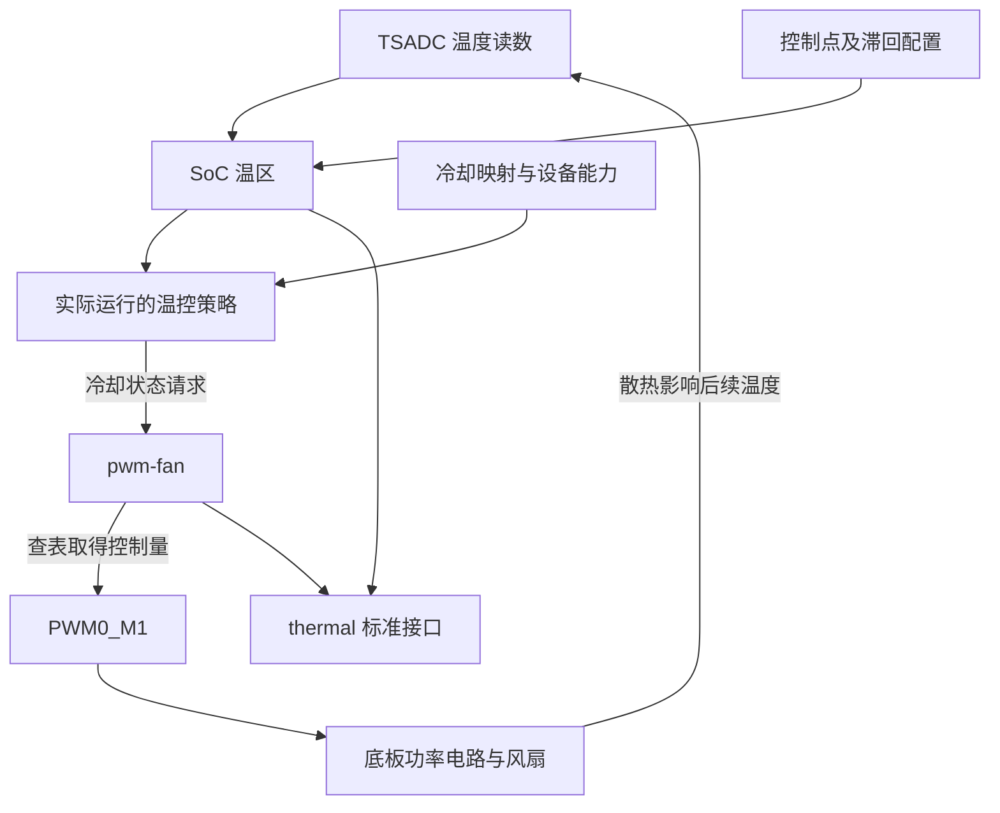

# 09 温控与风扇：温度怎样变成一次冷却动作

上一章追踪电池状态如何被读出来。本章进一步讨论：内核读到 SoC 变热之后，怎样让底板风扇增加散热，以及为什么设备树写了温度和档位，仍不一定能看到风扇转动。

先把目标说清楚：温控要根据温度变化持续调整冷却能力。温度是输入，风扇是执行器；两者之间还需要策略决定“现在应该加强多少冷却”。本项目用 Linux thermal 框架连接这几个角色，用 PWM 控制底板上的风扇供电电路。理解这条链之后，再看 60°C、85°C 和五个档位，才不会把它们误读成两个开关温度。

## 9.1 从发热问题建立控制关系

### 9.1.1 先有可信温度，才谈冷却动作

RK3566 的 TSADC 是芯片温度检测控制器。它负责提供温度读数，不负责直接决定风扇转速。Linux 把需要管理的一组温度关系表示为 thermal zone，本文称“温区”；本项目关心的是 SoC 温区。

只有温度还不够。系统还需要知道从什么位置开始介入、希望把温度控制到什么附近，以及什么情况需要严重过热保护。这些控制点称为 trip，每个点除了温度值，还有类型和滞回等配置。滞回用于避免温度在边界附近轻微抖动时反复改变状态，并不是独立的一套风扇开关程序。

温区把温度和控制点交给 governor，也就是选择冷却动作的策略。策略再通过 cooling device，即能够执行冷却动作的设备，提出请求。本项目的 `pwm-fan` 就是这类设备；它把冷却状态转换成 PWM 控制量。PWM 是周期性改变有效电平持续时间的硬件输出，底板电路根据它改变风扇端的供电。

这条运行链的配置意图如下。图中的每段关系都需要运行证据才能确认为当前板已经建立。



这张图只解释运行时反馈。内核怎样编译、模块怎样进入安装包属于构建流程；驱动怎样取得 PWM 则属于初始化流程，下面分别解释。

### 9.1.2 本项目有哪些确定的输入

[CM3 DTSI](../../src/rk3566-radxa-cm3.dtsi) 的 `&tsadc` 节点启用了温度控制器。[IO 板 DTS](../../src/rk3566-radxa-cm3-io.dts) 定义 `fan0: pwm-fan`，让它使用 PWM0，并给 `soc_thermal` 增加风扇冷却映射。它同时把 `threshold` 覆盖为 60000，并设置 `sustainable-power = <5000>`。

这些是本地源码事实，但还不是全部 thermal 配置。温区、`target` 等基础定义来自本目录没有完整保存的 SoC 包含文件。因此，下面较完整的控制点取自交付内核包中的基础 DTB，不能倒推本地源文件已经足够重建这个 DTB。

## 9.2 启动时，传感器和风扇怎样接到同一温区

### 9.2.1 两端分别准备资源，再建立关系

温度一端需要 TSADC 驱动取得控制器资源，向 thermal 框架提供读数；风扇一端需要 Rockchip PWM 驱动先提供通道，`pwm-fan` 再根据 `pwms` 取得这个通道。风扇驱动还要读取 `cooling-levels`，明确它支持哪些冷却状态，并注册冷却设备。两端都可用之后，温区与冷却设备才能按映射建立控制关系。

这里的先后是资源依赖，不是 DTS 的书写顺序。按照 Linux 的通用机制，消费者遇到尚未就绪的资源提供者时，可能返回延后探测；遇到非法配置或无法取得资源时，则可能直接初始化失败。本目录缺少目标 TSADC、thermal 和 pwm-fan 完整源码，不能把上述职责说明写成这个 BSP 已逐函数核验的调用栈。[Linux thermal 接口说明](https://www.kernel.org/doc/html/v6.1/driver-api/thermal/sysfs-api.html)

还要留意驱动代码何时进入运行内核。[交付内核包](../../debs/linux-image-6.1.84-12-rk2410-nocsf_6.1.84-12_arm64.deb) 的 `boot/config-6.1.84-12-rk2410-nocsf` 中，Rockchip thermal 和 PWM 为内建，`CONFIG_SENSORS_PWM_FAN=m` 则表示风扇驱动被做成模块。包内也确实包含 `lib/modules/6.1.84-12-rk2410-nocsf/kernel/drivers/hwmon/pwm-fan.ko.xz`。

所以“设备树有 fan0”之后，还有“匹配运行内核的模块被加载并成功探测”这一步。设备匹配信息通常可由用户空间模块管理机制用于自动加载，但这里没有当前 RootFS 的实际加载记录。不能因文件在包内就跳过模块状态，也不能在模块未绑定时把无响应归因于温度阈值。

### 9.2.2 cooling map 连接的是控制关系

IO DTS 的 `soc_thermal/cooling-maps` 中，`map2` 将 `target` 关联到 `fan0`，`map3` 将 `threshold` 关联到同一风扇。两项均写 `THERMAL_NO_LIMIT` 作为上下界，`contribution = <8192>`。

`THERMAL_NO_LIMIT` 表示此处没有进一步收紧冷却设备自身允许的状态范围，风扇仍只能接受它支持的档位。8192 是参与策略关系的权重配置，不是转速、频率或占空比。map 也没有写一条“到 60°C 就固定输出 64”的程序；动作怎样变化还取决于实际策略。

这解释了一个常见误判：温区和风扇都出现在 `/sys/class/thermal`，只能说明两类对象已注册。还要检查该温区的 `cdev*` 链接及对应控制点，才知道它们是否按预期关联。

## 9.3 两个温度值为什么不能直接推出风扇行为

### 9.3.1 先读清交付物中的完整参数

本次离线核对的是上述内核包的成员 `usr/lib/linux-image-6.1.84-12-rk2410-nocsf/rockchip/rk3566-radxa-cm3-io.dtb`。其中 SoC 温区的有关参数如下，它们是这份交付物的静态事实。

| 配置位置 | 包内值 | 在控制关系中的含义 |
| --- | --- | --- |
| `threshold` | 60000 m°C，`passive`，滞回 2000 m°C | 一个参与策略的被动冷却控制点 |
| `target` | 85000 m°C，`passive`，滞回 2000 m°C | 另一个参与策略的控制点，不能解释为“达到即关闭风扇” |
| `soc-crit` | 115000 m°C，`critical` | 严重过热保护配置，未进行触发试验 |
| `polling-delay` | 1000 ms | 通常状态下的轮询间隔配置 |
| `polling-delay-passive` | 20 ms | 被动冷却状态下的轮询间隔配置 |
| `sustainable-power` | 5000 mW | 温控策略使用的持续功率参数，不是风扇额定功率 |

`passive` 是控制点类型，不等于风扇只有开与关两个状态。表中的 2000 m°C 是 2°C 的滞回参数，不是增加 2000 ms 延时；它给温度状态的进入和退出留出间隔，具体怎样影响冷却请求仍由框架与策略决定。尤其不能只用 `60 − 2 = 58°C` 就宣称本项目风扇在 58°C 关闭。两个控制点、各自滞回、冷却映射和策略需要一起解释。

[Word 构建记录](../../RADXA%20CM3地面站编译.docx) 的早期风扇段落写过目标 75°C，后面的内核 6.1 适配记录又写 85°C。本章使用 85°C，是因为本次读取的包内 DTB 如此；它不代表早期记录有误，也不能证明当前实板没有加载别的 DT 或覆盖项。

### 9.3.2 默认策略还要与冷却设备能力配套

包内配置选择了 `CONFIG_THERMAL_DEFAULT_GOV_POWER_ALLOCATOR=y`。`power_allocator` 是按温度目标和功率模型分配允许功率的策略，理解它需要把“冷却状态”与“功率”区分开：设备支持几个档位，并不自动说明框架知道每档对应多少功率。[Linux power_allocator 说明](https://www.kernel.org/doc/html/v6.1/driver-api/thermal/power_allocator.html)

按这份上游说明，首个 passive trip 用作策略开始介入的控制点，最后一个 passive trip 用作目标温度。在这套规则下，60°C 与 85°C 分别可以承担这两个角色，85°C 并不是“该关风扇了”。策略根据目标与当前温度之差，并按配置结合历史偏差，计算允许功率，再换算成设备状态。以 CPU 限频式冷却为例，限制允许功率可以减少发热；而“风扇状态 2 对应 PWM 128”并没有给出这种功率换算。仅有这张表还不足以建立策略与执行器之间的能力约定，继续改两个温度数字并不能补上它。

这里有一项必须保留条件的实现核验。上游 Linux v6.1 的 `gov_power_allocator.c` 会检查冷却设备是否支持 power actor 接口；该接口让设备参与功率估算和换算。同版本普通 `pwm-fan` 的冷却操作只有取得最大状态、取得当前状态和设置状态，没有提供这些功率接口。因此，仅凭本项目的默认策略选项与风扇 map，不能推导出策略已经能驱动这个风扇。[上游策略实现](https://raw.githubusercontent.com/torvalds/linux/v6.1/drivers/thermal/gov_power_allocator.c)、[上游风扇实现](https://raw.githubusercontent.com/torvalds/linux/v6.1/drivers/hwmon/pwm-fan.c)

这个对照没有证明目标 Rockchip BSP 一定失败。目标 BSP 可能修改驱动或策略，运行温区也可能使用别的 `policy`。下一步需要配套源码、当前 `policy`、绑定关系和初始化日志，分别确认设备能力与实际行为；不能自行补出“自动回退到另一策略”的结论。

框架化设计的收益是让传感器、策略和风扇可以分别调整，代价就是必须检查它们的接口配套。应用直接按温度写 PWM 看似更短，却需要自己处理进程退出、调度、权限和多个控制者竞争；本项目现有材料没有实现这条替代链，不能把它当成已经部署的补救方案。

## 9.4 一次冷却请求怎样变成风扇端的变化

### 9.4.1 状态先查表，再提交给 PWM 控制器

IO DTS 的风扇节点写了 `cooling-levels = <0 64 128 192 255>`。因此一次“设为状态 2”的请求，首先取出表的第 3 项 128。2 是索引，128 是控制量，机械转速是后面的物理响应。

| 冷却状态 | 表中控制值 | 按 0–255 归一化的近似比例 | 尚不能证明什么 |
| --- | --- | --- | --- |
| 0 | 0 | 0% | 当前板的风扇电源一定完全断开 |
| 1 | 64 | 25.1% | 风扇能够从静止启动 |
| 2 | 128 | 50.2% | 转速、风量或散热能力正好是一半 |
| 3 | 192 | 75.3% | SoC 温度一定开始下降 |
| 4 | 255 | 100% 请求 | 风扇端有足额电压且电机没有受阻 |

上游 v6.1 的 `pwm_fan_set_cur_state()` 先检查状态范围，状态变化时查表调用 `set_pwm()`；提交成功后才更新保存的冷却状态，失败则返回错误。`set_pwm()` 中的 mutex 保护共享 PWM 状态。这些函数说明“接受档位”与“提交硬件”的分工，但不是目标 BSP 已确认的逐函数链路。资源申请与撤销也应看匹配源码；上游 `pwm_fan_probe()` 使用设备托管资源和清理动作管理 PWM 等资源。

这个锁解决软件请求并发访问的问题，无法感知风扇是否卡住。温控策略更新与用户接口访问可能并发，相关资源操作还可能需要可睡眠上下文，不能任意搬到硬中断里。即使软件保存了新的状态，也还要继续确认物理输出。

### 9.4.2 波形周期与温控更新周期属于两个时间尺度

`pwms = <&pwm0 0 10000 0>` 请求 PWM0 的通道 0，周期 10000 ns，flags 为 0。10000 ns 等于 10 µs，对应 100 kHz；这里的 flags 请求普通极性，不能越过底板电路直接解释成风扇电流的极性。

将它与状态 2 连起来，忽略整数舍入的教学算例是：每个 10 µs 周期的有效时间约为 `10 × 128 / 255 = 5.02 µs`。它描述控制脚波形的比例，既不是“每 5.02 µs 给风扇发一次软件命令”，也不能直接换算为电机转速。

IO DTS 为 PWM0 选择 `pwm0m1_pins`。包内 DTB 展开的复用配置是 bank 0、pin 23、function 2，即 GPIO0_C7 的 PWM0_M1 功能。控制器取得这个引脚之后，由硬件持续生成波形，CPU 不需要每 10 µs 手工翻转 GPIO。

与此相对，温区的 20 ms、1000 ms 是更新策略的节奏。策略被延迟调度时，可能推迟“何时换档”，却不等于已有 PWM 的每个周期都在等待工作队列。PWM 控制器时钟或引脚复用失效则是另一层问题，必须分别检查。

### 9.4.3 底板电路决定请求能否成为有效风量

[8 页底板原理图](../../原理图/SCH_RK3566底板V2_2025-10-21.pdf) 第 8 页的 CN1 是二线风扇供电接口。PWM0_M1 经 R81 驱动 U31 AO3400，图中该器件串在 +5 V 到风扇接口的供电路径。这是对供电路径的调制，不能套用带独立 PWM 输入和转速反馈的四线风扇模型，也不能只看 GPIO 高电平就断言风扇获得完整 5 V。

这一连接方式把几个问题留给实物验证：器件实际贴装是否与图一致、栅极驱动余量是否足够、风扇端电压怎样变化、风扇能否适应 100 kHz 的供电调制，以及最低哪一档可以可靠起转。图纸是设计资料，这些都不是本次已测结论。

当前风扇节点没有转速反馈配置。因而 `cur_state=4` 表示的是软件侧状态，不能读作“已测得满转速”。即使观察到转动，也要继续检查安装接触、气流路径和负载下的温度趋势，才能讨论散热能力是否满足要求。

物理响应还需要时间：占空比先改变，电机随后加速，热量再经芯片、散热器和空气传走。因此换档后下一次采样仍升温，并不单独证明调速无效；应在可比负载下观察趋势。反过来，一开机风扇就转也不证明策略已运行：上游 `pwm_fan_probe()` 会先请求最大 PWM，再注册冷却设备。目标 BSP 是否保留这个初值行为待核，检查时应把初始化输出与温度变化引起的调档分开。

## 9.5 检查时，先确定控制关系在哪里断开

以下是后续板端只读检查，本次没有执行，也没有提供模拟实测输出。先通过 `type` 识别温区和冷却设备，不预设编号永远为 0。

```sh
# 查看对象身份、温度、实际策略和冷却状态；不存在的属性会跳过。
for item in /sys/class/thermal/thermal_zone* /sys/class/thermal/cooling_device*; do
    [ -d "$item" ] || continue
    printf '\n%s\n' "$item"
    for key in type temp policy mode cur_state max_state; do
        [ -r "$item/$key" ] || continue
        printf '%s=' "$key"
        cat "$item/$key"
    done
done
```

如果没有 SoC 温区，先回到 TSADC 绑定和注册日志，谈阈值还没有意义。如果温度读数可信而没有风扇冷却对象，接着查匹配内核的 pwm-fan 模块、PWM 资源和 probe 日志。若两类对象都在，再看目标 zone 的 `cdev*` 链接、`cdev*_trip_point` 与 `trip_point_*` 属性，确认关联的是这一个风扇。

有了关系，再读实际 `policy`。它与包内默认选项不同，就要依据当前策略解释状态变化；若是 power_allocator，则继续核实前面的设备能力条件。`temp` 与 trip 温度通常用 m°C，60000 才是 60°C；`cur_state` 则是表索引，不能拿它与温度或 PWM 值直接比较。

若温度在变而状态不变，问题仍可能在策略、映射或更新条件。若状态已变而引脚没有波形变化，下一检查才是 PWM 控制器和 pinctrl。若引脚波形正确而电机不转，转查风扇端供电、MOS 驱动和启动条件，继续缩短 thermal 轮询间隔通常不能解决这类电路问题。若风扇转动而温度继续上升，则要考察热负载与散热能力。

这形成一条不能跨越的证明链：**温度输入可信 → 策略能操作目标设备 → 冷却状态改变 → PWM 到达引脚 → 风扇端有效响应 → 温升得到控制**。每一步只支持它所在的一段，不自动证明后续环节。

## 9.6 本章结论的证据边界

本地 DTSI 和 IO DTS 支持资源、档位和映射声明，是源码事实；包内配置、DTB 和模块成员支持交付物静态内容，是包内事实。原理图支持所画电路的连接关系，Word 支持不同阶段的参数记录，属于资料记录。

通用 thermal 机制和上游 v6.1 源码帮助解释接口职责及配套条件，不能替代目标 BSP 实现。当前板的模块加载、实际策略、PWM 波形、起转能力和长期温升仍待确认。本任务没有通过加热、禁用保护或强制输出进行试验。后续若验证全温区及保护动作，应另设有停止条件的受控硬件试验；先用正常负载下的已有日志与状态变化确认基本关系。

## 9.7 自查问题

1. 温度超过 60°C，但风扇没有转，为什么不能直接认定阈值配置错了？
2. 冷却状态 2、控制值 128、10000 ns 分别表示什么？
3. 包里有 pwm-fan 模块，同时有 cooling map，还缺哪几类初始化和策略证据？
4. 为什么默认 power_allocator 与普通 pwm-fan 之间需要额外核验？
5. 读到 `cur_state=4` 后，怎样继续判断真实散热是否成立？

## 9.8 回答要点

1. 温度必须来自正确传感器，实际 trip、策略、绑定和设备能力都要成立；之后还有 PWM、功率级和风扇本身。先找最早缺失的一段，改阈值不能修复所有层级的问题。
2. 2 是冷却表索引，128 是对应控制量，10000 ns 是 PWM 周期。前两者影响请求强度，第三个决定载波时间尺度，均不能直接等同于转速。
3. 还要确认模块与当前内核匹配且已加载、probe 成功、PWM 资源可用、风扇与目标温区已绑定，以及当前策略支持其能力。包内存在不等于运行生效。
4. 功率分配需要功率相关接口。上游对照中普通 pwm-fan 仅提供状态接口；目标 BSP 是否扩展、实际是否使用该策略，需源码和运行证据，不能预判一定成功或失败。
5. 先区分初始化输出与策略调档，再确认实际 PWM、风扇端响应及起转；最后在可比负载下观察温度趋势。没有转速反馈时，不把软件档位写成实测 RPM。

下一章[部署生效检查](10_部署生效检查.md)把本章的控制链放回整台目标系统，依次确认交付了什么、启动加载了什么、哪些驱动绑定成功，以及接口之后还有哪些物理结果需要验证。
