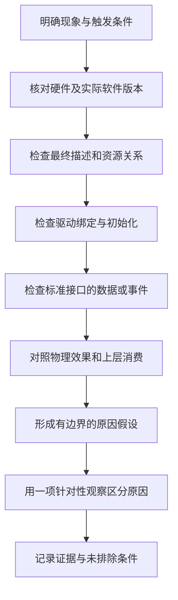

# 11 故障排查与验证：让下一步检查由证据决定

本章承接[部署生效检查](10_部署生效检查.md)。诊断的起点不是“哪个参数最像有问题”，而是把现象放回硬件、描述、驱动、接口、消费者之间，找到最早失去预期关系的一层。

以下均为依据材料建立的**排查方法与待验证假设** ，不是本次现场故障记录。除明确标注的静态文件与包内检查外，没有执行目标板测试，也没有示例实测输出。

## 先固定一次可解释的观察

先记录硬件版本、启动内核、最终设备树与驱动，再描述现象的触发条件：冷启动还是恢复后；只有背光还是有固定图像；单指还是多指；仅插入外部电源时异常还是一直异常。这样才能把“有时不好用”转成具体分支。

同一轮只选一个能改变判断的检查。若检查结果无论怎样都不会改变下一步，它通常不是当前最需要的检查。不同层级的故障可能同时存在，找到一个问题后也不能自动解释所有症状。

这是诊断工作流程，没有把安装包构建步骤混入运行时链路。具体检查命令集中在第 10 章；本章说明不同结果为什么会改变方向。

## 屏幕黑屏：先分清是否连照明都没有

“黑屏”包含多种现象。先观察背光是否发光、是否有极暗轮廓、是否从上电就黑、是否在桌面启动或唤醒后才黑。肉眼只能初分支，最终仍需对应电源、控制信号和像素通道。

| 现象 | 所属层级与可能原因 | 检查依据 | 下一步判断 |
| --- | --- | --- | --- |
| 背光完全不亮 | 背光电源、使能、PWM、blank状态或未注册backlight | 实物供电/使能、sysfs范围和当前值、驱动日志 | 接口缺失先查设备与probe；接口存在但无负载输出，转向PWM和电路 |
| 背光亮但无图像 | 面板供电/reset/命令或DRM→DSI数据链 | 最终route/endpoint、mode、panel错误、供电及复位时序 | 电源时序未成立先处理它；否则继续区分命令与像素输出 |
| 有图但颜色、行列或边缘异常 | 数据格式、lane、时序、传输质量 | RGB888/4lane、67.3MHz与总行列参数、排线与波形 | 固定规律错误优先查模式；偶发花屏还需考虑供电和信号质量 |
| 冷启动能亮，恢复后不亮 | suspend/resume中的电源、reset和命令恢复 | 同一次运行的前后日志与波形 | 不用冷启动成功覆盖恢复链，应比较两次资源和命令顺序 |

**源码事实。** 产品 overlay 将面板供电控制设为 GPIO1_D5、复位设为 GPIO3_C1，背光由 PWM5 与 GPIO4_B3 使能控制。它们不必同时失败，故“背光亮”不能代替测量 panel 的供电和复位。

**条件性风险。** 当前基础 DTS 开启 SDMMC0，其 bus4 引脚包含 GPIO1_D5；包内基础 DTB 已禁用它。如果重新用当前基础源码构建，再加载屏幕 overlay，资源组合可能与现有包不同。先查看最终树与 pinctrl 申请结果，再决定这项冲突是否适用于当前实板。

### 面板命令等待应该怎样判断

7 英寸原始表在 `0x11`（退出睡眠）后等待 120 ms，再发送 `0x29`（开显示）。当前 overlay 的 `15 00 02 11 00` 与 `15 78 02 29 00` 把 120 ms 放在另一条记录上。

如果实际 BSP 解析器按“发送本记录后等待”解释第二字节，则原表要求的等待阶段没有被这两条记录表达出来。它可能影响初始化可靠性，但当前没有匹配的完整 `panel-simple.c` 和实板命令轨迹，不能宣布已经复现某个黑屏故障。

有效的下一步是取得匹配解析器，确认包格式和每个等待点；再把供电、reset、Sleep Out、Display On 与首帧输出放到同一时间线上。一次手工尝试后亮屏，只能支持该组合的一次现象，不能替代完整因果解释。序列详解见[第 06 章](06_显示与背光.md)。

## 背光能亮，但亮度范围或变化不对

先区分三个数：用户写入的亮度索引、亮度表中的映射值、最终 PWM 输出及 LED 电流。把索引当百分比，会错误解释非线性表；把 PWM active-low 当最终亮度反向，也可能忽略光耦及驱动级。

**包内事实。** 普通表有 256 项，PWM 变体为 `[0,60…255]` 共 197 项，默认索引仍是 200。错误在“默认索引超出此表范围”，不是“数值 200 一定超过允许的占空比”。上游 v6.1 的钳制处理只能提供实现对照，目标 BSP 行为仍需匹配源码。

按以下顺序区分原因：先看实际 `max_brightness` 与加载表；再看请求和驱动报告值；最后在具备测量条件时对照 PWM 周期、占空比、使能和背光效果。低亮区没有变化时，可能是表内重复值、电路阈值或实际亮度受限，不能只从一张线性想象曲线判断。

## 触摸异常：把通知、采集、坐标和消费分开

### 没有事件，从最早缺失的一层查

| 现象 | 所属层级与可能原因 | 检查依据 | 下一步判断 |
| --- | --- | --- | --- |
| 没有对应 I2C 设备 | 最终树或总线未建立 | 父控制器status、触摸子节点、设备树来源 | 先修正对象与资源描述假设，不讨论桌面坐标 |
| I2C设备存在但无driver链接 | 未匹配、驱动不可用、probe失败或延迟 | compatible、配置/实际驱动、完整probe日志 | 找到失败的资源或属性，不以目录存在判绑定成功 |
| input节点存在但无事件 | 中断、采集工作状态、I2C、协议就绪位 | IRQ计数、驱动使用IRQ还是轮询、I2C错误及输入能力 | IRQ增长只证明通知到达；还要看采集是否形成有效帧 |
| 原始事件正常但桌面无响应 | 消费者选错设备、输入配置或会话问题 | evdev帧与上层输入选择 | 转到用户态消费者位置，避免再改触摸硬件描述 |

GT9XX 在复位时还利用 INT 电平参与 I2C 地址选择，因此“INT 有一根线”不只影响运行时中断。复位时序或上电电平错误，也可能让代码访问的 `0x14` 与实际器件状态不一致。

对已被驱动管理的器件，首轮检查优先使用标准接口和现有日志。直接读写触摸寄存器会绕过驱动状态与设备应答，不属于本章默认诊断流程。

### 坐标错位，先识别哪一次变换多了或少了

把一次点击的坐标依次记为：芯片 CFG 下的原始 X/Y → 驱动交换/翻转后的 input X/Y → 桌面映射后的画面位置。选中心和四角，是为了区分平移、缩放、轴交换与翻转，而不是为了增加测试数量。

若原始 input 已将左上变为右上，问题在桌面之前；若 input 四角与其公布范围一致而光标仍错位，转查显示旋转与桌面映射。只检查中心点不足以区分旋转，因为许多变换都保持中心近似不变。

**源码事实。** 旧版 probe 虽读取 `max-x/max-y`，将其直接赋给 `abs_x_max/abs_y_max` 的代码已注释，范围还要沿 CFG 和芯片信息追踪。当前 overlay 的 `tp-size=9112` 也不在本地旧分支显式选择列表里。单改两个设备树数值，未必改变最终上报范围。

### 多指、抬起或长时间使用后异常

旧分支的一帧多点数据分成首次和后续读取。后续读取结果未检查即复制，会影响整帧完整性；I2C 辅助函数耗尽重试后可能返回短传输结果，而部分调用者仅判断负数。应先确认一次完整有效读取，而不是把错误字节直接当坐标异常。

对于 slot 路径，原先存在的 ID 消失后应产生释放；对于旧 Type A 分支，要看触点分隔、全抬起和最终同步事件。包内 `CONFIG_CHROME_PLATFORMS` 未启用，本地旧头文件据此选择 Type A，但包中驱动完整源码缺失，实际能力仍应以运行接口确认。不能把 Type B 的释放判据机械套到任何 GT9XX 构建。

延迟突然变大时，要考虑 workqueue 排队、总线重试和复位占用时间。V2.8.7 在 IRQ 线程直接采集，旧分支则多一次队列调度；两者可解释的时延构成不同。V2.8.7 无 IRQ 时的 hrtimer 直接进入可睡眠 I2C 路径，是该源码分支的执行上下文风险，只有确认采用该分支和模式后才关联实际现象。

恢复后只有工作位恢复而无有效事件，也应保留在硬件通信层继续查。详见[第 07 章](07_触摸与input.md)的状态、重试和恢复路径。

## 电量读数异常：先确认读的是哪个供电对象

系统可能同时存在 CW2015、RK817 或外部输入对象。先从设备名称、driver 和 `of_node` 确认来源，再解释 `VOLTAGE_NOW`、`CAPACITY`、`STATUS`、`ONLINE`。字段相似不表示数据来自同一芯片。

| 现象 | 所属层级与可能原因 | 检查依据 | 下一步判断 |
| --- | --- | --- | --- |
| 无CW2015供电对象 | 总线、地址、驱动或probe | I2C3父节点、地址0x62、绑定和日志 | 回到初始化，不先改电池容量 |
| 电压呈数量级错误 | 单位、读错对象或实现换算 | µV等标准单位、实际驱动、测量值 | 先统一单位，再讨论单/双电芯换算 |
| 电压近似合理但SOC异常 | profile、芯片状态、模型与电池不匹配 | 实际电芯/串并结构、64字节profile及驱动消费 | 电压合理不证明SOC模型适用 |
| 插拔外部电源时ONLINE反向 | GPIO角色、有效极性和检测电路 | GPIO3_B4、光耦电路、实际输入变化 | 先分清逻辑和物理电平，再查软件报告 |
| ONLINE=1但电池不充电 | 外部输入检测与实际充电路径不同 | 电池电压、电流、充电硬件状态 | 检测成功不能替代充电电路诊断 |

**源码与资料交叉事实。** 当前 profile 与 Word 中远东 FEB 6 Ah 数据相同，`simple-battery` 声明 6000000 µAh。它们数值相容，但不证明实物电池就是该模型对象。`cellwise,dual-cell` 与 5000 ms 属性是否被实际驱动消费，还要取得匹配 CW2015 源码。

这里的“正确电量”不能仅靠一个显示百分比判断。应记录读数来源、单位、时间与电池状态，再与独立测量和模型适用条件对照。[第 08 章](08_电量与外部供电.md)解释各个对象为什么分开。

## 风扇没有响应：沿控制链逐段判断

温控故障不能仅用“温度超过 60℃”作为充分条件。温度采集、实际 trip、policy、cooling-device 绑定、策略支持、输出档位、PWM 和功率电路都要成立。

| 观察到的状态 | 优先归属层 | 检查依据 | 下一步判断 |
| --- | --- | --- | --- |
| 温区缺失或读数不可信 | TSADC与thermal注册 | type、temp、绑定、日志 | 先确认输入温度有效 |
| 温度变化但fan的cur_state始终不变 | 策略与冷却绑定 | 当前policy、trip_point、cdev链接、governor能力 | 核实是否绑定正确风扇、策略能否操作它 |
| cur_state变化但PWM不变 | pwm-fan到PWM控制器 | cooling-levels、pwms、pinctrl及驱动错误 | 核对资源和实际输出，软件档位不是波形证据 |
| PWM变化但电机不转 | 电源、功率级和负载 | 风扇电压/电流、MOS驱动、启动条件 | 转向电路与风扇，不继续改thermal阈值 |
| 风扇转动但温度继续升 | 散热能力与热负载 | 可比负载下温度趋势、转速或气流条件 | 可能是能力不足，不能只凭“能转”判散热达标 |

**包内事实。** 当前 DTB 的 threshold 为 60℃，target 为 85℃，均为 passive trip，包配置默认 power_allocator。**通用实现对照。** 上游 v6.1 的功率分配策略对 cooling device 能力有要求，普通 pwm-fan 的档位接口未必满足功率分配所需接口。BSP 是否扩展、实际 policy 是什么，需要另核。故“配置了 map”仍不是执行闭环已成立的证据。

当前只有五个配置档位 0/64/128/192/255，没有测得的 RPM 曲线。低档无法起转、极性与功率级余量等问题，需要在正确测点和负载条件下判断，不能由档位值直接推导。完整关系见[第 09 章](09_温控与风扇.md)。

## 从假设到结论，保留四种证据边界

“当前文件里有一个问题”与“它造成当前实板症状”之间至少还隔着版本对应、实际生效和因果验证。

| 层次 | 本项目中的例子 | 结论措辞 |
| --- | --- | --- |
| 源码事实 | V2.8.7 hrtimer调用可睡眠采集；旧分支续读返回值未检查 | 在对应源码路径存在静态风险 |
| 包内事实 | PWM变体默认索引200而表长197 | 此交付物含不成立的索引配置 |
| 资料记录 | 原始panel表要求0x11后等待；Word记录历史成功 | 对特定材料或历史运行成立 |
| 实板待确认 | 当前是否加载该变体、实际解析器怎样解释延迟 | 不能预写故障已复现或修复已有效 |

若之后做针对性修改，应先保存基线，再只改变一个已定位条件，并在同一硬件、版本和输入条件下比较。当前任务保留全部原始材料，仅提供理解和验证路径，未顺带修复这些配置或代码。

## 自查与回答要点

1. **背光亮但无图，第一句应该是什么？** 先说明背光链已有部分物理结果，接着检查独立面板供电、复位、命令和像素链；不能直接归因于应用。
2. **触摸中心正确、四角错，为什么值得记录？** 中心不能区分多种坐标变换，四角能帮助识别轴交换、翻转和缩放发生在哪层。
3. **SOC异常是否先改6000mAh？** 先确认读数对象、单位、profile和真实电池；容量元数据不是所有SOC计算的唯一输入。
4. **风扇状态为2为什么不等于它正在某转速运行？** 档位是软件请求，PWM、功率级和负载还可能改变或阻断物理效果。
5. **何时可以把静态风险写成现场原因？** 已确认对应版本与路径生效，并取得能区分其他原因的运行证据，而非仅凭症状相似。

最后用[项目讲解提纲](12_项目讲解提纲.md)把学习到的机制连起来。能够解释一条正常路径及它最关键的失败分支，才算真正理解适配过程。
