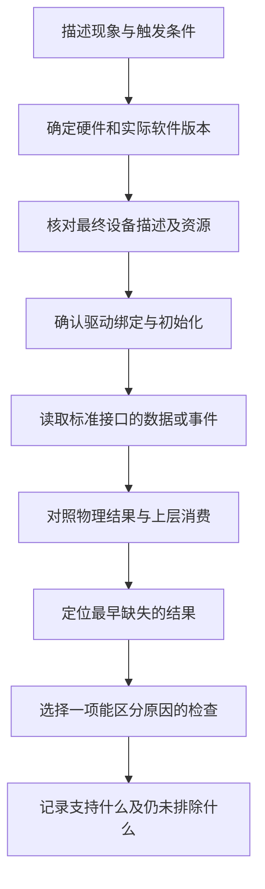

# 11 故障排查与验证：让下一步检查由证据决定

[上一章](10_部署生效检查.md)建立了交付物、启动配置、运行设备树和驱动接口之间的对应关系。现在有了一个现象，例如“屏幕黑”“触摸不准”或“风扇不转”，怎样从这些关系里找到最值得检查的一段？

方法是先找到正常链路上最早缺失的结果，再设计一个能区分原因的观察。例如背光已经发光，就应继续区分面板供电与像素链；不能把所有“黑屏”都从应用程序开始查。本章用几个完整判例说明这件事。判例是依据材料建立的检查路径，没有冒充本次现场故障，也没有未执行命令的模拟输出。

## 11.1 先把现象变成可判断的问题

### 11.1.1 一个症状必须带着版本和触发条件

“屏幕有时不好用”不足以选下一步。应先记录当前底板版本和屏幕型号、启动内核、实际生效 DT/overlay 与驱动分支，然后描述异常发生在什么时候：冷启动就有，还是休眠恢复后才有；完全不发光，还是背光正常但无图；触摸单指正常，还是多指后才卡住。

这样做是因为当前资料里存在 6 英寸与 7 英寸屏、两套底板图、两套 GT9XX 驱动，以及不同 overlay 包。某段源码确实存在风险，也只有在当前系统采用了它时，才可能参与解释当前症状。第 10 章的运行版本与 `of_node` 检查应在这里成为诊断输入，而不是每次都从文件名猜版本。

### 11.1.2 先找断点，再缩小原因

这是排查工作流程，不是各外设必须依次执行的启动流程。实际检查可以从最明显的已知结果切入，再向前或向后追踪。每次检查都应回答一个问题：如果结果 A 出现，下一步查哪里；如果结果 B 出现，又能排除什么。若无论结果怎样都准备做同一件事，这项检查通常不是当前最有价值的一步。

还要允许多个故障同时存在。例如背光使能错误和触摸坐标配置错误可以彼此独立，找到其中一个，不能自动解释另一个。

## 11.2 判例一：屏幕黑，问题先落在哪条链上

### 11.2.1 连照明也没有，先检查背光链

屏幕没有可见图像时，先区分背光是否发光，是否存在极暗轮廓，以及异常是否随亮度请求或开关屏状态变化。肉眼观察只用于分支，不是电源和信号测量的替代品。

如果背光完全不亮，第一段要确认的是 backlight 接口有没有注册。接口缺失时，回看最终背光节点、驱动和 probe 错误；这时调整桌面亮度通常没有对应对象可操作。接口存在后，再按[第 10 章](10_部署生效检查.md)读取范围、请求值和驱动报告值。请求非零仍不亮，才继续区分 blank 状态、PWM、使能、电源和底板负载。

[产品 overlay](../../设备树包/aircas-compact-GCS_overlay.dts) 中，背光用 PWM5，并由 GPIO4_B3 控制使能；面板供电则用 GPIO1_D5，复位用 GPIO3_C1。这是三种独立资源。因此，软件接受亮度请求不证明 PWM 已到引脚，测到 PWM 也不证明使能与背光电源已经成立。只有把检查移到下一段实际输入，才能缩小范围。

### 11.2.2 背光亮但没有图像，继续检查面板和像素通道

此时已有的证据只是照明链产生了物理效果。下一步先确认面板自己的电源与复位，再看初始化命令，最后核对 DRM/VOP → DSI → panel 的像素路径。背光与面板共用一个屏幕组件，不等于它们共用一条软件成功条件。

软件侧可从最终 route、endpoint、DRM connector 的状态和模式、panel/DSI 初始化日志判断配置推进到了哪里。connector 有模式只能证明软件公布了模式，不能证明排线上的高速传输和面板内部状态都正确。硬件侧则要把面板电源轨、复位物理电平和时间间隔对应起来：控制 GPIO 的逻辑“有效”可能经过反相或功率电路，不能直接拿一个逻辑值当供电实测。

这里还要排除“输出没有被使用”与“实际提交的就是黑画面”。按第 10 章区分 connector 的连接状态、候选模式和软件使能状态；如果输出尚未启用，先查桌面选用和显示提交，不急着改面板序列。如果后续用系统已有图形程序呈现非黑固定图样，且能够确认它提交到目标输出，却仍无图，才更有依据继续收敛到 panel 和像素链。该图样检查是待执行步骤，当前材料没有可代替它的应用提交记录。

本项目有一个需要先确认版本的资源条件。[当前 IO DTS](../../src/rk3566-radxa-cm3-io.dts) 启用 SDMMC0，而其 bus4 引脚包含 GPIO1_D5；本次读到的交付基础 DTB 已禁用 SDMMC0。若当前板使用包内版本，这项竞争条件未必成立；若重新使用本地源码构建后又叠加屏幕 overlay，则必须看最终树及 pinctrl 申请结果。正确结论是“这组资源在特定组合下需要检查”，不能写成所有现有板都有冲突。

### 11.2.3 初始化命令也要检查等待发生在哪个阶段

[7 英寸原始面板表](../../阿美林-1000nit-7inch/初始化序列/BOE_7WX_ILI9881C_V04_20210507.txt) 的末段先切回对应命令页，发送 `0x11` 退出睡眠，等待 120 ms，再发送 `0x29` 开显示。这个等待给面板从休眠切换到可显示状态留出时间；它不是看到任意一处“120”就算满足。

当前 overlay 的末段是 `15 00 02 11 00` 与 `15 78 02 29 00`，120 ms 位于第二条记录。如果匹配的 BSP 解析器把第二字节解释为“发送本记录后等待”，则这两条记录没有表达原表要求的 `0x11` 后等待阶段。它是有明确成立条件的静态风险，不能直接宣布为当前黑屏原因。

能改变判断的下一步是取得匹配解析器，先确认包格式，再把面板供电、复位、Sleep Out、Display On 与首帧的时间关系对应起来。本目录缺少完整匹配 `panel-simple.c` 与实板命令轨迹，故暂不能完成这一步归因。独立转换表与 overlay 也不是同一份序列，不能借其中一份的正确性证明另一份；具体差异见[显示与背光](06_显示与背光.md)。

### 11.2.4 已有图像或只在恢复后失败，检查方向会改变

如果已经显示图像，只是颜色、行列或边缘异常，说明链路至少部分建立。对采用当前 7 英寸 overlay 的系统，可继续核对 RGB888、四条 DSI 数据通道、67.3 MHz 像素时钟以及总行列时序。固定规律的颜色或位置错误优先核对格式和模式；偶发花屏还要考虑电源、排线及传输质量。这些数值属于该 overlay，不能直接套给 6 英寸屏。

如果冷启动正常、休眠恢复后黑屏，就保留这两个不同场景。比较同一次运行中挂起前后的供电、复位和命令恢复顺序，比重复证明冷启动能亮更有价值。某个恢复函数返回成功，也不足以证明面板已经重新接收图像。

## 11.3 判例二：背光可用，为什么亮度仍然不对

### 11.3.1 先判断错的是索引范围还是物理效果

一次亮度设置包含三层：上层提出亮度索引，驱动查亮度表取得控制值，再经 PWM 和底板电路改变 LED 电流。索引不是百分比，表中值也不是实测光强。若低亮度区看起来几乎不变，需要先问驱动是否把多个索引映射到相同值，再问电路是否有启动阈值，最后才讨论光学响应。

[普通 overlay 包](../../debs/radxa-overlays-dkms_0.2.4_all.deb) 的普通表为 256 项；[PWM 变体包](../../debs/radxa-overlays-dkms_pwm.deb) 的成员 `usr/src/radxa-overlays-0.2.4/arch/arm64/boot/dts/rockchip/overlays/aircas-compact-GCS-pwm.dts` 使用 `[0,60…255]`，共 197 项，默认索引仍为 200。后者的有效索引只有 0～196，所以问题是默认索引超出表范围，并不是“控制值 200 超过了允许占空比”。

这些是包内静态事实。先查当前最终树采用哪一张表，再读 `max_brightness`；若为 196，与 197 项表相符，但这个数本身仍不是包身份的唯一证明。之后结合日志和匹配驱动判断越界默认值如何处理。上游 v6.1 的钳制行为只能作为实现对照，不能补成目标 BSP 必定崩溃或必定安全钳制的结论。

### 11.3.2 软件值正常之后，再看 PWM 和电路

若范围与请求均符合预期，下一步才把输出周期、占空比、使能与背光效果放在一起比较。`actual_brightness` 是驱动报告值，不是光学传感器测量。PWM 的有效极性也不能越过光耦或后级驱动，直接推导“数值越大一定越暗”。

例如表中重复值可以解释相邻索引输出相同；若表值确实变化而电路输出不变，就应转查 PWM、使能及电流调节条件。这样才能把“软件映射没有变化”与“电路没有响应变化”分开，而不是反复改亮度表试运气。

## 11.4 判例三：触摸无事件、坐标错误或偶发卡顿

### 11.4.1 没有触摸事件，逐层寻找最早缺失的对象

先确认触摸对应 I2C 设备是否存在。不存在时，回看最终树的父总线状态、触摸子节点与当前树来源；总线尚未建立时，讨论桌面映射没有意义。设备存在但缺少 `driver` 链接，则继续核对 `compatible`、实际可用驱动和 probe 日志，区分未匹配、资源错误和延后探测。

如果 input 节点已经建立，再看是否产生事件。IRQ 计数增长只能说明通知到达，不能证明 I2C 成功读出有效触点。此时要先确定驱动实际走 IRQ 还是轮询，再把采集函数、就绪位、读取错误和 input 上报对应起来。若 evdev 已有正常帧而桌面没有响应，则检查上层选了哪个设备及会话输入配置，避免继续改动已经工作的采集链。

在已经确认采用 IRQ 的系统中，可以在操作前后只读 `/proc/interrupts`，按本次驱动登记的中断名和设备关系比较计数，而不按文档预设 IRQ 编号。计数不变时继续查线路、电平、屏蔽状态及实际工作路径；计数增长而没有 input 帧时，继续查读取和上报。共享中断的计数还不能独立归属于这一颗芯片，必须保留这个判断限制。

GT9XX 的 INT 在启动复位阶段还参与 I2C 地址选择，所以它并非只有“触摸发生后发中断”这一个角色。复位时序或上电电平错误，可能让软件访问的 `0x14` 与器件实际选择不一致。判断它需要物理复位和地址选择条件，不能用 input 目录存在替代。

首轮检查使用标准接口和已有日志；对已经被驱动管理的器件，直接访问寄存器会绕过驱动的状态管理与设备应答，不作为本章默认检查步骤。

### 11.4.2 坐标错位，找出变换发生在哪一层

同一次点击在链路中有三个不同的观察位置，但现有工具不一定能同时取得它们：

| 观察位置 | 可以用什么证据 | 能够区分哪一段 |
| --- | --- | --- |
| I2C 帧中的坐标字段 | 匹配驱动中解析前的诊断记录，或已有可归属的总线采集 | 控制器配置和实际输出；`evtest` 看不到这一层 |
| 驱动提交给 input 的坐标 | evdev/`evtest` 的事件及 ABS 范围 | 驱动处理后的结果，还未经过桌面映射 |
| 桌面或应用中的位置 | 同次操作的实际命中位置及用户态变换配置 | 显示方向、设备映射和上层消费 |

先用已经能取得的后两层证据：选择中心和四角，对照 input 公布的最小/最大范围与桌面命中位置。四角用于区分轴交换、翻转、缩放或偏移；中心在多种旋转或翻转下仍近似不变，单测中心不能排除这些错误。比较前还要明确 input 约定的原生方向，不能把横屏桌面的“左上”无条件当成控制器的坐标原点。

若 input 结果符合已经确定的坐标约定，而桌面位置不对应，就查显示旋转和用户态映射。若 input 结果本身不符，只能先将问题缩到桌面之前，仍不能仅凭 `evtest` 区分芯片 CFG 与驱动内变换。那一步需要匹配分支和解析前后的诊断证据；当前若没有这些记录，就明确保留待确认，不绕过在用驱动直接读寄存器。输入范围与显示像素有关联，但任意改成同一组数字不能保证方向、缩放和配置都正确。

这里有两个本地实现条件。旧版 [gt9xx.c](../../云奥-270nit-6inch/mipi_touch%20%281%29/mipi_touch/gt9xx.c) 的 probe 虽读取 `max-x/max-y`，将它们直接赋给 `abs_x_max/abs_y_max` 的两处代码已注释；最终范围还要沿芯片 CFG 与信息读取追踪。同一分支显式处理的 `tp-size` 列表也不包含当前 overlay 的 9112。因此“设备树里写了某个范围”不能证明该驱动最终采用了它。

### 11.4.3 多指和抬起异常，先确认是一帧完整数据

旧分支首次读取后，还可能为多触点续读数据。对应 `goodix_ts_work_func()` 中，续读返回值未检查便复制到解析缓冲；其 I2C 辅助函数还可能在重试耗尽后返回短传输结果，而部分调用方只把负数当错误。于是“没有负错误码”和“完整帧已到手”不是同一件事。这些是对应源码的静态风险，不能跳过版本确认而认定现场已经受影响。

只有在完整有效帧成立后，才继续查触点 ID、按下和释放状态。slot 路径通过更新各触点槽并释放消失的 ID 管理多点状态；旧 Type A 路径则需要看触点分隔、全部抬起及最后同步事件，不能把 Type B 的释放判据套到任何名为 GT9XX 的驱动。

本地旧版 [gt9xx.h](../../云奥-270nit-6inch/mipi_touch%20%281%29/mipi_touch/gt9xx.h) 根据 `CONFIG_CHROME_PLATFORMS` 选择 slot 路径。交付配置没有启用该项，但完整包内 GT9XX 对应源码缺失，因此不能仅据此断言交付内核一定采用本地旧分支。运行 input 能力仍是需要补充的证据。

### 11.4.4 卡顿和恢复失败，要分清等待在哪里发生

旧版驱动在 IRQ 到达后排入 workqueue，由工作函数读 I2C，因此可能多出队列等待；[V2.8.7 分支](../../阿美林-1000nit-7inch/GT9XX通用调试包/gt9xx.c) 的 IRQ 线程直接进入采集路径。两者都可能受到总线重试和复位等待影响，但不能把它们的函数拼成一条调用链后讨论延迟。

V2.8.7 的无 IRQ 分支还有一个需要单独限定的风险：其 hrtimer 回调直接进入包含可睡眠 I2C 操作的采集函数。定时器回调的执行上下文与可睡眠操作不匹配；只有确认运行的是该分支且使用这条轮询路径，才把它列为当前症状的候选原因。

最后，恢复代码清除了标志位或重新允许工作，只能证明软件状态发生了变化。继续取得有效 I2C 帧并形成正常事件，才能证明硬件通信与上报链一起恢复。更完整的版本内调用关系见[触摸与 input](07_触摸与input.md)。

## 11.5 判例四：电量百分比异常，或显示接电却不充电

### 11.5.1 先确认数据来自哪个对象

系统可能同时存在 CW2015、RK817 和外部输入对象。先用设备名称、driver 及 `of_node` 确认来源，再解释 `VOLTAGE_NOW`、`CAPACITY`、`STATUS` 和 `ONLINE`。字段形式相似，并不表示来自同一个测量点。

如果没有 CW2015 的 power_supply 对象，先看 I2C3 是否启用、地址 `0x62` 的设备是否建立、驱动是否绑定，以及初始化日志在哪里失败。这时修改电池容量元数据不能使未建立的 I2C 链突然恢复。如果对象存在，但电压出现数量级错误，先统一标准接口单位，例如 µV 与 V，再核对驱动换算和独立测量；不要立即把差异解释成电池损坏。

### 11.5.2 电压近似合理，仍不能证明百分比可信

电压与 SOC，即剩余电量比例，回答不同问题。当前 overlay 的 `simple-battery` 声明 6000000 µAh，其 64 字节 profile 与[Word 记录](../../RADXA%20CM3地面站编译.docx)中远东 FEB 6 Ah 数据相同。这证明源码与该条记录对应，不能证明实装电池、串并结构及当前电量计状态都符合模型。

因此，电压看起来合理而 SOC 不合理时，下一步核对真实电池对象、profile 是否实际写入和被使用，以及驱动怎样处理测量与状态。只把 6000 改成另一个容量，未必改变真正参与 SOC 估计的参数。`cellwise,dual-cell` 和 5000 ms 更新属性是否被目标驱动消费，也需要匹配 CW2015 源码；本目录的属性声明不足以补出算法。

读数停住时还要区分缓存与新采样。一个接口继续返回数字，并不证明最近一次 I2C 通信成功。应连同时间、错误日志和电池状态观察，再判断是采集失败、旧值保留，还是物理状态本来变化缓慢。

### 11.5.3 ONLINE 的正确性与充电电路的正确性分开验证

如果插拔外部电源时 ONLINE 反向，先核对 GPIO3_B4 是否仍用于外部输入检测，再追光耦输出、GPIO 物理电平与设备树有效极性。不同底板图可能重用管脚；逻辑值错误不一定来自同一版电路，也不能未经测量就把 ACTIVE_HIGH 改成 ACTIVE_LOW。

如果 ONLINE 已合理变化，但电池没有充电，检测链已经提供了一项有效信息：外部输入被识别。下一步转向实际充电电路及其工作条件，观察电池电压、电流与相关硬件状态。`gpio-charger` 不因注册到 power_supply 就自动控制 TP5100 的充电过程。

这类问题的判断边界是：外部输入存在、充电电流流入和 SOC 增长是三个相互关联但不同的现象。一次读到 ONLINE=1 不能替代后两项证据。各对象的职责和数据关系见[电量与外部供电](08_电量与外部供电.md)。

## 11.6 判例五：温度升高了，风扇为什么没有响应

### 11.6.1 先确认温度输入和风扇对象

先按 thermal `type` 确认 SoC 温区，再判断 `temp` 是否可信。温区缺失就回到 TSADC 与 thermal 注册；温度不可信就先检查输入，不能通过改风扇表修复温度采样。

若温区正常而没有风扇冷却对象，检查 pwm-fan 的实际加载和绑定。交付配置为 `CONFIG_SENSORS_PWM_FAN=m`，包内存在模块并不等于当前系统已经加载它。模块与运行内核必须匹配，PWM 资源和 probe 也必须成功。只有风扇对象建立后，讨论它为何不换档才有明确对象。

### 11.6.2 温度在变而档位不变，先看策略关系

本次包内基础 DTB 的 threshold 为 60°C、target 为 85°C，两者均为 passive trip。它们不能构成“60 开、85 关”的直接解释。接着核对当前 policy、trip 属性、`cdev*` 绑定与对应控制点，确认这个温区关联的是这个风扇。

默认 power_allocator 还带来能力配套条件：上游 v6.1 功率分配策略需要 power actor 能力，同版本普通 pwm-fan 只有冷却状态接口。这是上游实现对照，不是目标 BSP 已失效的证据；目标是否扩展过、当前是否使用这一策略，都需另核。若没有配套源码和日志，不能只凭 map 存在认定闭环成立，也不能断言一定回退到了另一策略。

### 11.6.3 档位已经改变，就继续追物理输出

`cur_state` 变化说明软件侧状态变化，不是风扇速度反馈。下一检查是 PWM 控制器与 GPIO0_C7 的 PWM0_M1 输出，再到风扇接口。当前五个档位对应 0、64、128、192、255，没有随包提供的实测 RPM 曲线。

如果档位变了而引脚波形没变，就查 PWM 资源、pinmux 和驱动错误；如果波形变了但风扇不转，就转查供电、MOS 驱动及最低启动条件。[旧底板图](../../原理图/SCH_RK3566底板V2_2025-10-21.pdf)第 8 页是二线风扇的供电调制电路，不能套用四线风扇控制和测速模型。

若风扇确实转动而温度继续上升，还要检查散热接触、风向、气流路径与负载功耗。转动证明执行器有所响应，未证明散热能力足够。下一判断应依据可比负载下的温度趋势，而非继续无目的地降低阈值。完整控制关系见[温控与风扇](09_温控与风扇.md)。

本任务没有为了验证而升温到保护点、关闭保护或强制输出。正常负载下的现有数据可先验证基本关系；全温区和保护动作需要另行安排有停止条件的受控试验。

## 11.7 从候选原因到结论，还差哪些证据

排查时沿用全文的四类标记。源码事实、包内事实和资料记录可以支持具体假设；待确认事项列出仍需补证的关系，本身不是验证结果。只有取得对应的运行和物理证据，才能把假设与当前板联系起来。

| 证据种类 | 本项目的实例 | 能够支持的结论 |
| --- | --- | --- |
| 源码事实 | 旧 GT9XX 续读未检查返回值；V2.8.7 特定定时器路径调用采集 | 对应版本和路径存在静态风险 |
| 包内事实 | PWM 变体亮度表 197 项，默认索引 200 | 这份交付物存在索引配置不一致 |
| 资料记录 | 原始 panel 表要求 `0x11` 后等待；Word 记录某阶段运行情况 | 特定材料提出的要求或历史观察 |
| 待确认事项 | 当前板是否加载该对象，实际解析器及电路如何响应 | 需要运行和物理证据，不能预写已复现或已修复 |

例如“亮度表有风险”和“本次启动黑屏由它造成”之间，还隔着实际采用该表、驱动处理方式、失败时间及其他链路是否正常。若后续获准做针对性修改，应先保存基线，在同一硬件、版本和输入条件下只改变已定位的条件，再比较结果。本次仅重写学习文档，没有顺带修复源码、配置或部署文件。

记录一个检查结果时，至少写清对象与版本、观察条件、实际看到什么、它支持哪一层，以及仍未排除什么。这样以后资料增加时，才能继续收窄结论，而不是把一次“看起来正常”扩展成整机验收。

## 11.8 自查问题

1. 背光亮但没有图像，哪些结果已经成立，哪些仍需检查？
2. 触摸中心正确而四角错误，为什么比“触摸不准”更有诊断价值？
3. 电压合理、SOC 异常时，为什么不先修改 6000 mAh？
4. 温度上升且 `cur_state=2`，能否证明风扇正在以某个固定转速运行？
5. 什么时候才能把代码里的静态风险写成当前实板的故障原因？

## 11.9 回答要点

1. 已有背光链的部分物理结果；面板供电、复位、初始化命令和 DRM/DSI 像素链仍独立需要证据。先确定这几段中最早缺失的结果。
2. 中心可能在多种旋转或翻转下保持不变，四角更容易区分轴交换、翻转和缩放。再对比原始 input 与桌面位置，才能确定变换发生在哪层。
3. 容量元数据不等于电量计模型。应先确认供电对象、单位、真实电池、profile 和目标驱动消费路径，合理电压也不证明 SOC 模型适用。
4. 不能。2 是表索引，对应控制值 128；还需确认策略、PWM、功率级和风扇响应。当前没有节点层面的转速反馈配置。
5. 已确认版本与路径实际生效，并取得能区分其他原因的运行证据。症状相似、文件存在或一次修改后正常，都不足以单独证明完整因果链。

最后用[项目讲解提纲](12_项目讲解提纲.md)把正常流程和失败分支连起来。能够说明数据如何前进，也能够指出哪一项证据会改变下一步判断，才真正具备独立分析板级适配问题的能力。
