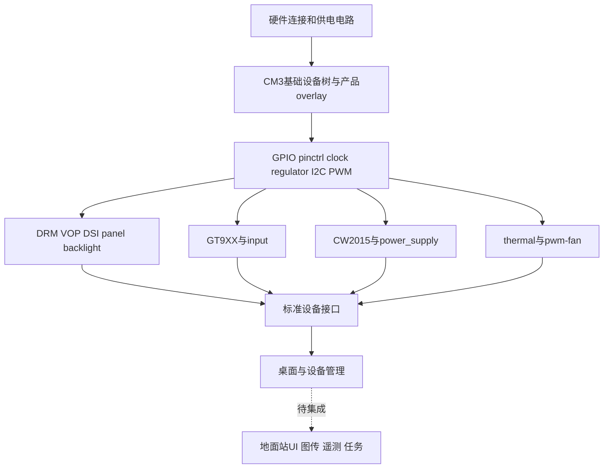
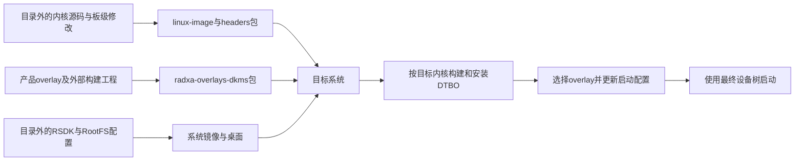
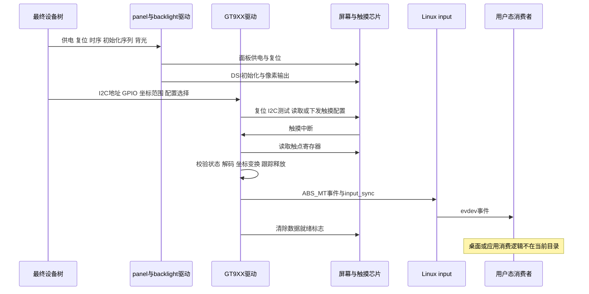
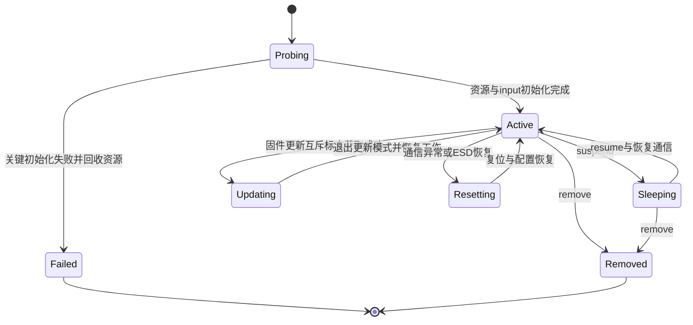

# RK3566_Ground_station 架构解析与业务逻辑全景图

审计日期：2026-09-30。审计对象：`E:\Project\RK3566_Ground_station` 当前文件快照。

**核心结论：本项目当前可审计的主体是 Radxa CM3/RK3566 地面站的板级适配与交付资料，架构主线是“硬件连接与供电 → 基础设备树与 overlay → Linux 驱动 → 标准设备接口 → 桌面与应用”。** 目录包含可分析的触摸驱动源码、设备树源码和 Debian 安装包，但没有完整 Linux/BSP 构建仓库，也没有地面站应用源码。

本文沿两条核心链路展开：① 屏幕显示与触摸输入；② 电量、充电输入与温控。WFB-NG、ROS、QGC 和相机采集仅按已有证据界定其集成位置。

证据分为四类：**源码事实** 是当前文本代码中的行为；**包内事实** 是现有 `.deb` 的配置、脚本、符号和 DTB；**资料记录** 是 Word、原理图或厂商说明中的设计与历史调试结论；**待确认** 是需要完整构建源码或板端运行信息才能确定的事实。本次没有执行 Linux 完整编译、安装、刷机或板端测试。

## 一、项目定位与技术全景

### 1.1 核心业务目标与职责边界

#### 1.1.1 产品目标

[RADXA CM3地面站编译.docx](<E:/Project/RK3566_Ground_station/RADXA CM3地面站编译.docx>) 开篇将目标定义为适合室外使用的高亮、低成本、具备散热能力和 ROS 开发空间的手持无人机地面端。文档给出 RK3566、2 GB LPDDR4、16 GB eMMC 的硬件方案，并规划屏幕、触摸、背光、风扇、电量计、充电检测、无线通信和按键等外设。

这些是产品设计记录。当前目录不能证明成本、屏幕实际亮度、整机功耗、无线距离、地面站业务完整性或现场可靠性已经达到目标。

#### 1.1.2 当前实现覆盖到哪里

| 能力 | 当前可见证据 | 可得结论与边界 |
| --- | --- | --- |
| CM3 基础板级支持 | CM3 `.dtsi`、IO 板 `.dts`、包内 CM3 DTB | 已有供电、存储、总线、显示和风扇等配置；实际启动选择待确认 |
| 7 英寸屏幕 | AIRCAS overlay、ILI9881C 初始化序列、GT911 配置 | 显示、背光、触摸的配置链完整可读；存在版本与时序问题 |
| 电池与充电检测 | CW2015、`simple-battery`、`gpio-charger` 节点 | 声明电量采集和外部电源输入关系；不是软件控制充电算法 |
| 风扇与温控 | `pwm-fan`、thermal cooling maps、内核配置 | 声明温度驱动风扇的内核闭环；实际风扇接线与效果待确认 |
| 6 英寸屏幕 | 云奥面板资料及旧触摸驱动 | 属于另一适配方案，不能直接套用 7 英寸屏幕参数 |
| 相机 | IMX415 调试文档、IMX415/GC2093 FPC 原理图、内核配置 | 有硬件与调试资料；缺少当前 CM3 完整 sensor endpoint 配置及采集应用 |
| 无线图传 | 文档中的 WFB-NG、RTL8812EU 章节 | 属于集成规划；没有对应源码、运行配置或服务清单 |
| 地面站应用 | 文档的 QGC、ROS 描述 | 当前目录没有可追踪的 UI、遥测协议、任务、录像或飞控命令实现 |

因此，本文中的“业务输入”主要是触摸事件、亮度控制和电源状态变化；“输出”是 Linux input、backlight、power_supply 和 thermal 接口。不能据此构造 HTTP Controller、数据库 DAO 或 MAVLink 业务处理链。

### 1.2 技术栈清单及选型动因

下表的优势是对当前结构作用的解释；没有设计记录支持的部分属于工程合理性分析。

| 技术项 | 版本/组件 | 承担职责 | 选型优势 |
| --- | --- | --- | --- |
| 硬件平台 | RK3566 / Radxa CM3 | 提供 ARM64 计算、显示、总线及视频硬件 | 将核心板通用能力与自定义底板连接分开适配 |
| Linux | 包内版本 `6.1.84-12-rk2410-nocsf` | 驱动、调度、电源管理、用户态设备接口 | 外设能力可以通过标准子系统向桌面和应用开放 |
| 根文件系统 | 文档记录 Debian 12 Bookworm；旧方案 Debian 11 Bullseye | 提供桌面、包管理及应用运行环境 | 便于安装开发工具及复用 Linux 应用；当前 RootFS 未随目录提供 |
| 桌面 | 文档记录 XFCE / X11 | 消费显示输出和输入事件 | 可复用桌面环境；实际桌面版本、旋转配置及自启动方式待确认 |
| 驱动语言 | C | GT9XX 通信、触点解析、状态控制和固件更新 | 可以直接接入 Linux I2C、input、IRQ 和电源管理接口 |
| 硬件描述 | DTS / DTSI / DTBO | 声明设备、引脚、供电依赖和显示拓扑 | 从驱动代码中分离板级连接；通过 overlay 组合产品配置 |
| 构建 | Kbuild / Kconfig / Makefile | 选择驱动并组合目标文件 | 与 Linux 内核编译流程一致；完整内核构建环境位于目录外 |
| 分发 | Debian `.deb`、DKMS；overlay 包 `0.2.4` | 分发内核、头文件及 overlay 源码 | 将设备树插件构建与目标内核版本关联起来 |
| 显示 | Rockchip DRM/VOP、DSI0、`simple-panel-dsi`、ILI9881C | 将图像送往 800×1280 面板 | 将 SoC 显示输出与面板初始化参数分开；使用的是厂商 BSP 接口 |
| GPU | 包内 `CONFIG_DRM_PANFROST=m` | 提供图形驱动能力 | 配置具备 Panfrost 模块支持；不能单凭此证明桌面已硬件加速 |
| 触摸 | GT9XX；本地 V2.2 与 V2.8.7 两套代码 | I2C 读取触点、处理中断、报告 input 事件 | 上层应用无需自行处理触摸芯片协议；两套属性接口不同 |
| 背光与散热 | `pwm-backlight` / `pwm-fan` / Rockchip PWM | 控制背光占空比及风扇冷却状态 | 复用内核标准接口，而不是由应用直接翻转 GPIO |
| 电源监测 | CW2015 / `gpio-charger` / `simple-battery` | 关联电量计、设计容量和外部电源在线状态 | 对上层暴露统一的 power_supply 数据模型 |
| 扩展媒体 | CIF / ISP、IMX415、GC2093 | 为相机采集提供底层能力 | 内核包启用了相关组件；完整采集拓扑和业务链未提供 |

没有发现数据库、缓存中间件、消息代理、Web 框架或第三方 API 客户端。内核 workqueue 是驱动的异步执行机制，不应解释为应用消息队列。

## 二、系统架构与分层设计

### 2.1 目录组织与模块拓扑

#### 2.1.1 文件职责

```text
RK3566_Ground_station/
├── src/                         CM3 核心板与 IO 板设备树快照
├── 设备树包/                    基础设备树副本、早期片段、AIRCAS overlay
├── debs/                        ARM64 内核包、开发头文件、两种 overlay 包
├── 阿美林-1000nit-7inch/         7 英寸面板、初始化序列、触摸参数、通用驱动
├── 云奥-270nit-6inch/            6 英寸面板资料、旧版触摸驱动及历史 .o
├── 原理图/                      CM3 引脚表、参考 IO 板和较早底板原理图
├── RADXA CM3地面站编译.docx       设计目标、环境搭建与历史适配步骤
├── IMX415调试.docx               相机调试记录，包含 Zero3 与不同内核背景
└── SCH_*.pdf                    后续底板与两种相机 FPC 电路资料
```

当前目录及检查到的上级位置未发现 `AGENTS.md`；当前目录不是 Git 仓库。没有顶层构建入口、锁定的子模块、CI 配置或自动化测试目录。因此 `src/` 代表设备树材料，并不代表整个系统的源码根目录。

#### 2.1.2 重复文件与版本分叉

字节哈希确认以下文件组各自完全相同：

- `src/rk3566-radxa-cm3-io.dts`、`src/rk3566-radxa-cm3-io.txt`、`设备树包/rk3566-radxa-cm3-io.dts`。
- `src/rk3566-radxa-cm3.dtsi`、`src/rk3566-radxa-cm3.txt`、`设备树包/rk3566-radxa-cm3.dtsi`。

[rk3566-radxa-cm3-io_v1.dts](E:/Project/RK3566_Ground_station/设备树包/rk3566-radxa-cm3-io_v1.dts:1) 以裸的 regulator 节点开头，没有 `/dts-v1/;`、include 或包裹这些节点的根节点；按独立 DTS 文件理解，结构不完整。它更符合“待嵌入其他设备树的历史片段”，不能凭文件名当成可独立编译的完整旧版。

[aircas-compact-GCS_overlay.dts](E:/Project/RK3566_Ground_station/设备树包/aircas-compact-GCS_overlay.dts:1) 与普通 overlay 包内 `aircas-compact-GCS.dts` 按行归一化后内容一致，原始字节差异来自 CRLF/LF。PWM 包还增加了 `aircas-compact-GCS-pwm.dts`，其亮度表发生实质变化。

#### 2.1.3 基础源码与交付包并非同一配置快照

读取内核包中的 `rockchip/rk3566-radxa-cm3-io.dtb` 并解析其节点后，发现：

| 配置对象 | 当前基础源码 | 内核包内 CM3 DTB | 含义 |
| --- | --- | --- | --- |
| HDMI | IO `.dts` 中开启 HDMI、VP0 输入与 route | `hdmi`、`route_hdmi` 为 `disabled` | 包内基础显示配置已经不同 |
| PCIe2x1 | IO `.dts` 将核心板的 `disabled` 覆盖为 `okay` | `disabled` | 最终硬件启用范围不同 |
| SDMMC0 | IO `.dts` 中 `okay` | `disabled` | 包内避免了部分 SD 引脚占用；源码再构建会改变此条件 |
| CH482D 供电节点 | 存在 GPIO3_C7、GPIO3_C6 两个节点 | 未发现对应节点或符号 | 当前源码新增内容不能认为已经进入此包 |
| 风扇 PWM0 | `pwm0m1`、周期 10000 ns | 同为 GPIO0_C7 / PWM0_M1、周期 10000 ns | 风扇基础配置在这两份材料中一致 |
| I2C1、I2C3、PWM5 | 产品 overlay 用于开启 | 包内基础 DTB 中均 `disabled` | 安装内核包后仍需要产品 overlay 生效 |

包内 DTB 的 model 为 `Radxa CM3 IO Board`，compatible 为 `radxa,cm3-io`、`radxa,cm3`、`rockchip,rk3566`。这验证了交付包带有 CM3 板级目标；不能证明板端正在使用它。

### 2.2 核心分层架构

#### 2.2.1 分层与依赖方向



设备树组织“有哪些设备、接在哪里、依赖谁”，驱动组织“如何与设备交互”，Linux 子系统组织“上层如何访问这些能力”。这是硬件描述驱动的分层架构，带有事件驱动和后台周期任务；当前材料没有应用级 Controller/Service/DAO 分层。

#### 2.2.2 配置组合不是串行执行脚本

[核心板 `.dtsi`](E:/Project/RK3566_Ground_station/src/rk3566-radxa-cm3.dtsi:10) 引入 `rk3566.dtsi` 与 `rk3568-linux.dtsi`，声明 RK817 供电、IO 电压域、eMMC、SDIO、GPU、VOP 和媒体单元等。此处两个 SoC include 的完整文件不在本目录。

[IO 板 `.dts`](E:/Project/RK3566_Ground_station/src/rk3566-radxa-cm3-io.dts:10) 引入核心板 `.dtsi`，进一步定义风扇、RTC、USB 供电、SD 卡、HDMI、音频、LED 和板级 pinctrl。后出现的同节点属性会覆盖之前的定义；不能只读核心板 `.dtsi` 就判断最终状态。

产品 overlay 使用 `/plugin/;`，通过 `&dsi0`、`&i2c1`、`&i2c3` 和根路径扩展最终设备树，添加屏幕、触摸与电池相关节点。`backlight`、`power-supply`、`tp-supply`、`monitored-battery` 和 `remote-endpoint` 等 phandle 引用组成依赖图。overlay 的标签引用需要基础 DTB 提供可解析符号；已在现有包内确认相关 `__symbols__`。这一机制与 Linux 的 [overlay 说明](https://www.kernel.org/doc/html/v6.1/devicetree/overlay-notes.html)一致，但项目在启动加载器还是运行中的内核应用 overlay，仍需板端启动配置确认。

`metadata.exclusive` 列出 `dsi0`、`vp0`、`video_phy0`、`pwm5`，属于 overlay 管理工具使用的资源元数据。它不是内核互斥锁，也没有列出所有 GPIO 和 I2C 资源。

## 三、核心主干流程全周期解析

### 3.1 系统启动与初始化链路

#### 3.1.1 构建、分发和启用

系统存在三条互相汇合的交付支线：内核及基础 DTB、overlay 源码包、RootFS 镜像。它们在目标系统组合，不能把“先编译内核，再编译全部应用”写成此目录内已经存在的一条顶层流水线。



Word 文档记录了旧的 `bsp/rbuild` 方案和后续 `linux-rk2410-nocsf`、`radxa-overlays`、RSDK 方案。这里的命令属于历史构建记录；因为源码工程和版本锁定不在目录中，本文不把它们视为当前可直接执行的重建入口。

包内脚本给出的实际安装关系是：

1. `linux-image` 的维护脚本将内核版本和 `/boot/vmlinuz-6.1.84-12-rk2410-nocsf` 传给 `/etc/kernel/*inst.d`、`*rm.d` hooks。设置 `INITRD=Yes` 表示供 hook 消费的意图；是否生成或更新了 initramfs、启动配置，要看目标系统的 hook。
2. overlay 包安装源码到 `/usr/src/radxa-overlays-0.2.4`，`postinst` 调用 DKMS `common.postinst`。其 `dkms.conf` 设置 `AUTOINSTALL=yes` 和构建、安装、删除回调。
3. `dkms.post_build` 从各厂商目录保存生成的 `.dtbo`；`dkms.post_install` 将对应目录链接到 `/usr/lib/linux-image-<kernelver>/<vendor>/overlays`。目标内核不支持该 vendor 或已经带有实际 overlay 目录时，脚本会跳过。
4. 系统存在 `rsetup` 时，安装回调调用 `rsetup rebuild_overlays <kernelver>`。文档另有使用 `rsetup` 选择 overlay 的步骤。安装了包、生成了 DTBO、选中了插件、启动时应用成功，是四个不同状态。

`linux-headers` 用于目标内核相关的外部构建；`linux-libc-dev` 提供用户态 Linux UAPI 头文件。后者不能代替前者，也不决定正在运行的内核版本。

#### 3.1.2 启动到驱动绑定

通用 Linux 启动关系可概括为：引导程序装载内核与最终设备树 → 内核初始化总线及资源提供者 → 匹配设备的 `compatible` → 调用驱动 `probe` → 注册子系统接口 → 用户态启动桌面或应用。**本目录没有 loader、U-Boot、分区表、启动配置或 systemd unit，故具体引导阶段、根分区和自启动服务待确认。**

包内 `.config` 确认 `CONFIG_TOUCHSCREEN_GT9XX=y`、`CONFIG_BATTERY_CW2015=y`、`CONFIG_CHARGER_GPIO=y`、`CONFIG_BACKLIGHT_PWM=y`、`CONFIG_PWM_ROCKCHIP=y` 和 `CONFIG_DRM_PANEL_SIMPLE=y`。其中 `y` 表示相关驱动编入内核，不需要把它们一概描述为启动时执行 `insmod`。

供电依赖是初始化的前置条件：RK817 和 fixed regulator 提供资源，pinctrl 选择引脚功能，I2C 控制器建立总线，触摸和电量计才能绑定。内核框架通常支持资源未就绪时延迟探测；本地厂商驱动对错误和延迟探测的处理并不全部一致，详见 4.3。

#### 3.1.3 触摸初始化的源码落点

与产品 overlay 属性风格对应的旧分支，可在[云奥 `goodix_ts_probe()`](<E:/Project/RK3566_Ground_station/云奥-270nit-6inch/mipi_touch (1)/mipi_touch/gt9xx.c:2630>)观察到：检查 I2C 能力 → 分配 `goodix_ts_data` → 读取 `tp-size`、GPIO、`max-x/max-y` → 获取并开启 `tp` regulator → 初始化锁和 work → 请求 GPIO、复位 → I2C 测试和版本读取 → `gtp_init_panel()` → 注册 input → 请求 IRQ 或采用轮询。

本地旧分支只显式处理 `tp-size` 为 89、101、911、970、910 的选择，不能据此声称它已经支持 overlay 中的 9112。包内 `System.map` 存在 `goodix_ts_probe`、`goodix_ts_work_func` 和 `gtp_dat_gt9112`，表明打包内核包含进一步适配的旧驱动家族；对应完整修改源码仍缺失。

阿美林通用包的 [V2.8.7 `gtp_probe()`](E:/Project/RK3566_Ground_station/阿美林-1000nit-7inch/GT9XX通用调试包/gt9xx.c:1993) 则采用 `goodix_ts_platform_data`、`gtp_parse_dt()`、`vdd_ana/vcc_i2c` regulator 和不同 GPIO 属性。它是另一条可审计的供货驱动路径；当前产品 overlay 不能不做转换就与它配套。

### 3.2 典型业务执行流

#### 3.2.1 主链路一：显示输出与触摸输入

显示输出与触摸输入共享屏幕组件，但使用不同的硬件总线和驱动。DSI 输出像素，I2C 读取触点，GPIO 提供复位和中断，PWM 调节背光。DSI 接通并不能证明触摸可用；背光亮起也不能证明像素链路正常。



**显示侧入口。** overlay 的 `dsi_panel` 节点声明 `simple-panel-dsi`，引用 `vcc_lcd_mipi` 和 `backlight`；`route_dsi0.connect = <&vp0_out_dsi0>` 将 VP0 路由到 DSI0。`panel_in_dsi` 与 `dsi_out_panel` 的双向 `remote-endpoint` 将 DSI 输出和 panel 输入连接成图。

节点还配置 4 lane、RGB888、video/burst/LPM 等 DSI 标志，并给出 `prepare/reset/init/enable` 延迟 20/5/5/120 ms。Word 文档说明的 `panel_simple_prepare()`、`panel_simple_enable()`、`panel_simple_disable()` 和 `panel_simple_unprepare()` 是对应 BSP 中的生命周期回调；本目录没有 `panel-simple.c`，包内符号只能确认存在部分相关函数，不能确认文档中的手工补丁已经编入内核。

**触摸侧入口。** 对本地旧分支，`goodix_ts_irq_handler()` 关闭触摸 IRQ 后向全局单线程 `goodix_wq` 提交 work；`goodix_ts_work_func()` 在可睡眠的工作上下文读取 I2C。正常模式下它从 `0x814E` 读取状态和首个触点，检查就绪位与触点数量，多触点时继续读剩余记录。

每个触点记录含 ID、X、Y 和宽度/压力信息。坐标由低字节与高字节合成为 16 位数；`gtp_touch_down()` 根据配置交换 X/Y，再做 X/Y 反转，然后调用 `input_mt_slot()`、`input_report_abs()` 等接口。上一帧存在而当前帧消失的触点，通过 `gtp_touch_up()` 报告 tracking ID 为 `-1`。`input_sync()` 将本轮事件组成完整输入帧。

正常工作结束时，驱动向坐标寄存器写结束命令、清除就绪标志，再重新启用 IRQ；raw/diff 调试模式有不同的清除策略。这是设备事件应答，不是磁盘落地或数据库提交。Linux [多点触摸协议](https://www.kernel.org/doc/html/v6.1/input/multi-touch-protocol.html)解释了 slot、tracking ID 与同步帧的含义。

V2.8.7 的执行结构不同：`gtp_irq_handler()` 直接调用 `gtp_work_func()`，再由 `gtp_get_points()` 解码、`gtp_mt_slot_report()` 报告；IRQ 通过 `request_threaded_irq(..., IRQF_ONESHOT, ...)` 注册。不能把两份源码的函数拼成同一调用栈。

#### 3.2.2 主链路二：电量监测、外部电源状态与温控

这条链路由几个内核子系统协作，没有项目自建的服务层或数据库。

| 环节 | 输入与配置 | 处理关系 | 对上层的结果 |
| --- | --- | --- | --- |
| 电池描述 | `simple-battery`、6000000 µAh | 提供 6000 mAh 设计容量元数据 | 供电量计引用，不是一次实测电量 |
| 电量计 | I2C3、地址 `0x62`、CW2015、64 字节 profile | 驱动读取芯片状态并关联电池描述 | power_supply 属性，具体名称与数值范围待板端确认 |
| 监测间隔 | `cellwise,monitor-interval-ms = <5000>` | 配置希望每 5 秒监测一次 | 当前绑定驱动是否消费这一属性待确认 |
| 外部电源 | GPIO3_B4、`gpio-charger`、active high | 描述外部供电输入的逻辑在线状态 | 不能直接等价为“电池正在充电” |
| 电量计关联 | `power-supplies = <&mains_charger>` | 提供上游供电关系 | 充电状态的计算规则需要对应驱动源码确认 |
| 温度 | TSADC 与 thermal zone | thermal trips、governor 和 cooling maps 选择冷却状态 | 提供温度及冷却设备状态 |
| 风扇 | PWM0_M1、GPIO0_C7、10000 ns 周期 | `pwm-fan` 将冷却档位映射到 PWM | 档位为 0/64/128/192/255；电机转速和效果待实测 |

`cellwise,dual-cell = <1>` 在注释与设计记录中表示 2S 电池方案；它属于具体驱动消费的属性，不能只凭字段名断言电压换算已经正确。Word 文档列出 2S 4000 mAh 和远东 FEB 6 Ah 两份 profile，当前 overlay 的 64 字节内容与后者一致，与 6000 mAh 设计容量对应。实际装配电池是否属于这份模型覆盖的电芯，仍待确认。

风扇节点由 `soc_thermal.cooling-maps` 绑定到 `threshold` 与 `target`。本地 IO DTS 将 threshold 设为 60000 m°C；包内 DTB 为 60°C，target 为 85°C。包内 `.config` 的默认 governor 为 `power_allocator`。这些值说明配置的控制关系，不能简化为“60°C 开、85°C 关”；真实状态还取决于有效 trips、governor、供电和风扇能力。

power_supply、thermal 和 backlight 的 sysfs 文件由驱动注册，文件内容通常是实时或缓存的内核状态；它们不是配置数据库，也不会自动形成持久化业务日志。

### 3.3 状态机与关键数据模型

#### 3.3.1 核心数据结构

| 数据模型 | 位置 | 内容与生命周期 |
| --- | --- | --- |
| `goodix_ts_data`，旧分支 | 云奥 `gt9xx.h` | I2C client、input、work、timer、IRQ 锁、坐标范围、更新/休眠标志；随 probe/remove 存在 |
| `goodix_ts_platform_data` | 阿美林 `gt9xx.h:82` | GPIO、坐标范围、最大 ID、配置数据、轴变换、手势及更新策略；解析设备树后保存 |
| `goodix_ts_data`，V2.8.7 | 阿美林 `gt9xx.h:149` | flags、input、regulator、pinctrl、ESD work、固件信息等运行状态 |
| `goodix_point_t` / `point_data` | 两套 `gt9xx.c` | 单轮触点原始记录或解码值，不是持久化实体 |
| `pre_touch` / slot 状态 | 旧分支 work 与 Linux input | 保留上一帧触点集合，判断按下、持续、释放 |
| panel/route/endpoint 节点 | AIRCAS overlay | 供电、复位、显示模式与连接图；属于启动配置 |
| battery/CW2015/charger 节点 | AIRCAS overlay | 设计容量、profile、地址、上游供电关系；不存储任务和用户数据 |

#### 3.3.2 触摸生命周期与恢复

V2.8.7 明确采用 flags 表示 `WORK_THREAD_ENABLED`、`SLEEP_MODE`、`DOZE_MODE`、`POWER_OFF_MODE`、`FW_UPDATE_RUNNING`、`PANEL_RESETTING` 等状态。以下是对其状态关系的归纳，图中状态名称不表示代码中存在同名 enum：



休眠时先阻止重复 suspend、关闭 ESD 和正常报告，再按配置进入 doze、断电或 sleep；恢复时重新建立工作条件，再开启数据处理。正在固件更新时，suspend/resume 会退出，避免更新期间改变芯片电源状态。

其 `gtp_resume()` 即使恢复失败也会清除 `SLEEP_MODE` 并开启 work，因此“软件状态回到 Active”并不严格证明“硬件通信恢复”。这是状态机的容错边界。

#### 3.3.3 数据落地与退出边界

当前可确认的持久化对象是源码、面板/触摸配置、Debian 包，以及目标系统安装后的内核与 overlay 文件。GT9XX 配置下发是否写入芯片非易失存储取决于具体芯片和更新流程，不能一概称为项目数据库。

旧分支的 GT9XXF 兼容代码还出现 `/data/gtp_ref.bin`、`/data/gtp_clk.bin` 等路径，但相关分支的部分处理被注释，不能据此认为正常 GT911 场景每次都写文件。当前没有用户设置保存、遥测历史、任务存储、录像归档或数据保留策略的源码。

正常退出或卸载应先停止 work/timer 和 IRQ，再注销 input 与调试节点、释放 GPIO 和电源引用。两套 vendor 驱动都有 remove/exit 路径，但资源收尾的完整性需要按具体分支评估，不能由“存在 remove 函数”推导为全部路径安全。

## 四、关键技术实现与设计模式深潜

### 4.1 核心算法 / 复杂机制剖析

#### 4.1.1 DSI 命令序列：把厂商寄存器表变为驱动输入

[BOE 原始序列](E:/Project/RK3566_Ground_station/阿美林-1000nit-7inch/初始化序列/BOE_7WX_ILI9881C_V04_20210507.txt) 使用 `REGISTER` 和 `Delay` 记录面板初始化。overlay 转换为 BSP panel 驱动消费的字节记录，按文档定义为：`数据类型 / 执行后延迟 / payload 长度 / payload`。

| 记录 | 含义 | 为何需要 |
| --- | --- | --- |
| `39 00 04 FF 98 81 03` | 长写；payload 为 `FF 98 81 03` | 切换 ILI9881C 寄存器页 |
| `15 00 02 01 00` | 带一个参数的短写 | 写面板寄存器 |
| `05 00 01 28` | 无参数短写 | 面板退出序列中的 display off |

本次逐条解析 overlay，得到 194 条长度自洽的记录。**结构自洽只说明记录可以按格式拆解，不说明面板参数或时序正确。**

这里存在实际的语义偏差：原始表末尾是 `REGISTER,11,01,00` → `Delay,120` → `REGISTER,29,01,00`；当前 overlay 则是 `15 00 02 11 00` → `15 78 02 29 00`，把 120 ms 延迟放到了 `0x29` 执行后。若驱动按文档所述“执行后延迟”解释，则 sleep out 与 display on 之间缺少厂商要求的等待。后续 `enable-delay-ms=120` 位于另一生命周期阶段，不能自动修补这两个命令之间的间隔。

[独立转换文件](E:/Project/RK3566_Ground_station/阿美林-1000nit-7inch/初始化序列/panel_init_sequence.txt) 有 195 条记录，在同一位置还重复发送了 `0x29`。这说明初始化序列已有多份派生版本；修正时应回到同一份原始厂商表，再统一生成与打包。

#### 4.1.2 显示时序、刷新率与带宽

overlay 的有效区域是 800×1280，横向 porch/sync 为 18/18/18，纵向为 20/10/4，pixel clock 为 67.3 MHz。因此：

```text
Htotal = 800 + 18 + 18 + 18 = 854
Vtotal = 1280 + 20 + 10 + 4 = 1314
刷新率 = 67300000 / (854 × 1314) ≈ 59.974 Hz
4-lane RGB888 估算 = 67.3 MHz × 24 / 4 ≈ 403.8 Mbps/lane
```

最后一行只是按像素时钟分摊的负载估算，实际 lane rate 还受 packet 开销、传输模式、PHY 与 PLL 约束影响。源码中的 `rockchip,lane-rate = <480>` 已注释，当前设计让驱动决定速率；不能将 480 Mbps 写成实际配置。

GPU 负责渲染、VOP 负责组织显示输出、DSI 负责传输、面板接收并显示；视频解码器是另一条能力路径。GPU 模块被编译或媒体节点为 `okay`，都不足以证明某个地面站应用已经使用硬件渲染或解码。

#### 4.1.3 PWM 亮度映射与物理极性

背光配置周期为 50000 ns，即 20 kHz。`brightness-levels` 是索引到驱动归一化值的查找表，`default-brightness-level` 是索引。普通表有 256 项、默认索引 200；PWM 变体有 197 项，有效索引 0～196，却仍设置 200。

Linux v6.1 上游 [pwm_bl.c](https://raw.githubusercontent.com/torvalds/linux/v6.1/drivers/video/backlight/pwm_bl.c) 会对超范围默认索引报警并钳制到最大值。因此这里首先是默认配置错误，不能直接判定为数组越界或系统崩溃；打包 BSP 的具体处理仍需其源码或运行日志确认。

`PWM_POLARITY_INVERTED` 改变物理波形的有效极性；历史屏幕电路中还有光耦信号隔离和恒流背光供电。查找表、PWM 极性、光耦输出及 LED 驱动响应共同决定最终亮度，不能仅根据“越小越亮”的注释认定用户亮度方向。默认亮度应结合实际背光接口与测量结果解释。

风扇另用 PWM0，周期为 10000 ns，即 100 kHz；这是源码配置的频率，是否匹配实际风扇输入规格待确认。

#### 4.1.4 触摸配置选择、校验和坐标变换

旧驱动的 `gtp_init_panel()` 根据 panel/芯片选择与 sensor ID 决定配置组，检查组长度、芯片配置版本，复制配置并计算字节累加的二补数校验；配置版本被视为固定时，也有保留芯片现有配置的分支。V2.8.7 则可通过 `goodix,cfg-groupN` 等设备树属性读取配置组。两个接口的“配置放置位置”不同。

对[7 英寸 GT911 参数文件](E:/Project/RK3566_Ground_station/阿美林-1000nit-7inch/GT911_700190_20191129_164215_800_1280_V96.cfg)，本次确认：186 字节、版本 96、编码尺寸 800×1280、含校验字节的累加结果模 256 为 0、fresh 字节为 1。这是参数文件完整性证据，不能证明打包内核使用了这份参数，更不能证明电容矩阵适配和触摸轨迹正确。

overlay 的触摸范围为 1280×800，panel 原生为 800×1280，并设置 `rotation=<90>`。它们体现了横屏使用意图，但内核 panel orientation、驱动 X/Y 变换和 X11 输入映射可能叠加。必须把触摸原始坐标、input 范围和桌面显示方向放在同一坐标关系中核对；不能随意再加一次轴交换。

#### 4.1.5 固件更新与 ESD 恢复

V2.8.7 的 `gup_update_proc()` 先检查更新条件、原子取得 `FW_UPDATE_RUNNING`，加载并校验固件，关闭普通报告和 ESD，再进入更新模式，按 SS51/DSP/boot 等区域执行烧写与校验，失败时进行有界重试，最后退出更新模式、释放固件、清标志并恢复工作。

这是芯片维护流程。文件校验、读回检查和重试改善了单次更新的可靠性，但代码没有提供可据此证明的双分区原子切换或断电回滚机制。旧分支的 `GTP_AUTO_UPDATE=0`、`GTP_ESD_PROTECT=0` 也说明“目录中有实现”与“该方案默认启用”是两件事。

### 4.2 运用的设计模式及收益

这些是由代码结构归纳的模式，不表示项目作者显式采用了某种应用架构框架。

| 模式/机制 | 生效位置 | 实际收益与边界 |
| --- | --- | --- |
| 声明式配置、资源依赖图 | DTS phandle、regulator、pinctrl、endpoint | 将板级接线从通信逻辑中分开；属性必须被正确版本的驱动消费 |
| 框架回调与控制反转 | I2C `probe/remove`、IRQ、PM、DRM panel 回调 | 内核管理生命周期，设备代码实现相应动作 |
| 策略选择 | 芯片/配置组、IRQ/轮询、Type A/Type B 报告、sleep/doze | 同一驱动可适配多个组件；大量分支也增加组合验证成本 |
| 观察者/通知 | FB notifier、input 事件、sysfs notify | 由显示电源变化或输入事件触发后续动作，减少应用直接轮询芯片 |
| 状态机 | flags、更新/休眠/复位状态 | 限制互相冲突的操作；状态位不能替代通信成功证据 |
| 异步工作队列 | 旧分支 `goodix_wq`、ESD delayed work | 将有睡眠需求的处理移出即时事件入口，集中处理触摸事件 |
| 资源生命周期管理 | `devm_*`、显式错误标签与回收路径 | 失败后释放已申请资源；devm 不会自动平衡所有 regulator enable 引用 |
| 单设备全局上下文 | `i2c_connect_client`、`cmd_head`、`pre_touch` | 适合单触摸屏假设；同时支持多设备时会形成状态共享风险 |

没有发现应用层工厂、Repository、分布式事务、熔断或业务连接池，不应为补全模板而虚构这些机制。

### 4.3 并发控制、容错与一致性保障

#### 4.3.1 并发控制的实际覆盖范围

旧分支的 `gtp_irq_disable/enable()` 用 `spin_lock_irqsave()` 保护 IRQ 开关标志，防止重复禁用/启用导致计数失衡；单线程 workqueue 串行化该队列内的触摸 work。它不会自动串行化 proc 调试、固件线程、休眠回调等所有 I2C 操作。

V2.8.7 的 ESD 开关用 mutex，更新入口用 `test_and_set_bit()` 排除重复更新，采集路径用工作标志决定是否执行。虽然 `goodix_ts_data` 中存在 `lock` 成员，也不能据此认为所有调试读写已处于同一把锁下；需要检查每条调用路径实际加锁的位置。

触摸一致性主要依赖“完整读数 → 坐标解析 → slot 更新 → input_sync → 应答设备”的顺序。I2C 总线访问的串行化只约束一次传输，不能保证一组配置读写、复位和更新操作天然成为事务。

#### 4.3.2 已有容错及其缺口

| 场景 | 已有处理 | 源码可见的限制 |
| --- | --- | --- |
| I2C 通信失败 | 旧分支最多 5 次传输尝试，失败后复位 | `gtp_i2c_read()` 成功要求返回 2，但耗尽重试后仍原样返回；部分调用者只判断 `<0`，不能完整覆盖短传输 |
| 多点继续读取失败 | V2.8.7 检查继续读取结果 | 旧分支 `goodix_ts_work_func()` 的追加读取后直接 memcpy，未检查结果，会影响整帧有效性 |
| IRQ 申请失败 | 旧分支回退 hrtimer 轮询 | 会改变响应延迟和功耗；V2.8.7 在有效 IRQ 申请失败时返回错误，策略不同 |
| 未配置硬件 IRQ | V2.8.7 使用 hrtimer 轮询 | 定时器直接调用采集函数，继续进入可睡眠的 I2C 和重试路径，执行上下文不匹配 |
| probe 初始化失败 | 错误标签和 remove 路径 | 旧分支部分 `kzalloc` 后直接 return，没有集中回收；input 初始化失败也只打印日志后继续 |
| 更新与 suspend 冲突 | V2.8.7 检查更新状态，阻止 suspend | 调试入口与全局状态仍需统一审查 |
| resume 通信失败 | 记录 warning | V2.8.7 仍恢复工作标志，可能出现“报告已启用但硬件仍不可用” |
| 获取 regulator 失败 | V2.8.7 将错误结果置 NULL 并继续 | `PTR_ERR()` 在置 NULL 后使用，丢失错误码；还可能吞掉应传播的延迟探测错误 |

旧分支轮询间隔来自 `(GTP_POLL_TIME + 6) ms`，本地宏为 10，故正常周期约 16 ms，即约 62.5 次/秒；这是配置节奏，不是已测得的有效采样率。

V2.8.7 的无 IRQ 分支另有明确的实现缺口：[gtp_timer_handler()](E:/Project/RK3566_Ground_station/阿美林-1000nit-7inch/GT9XX通用调试包/gt9xx.c:639) 直接调用 `gtp_work_func()` → `gtp_get_points()` → `gtp_i2c_read()`。后者执行 I2C 传输，失败重试时调用 `usleep_range()`，较长读取还使用 `GFP_KERNEL` 分配。普通 hrtimer 回调不能承担这些可睡眠操作；应让定时器只投递 work，由线程上下文完成采集。该问题限于这套供货驱动的轮询分支，不能认定打包内核已经采用它。[Linux 对原子上下文与睡眠调用的约束](https://www.kernel.org/doc/html/v6.1/timers/timers-howto.html)

#### 4.3.3 调试接口与发布边界

V2.8.7 的 `gtp_probe()` 会调用 `init_wr_node()`；[goodix_tool.c](E:/Project/RK3566_Ground_station/阿美林-1000nit-7inch/GT9XX通用调试包/goodix_tool.c:171) 创建权限 `0666` 的 proc 调试节点，提供寄存器访问与维护命令。代码对部分数据长度做了检查，但命令头、地址长度、全局共享状态和与更新/采集的互斥仍需要完整校验。

如果使用这套驱动作为发布版本，应收紧调试权限、将输入长度和枚举值集中验证，并由同一设备上下文管理访问互斥。该发现针对本地供货源码；包内内核的符号体现另一驱动家族，不能把这一接口风险直接认定为目标系统已暴露的问题。

## 五、系统上下游依赖与扩展性分析

### 5.1 外部依赖与数据接口

#### 5.1.1 构建依赖与运行依赖

| 依赖方向 | 组件 | 交接内容 | 当前材料边界 |
| --- | --- | --- | --- |
| 构建上游 | Radxa/Rockchip 内核源码、SoC DTSI、dt-bindings | 驱动与基础 DTB | 本目录只有板级片段与包；缺少完整源码、补丁和版本锁定 |
| 构建上游 | `linux-rk2410-nocsf` 的 Debian 构建工程 | 内核、headers、UAPI 包 | Word 有步骤，工程不在目录内 |
| 构建上游 | `radxa-overlays`、DKMS、对应内核 headers | 产品 DTBO | 包内有源码与 hooks；当前目录没有完整可重建的 overlay 工程 |
| 镜像上游 | RSDK、Debian、桌面包 | RootFS 与镜像 | 文档描述此路线，当前未提供镜像和软件包清单 |
| 硬件上游 | 面板厂、Goodix、Cellwise、电路设计 | 初始化参数、触摸 CFG、电池 profile、信号极性 | 不同供应商、型号和硬件版本不可混用 |
| 运行下游 | Linux evdev | `/dev/input/event*` 类型输入接口 | 数字编号动态分配，当前没有板端设备清单 |
| 运行下游 | DRM/KMS、桌面 | 显示设备与模式 | 显示 connector、renderer 和实际旋转待确认 |
| 运行下游 | backlight | `/sys/class/backlight/<name>/` | 亮度范围由实际表决定，应用不能固定假设 0～255 |
| 运行下游 | power_supply | `/sys/class/power_supply/<name>/` | 实际字段、单位与电压换算依赖绑定驱动 |
| 运行下游 | thermal / hwmon | 温度、冷却状态、风扇相关属性 | zone 名称、实际 trips、转速反馈待确认 |
| 扩展下游 | 地面站、ROS、WFB-NG | 输入、显示、遥测、图传 | 当前缺少源码、协议配置和启动单元 |

总线接口中，触摸使用 I2C1、地址 `0x14`；CW2015 使用 I2C3、地址 `0x62`；RTC 在基础 IO DTS 中使用 I2C2、地址 `0x51`。I2C 用于控制与少量数据读取；显示像素走 DSI，相机像素走 CSI，背光和风扇走 PWM，不能把这些路径合并理解为一个通信通道。

#### 5.1.2 相机扩展的真实位置

[IMX415调试.docx](E:/Project/RK3566_Ground_station/IMX415调试.docx) 主要记录 Radxa Zero3 背景下的相机 overlay、供电/复位/MCLK 调试，以及 5.10 内核设置 37.125 MHz xvclk 失败等情况。这些是历史调试记录，不代表当前 CM3、6.1 包中的相机链路已经实现同样行为。

相机 FPC 原理图分别给出 IMX415 的 4 组数据 lane 与 37.125 MHz 振荡器、GC2093 的 2 组数据 lane 与 27 MHz 振荡器。接口排针存在更多 MIPI 信号，并不代表 sensor 本身使用 4 lane。底板 FPC 上的网络名 `I2C1_*` 也不能直接当成 SoC 的 I2C 控制器编号，必须沿底板实际网络追踪。

当前核心板 `.dtsi` 开启 CIF/ISP，包内配置启用 IMX415 与 GC2093；但是产品 overlay 没有 sensor 节点、clock/reset 定义及 sensor → DPHY → CSI/CIF → ISP 的完整 endpoint 图。**框架和驱动存在，不等于 media graph 已连接，更不等于 V4L2 能持续采样。** 完整相机链路只能作为后续扩展方向，不能作为当前核心业务执行流。

#### 5.1.3 无线图传与飞控接口

Word 文档将 WFB-NG 作为原始 Wi-Fi 数据包图传方案，并保留 RTL8812EU、QGC 等章节；后几个章节正文在当前提取内容中很少，没有足以追踪进程启动、视频编解码、传输参数、遥测路由或重连状态机的实现。

基础核心板 DTS 中 UART1 已用于 Bluetooth。文档开篇的“UART0 调试、UART1 飞控调试”不能直接作为现有板卡串口分配：后续底板图纸又标出 UART2 和 UART5，当前源码也未提供完整飞控串口业务配置。正式集成前应按具体底板、pinmux、设备节点和软件占用关系确定串口资源。

### 5.2 潜在技术债、性能瓶颈与优化建议

#### 5.2.1 已确认的配置与交付问题

优先级含义：P1 为应在对应方案发布或部署前解决的正确性/可追溯性问题；P2 为可靠性或维护性改进。它们不表示已在板端复现故障。

| 优先级 | 发现 | 证据与影响 | 最小改进方向 |
| --- | --- | --- | --- |
| P1 | 面板 120 ms 延迟位置不符合原始表 | overlay 第 337～338 行在 `0x29` 后延迟；厂商表要求 `0x11` 后等待 | 核对实际 panel 解析器，以原始表统一修正序列并同步打包 |
| P1 | PWM 变体默认亮度索引无效 | 包内 `aircas-compact-GCS-pwm.dts` 表长 197、默认 200 | 将默认值设为目标亮度对应的有效索引；上层使用实际 `max_brightness` |
| P1 | 基础源码与已交付 DTB 不一致 | HDMI、PCIe、SDMMC0、CH482D 等状态不同 | 保留明确的源码版本、补丁、最终配置和对应包哈希，建立一对一发布关系 |
| P1 | 两套 GT9XX 的配置契约不兼容 | overlay 使用 `touch-gpio/reset-gpio/max-x/max-y/tp-size/tp-supply`；V2.8.7 读取 `irq-gpios/reset-gpios/touchscreen-size-x/y`、`goodix,*` 和另一套 supply | 选定实际内核驱动分支，再按该分支统一设备树和 CFG；不只替换 `.c` 文件 |
| P2 | 两个不同 overlay 包使用同一身份与版本 | Package 均为 `radxa-overlays-dkms`，Version 均为 `0.2.4`，DKMS 版本也相同 | 为修改版本设置可区分的包版本和 DKMS 标识，记录实际文件哈希与启用的 DTBO |
| P2 | 本地旧驱动不是完整独立源码 | `gt9xx.h` 引用未随目录提供的 `../tp_suspend.h`；本地 `tp-size` 分支不覆盖 9112 | 保存与打包内核匹配的完整依赖及修改补丁 |
| P2 | 历史对象文件与 ARM64 目标不匹配 | 云奥四个 `.o` 的 ELF class 为 32 位、machine 为 ARM；内核包为 ARM64 | 将历史对象视作调试产物，正式构建由目标工具链重新生成 |
| P2 | 源码、片段、生成结果没有状态标识 | `src/` 与设备树副本重复，`_v1.dts` 不完整，多份 panel 序列分叉 | 为源码入口、参考片段和发布产物分别声明用途及生成关系 |

#### 5.2.2 条件性集成风险

**硬件资料覆盖多个产品快照。** `原理图/SCH_RK3566底板V2_2025-10-21.pdf` 的第 3～4 页包含显示、触摸、背光、电量计和充电电路；根目录 `SCH_RK3566底板V2_2025-11-21.pdf` 是 3 页的 `3566cam_internet` 设计，已出现引脚用途变化：

| GPIO | 地面站 overlay / 较早屏幕方案 | 后续相机底板图第 1 页 | 集成含义 |
| --- | --- | --- | --- |
| GPIO3_C1 | 面板 reset | 驱动绿色 LED 电路 | 同一 GPIO 不能按两套产品用途同时配置 |
| GPIO3_B4 | 外部电源检测输入 | 驱动红色 LED 电路 | 使用旧 charger 配置会与该硬件角色不符 |
| GPIO3_C2 | 基础 IO DTS 的 USB3 供电控制 | 驱动蓝色 LED 电路 | 原始 IO 板配置不能自动当成自定义底板真值 |
| GPIO3_C3 | 非当前屏幕核心链路 | 蜂鸣器 | 需要独立声明最终用途和上层驱动 |

因此，不能仅根据目录名或文件日期认定某份原理图就是实际装配版本。需要先锁定目标底板，再确定使用地面站 overlay 还是相机底板配置；表中冲突是资料与配置的集成断点，不是本次现场测得的电气故障。

**SDMMC0 与屏幕电源引脚共享。** 当前基础 IO DTS 开启 SDMMC0，bus4 pinctrl 使用 GPIO1_D5，而 overlay 也将 GPIO1_D5 用作屏幕供电 GPIO。现有包内 DTB 已禁用 SDMMC0；若照当前源码重新构建并加载此 overlay，会重新引入引脚复用冲突。应按实际是否需要 SD 卡明确资源所有权，不能只修改屏幕节点。

**GPIO 逻辑值、物理电平和 regulator 旧绑定不同。** panel reset 使用 `GPIO_ACTIVE_LOW`。Linux [GPIO descriptor 文档](https://www.kernel.org/doc/html/v6.1/driver-api/gpio/consumer.html)规定 `gpiod_*` 操作逻辑值，因此 logical 1 对 active-low 引脚通常是物理低电平。Word 末尾把 `gpiod_direction_output(..., 1)` 直接注释为“高”，并将 logical 1→0→1 当成物理高→低→高，不能直接照搬。

overlay 的触摸 regulator 同时写 `GPIO_ACTIVE_LOW` 与 `enable-active-high`；历史片段缺少后者。较早原理图中触摸和屏幕供电都经过 NPN/PMOS 电路。fixed-regulator 旧 GPIO 绑定还有自己的极性规则，其 [v6.1 绑定说明](https://raw.githubusercontent.com/torvalds/linux/v6.1/Documentation/devicetree/bindings/regulator/fixed-regulator.yaml)规定 `enable-active-high` 的含义。这里应核对实际 BSP 驱动解释和 MOS 输出，而不是按两个字段的字面值直接判定一定反相或一定正确。

**调度延迟不能当成严格时序保证。** Word 将 `usleep_range(5000,5100)` 描述为将初始化间隔严格确定在 5～5.1 ms，并认为它提升调度优先级。该函数主要指定 timer 范围并允许调度合并，不会把线程改为实时优先级；实际恢复执行仍受系统调度影响。应按面板要求区分最小等待与硬上限，再用波形确认电源、reset 和 DSI 命令的实际关系。[Linux 延迟机制说明](https://www.kernel.org/doc/html/v6.1/timers/timers-howto.html)

**能力开关不代表端到端可用。** GPU、CIF/ISP、sensor 和 NPU 等节点或内核配置的启用，只表示系统描述或编译能力。ROS 节点、QGC、WFB-NG、视频管线和按键业务均缺少当前实现，不能扩展为“全部外设与业务已经完成”。

#### 5.2.3 性能瓶颈与优化方向

| 关注点 | 因果关系 | 有证据后再采取的优化 |
| --- | --- | --- |
| 触摸响应尾延迟 | I2C 重试、复位、workqueue 等待会延后 input 帧；轮询另有约 16 ms 配置周期 | 优先保留正确 IRQ 路径；统计重试、排队和事件间隔，修正短传输及恢复处理 |
| 桌面显示 | 编译 Panfrost 模块不代表 X11 renderer 采用它；旋转与应用绘制可能增加负担 | 确认实际 renderer、刷新模式和图像复制链，再调整桌面/渲染配置 |
| 背光与整机功耗 | 高亮背光、无线网卡和 CPU/GPU 同时影响供电与温升 | 核实最小可用亮度、输入功率和热稳态；仅调整必要的亮度表与温控配置 |
| 风扇与热控制 | trips、档位、PWM 频率和风扇能力共同决定散热 | 确认启动占空比及可调范围，用有效温度曲线调整，避免凭阈值推断效果 |
| 可观测性 | 仅有 vendor printk，缺少运行版本、事件和故障的统一记录 | 保存内核版本、有效设备树、关键驱动状态和代表性日志，不记录每轮高频数据 |
| 发布重现 | 未锁定源码、同版本包、历史片段混合导致无法重建同一行为 | 为每次发布提供提交/补丁、配置、产物哈希与板端验证摘要 |

当前没有运行性能数据，不能量化 FPS、触摸延迟、丢包率、功耗或 CPU 负载，也不能断言某处已经成为真实瓶颈。

#### 5.2.4 最短改进顺序与扩展原则

1. **锁定产品与硬件快照。** 确认地面站底板还是后续相机底板，将 GPIO、pinmux、供电与目标功能对应起来。
2. **锁定软件配套关系。** 保存与内核包匹配的 GT9XX/CW2015/panel 源码、最终 DTS、defconfig 和补丁，明确基础 DTB 与 overlay 的版本组合。
3. **修正已确认配置问题。** 统一 panel 原始序列及延迟，修正 PWM 变体默认索引，处理 SDMMC0 共享引脚，区分修改包版本。
4. **补齐一次必要的板端证据。** 确认运行内核、启用 overlay 和绑定驱动，再验证显示/触摸与 power_supply/thermal 的端到端结果。无需为了文档重复刷机或进行无关压力测试。
5. **再接应用业务。** 上层通过标准设备接口消费输入、显示和电源状态；将遥测、图传、任务及持久化放入有独立入口和运行配置的应用模块，避免继续混入板级参数文件。

后续增加第二种屏幕时，优先提供独立的产品 overlay、面板序列和 CFG，而不是在同一个正式配置里不断叠加供应商分支。增加相机时，应先补全媒体拓扑与传感器时钟/供电定义，再接入采集和编码应用。新增按键时，应先建立明确的 input 事件，再由地面站应用定义一键返航或任务语义。

## 附录：证据索引与验证边界

### A. 关键源码定位

下列行号对应本次审计快照；修改源码后应重新定位。

| 证据 | 关键位置 | 支持的分析 |
| --- | --- | --- |
| 核心板配置 | [CM3 DTSI](E:/Project/RK3566_Ground_station/src/rk3566-radxa-cm3.dtsi:113) | IO 电压域、供电、媒体、存储、网络与 UART1 Bluetooth |
| IO 板配置 | [CM3 IO DTS](E:/Project/RK3566_Ground_station/src/rk3566-radxa-cm3-io.dts:86) | 风扇、thermal、SD、HDMI、USB 与新增 regulator |
| 产品入口与资源元数据 | [AIRCAS overlay](E:/Project/RK3566_Ground_station/设备树包/aircas-compact-GCS_overlay.dts:11) | 产品组合、exclusive、面板/触摸/电源配置 |
| 面板模式与时序 | [panel 节点](E:/Project/RK3566_Ground_station/设备树包/aircas-compact-GCS_overlay.dts:120) | 供电、GPIO、lane、命令序列及生命周期延迟 |
| 初始化等待 | [命令末尾](E:/Project/RK3566_Ground_station/设备树包/aircas-compact-GCS_overlay.dts:336) | 与厂商表不同的 120 ms 延迟位置 |
| 触摸与电量计 | [I2C 节点](E:/Project/RK3566_Ground_station/设备树包/aircas-compact-GCS_overlay.dts:391) | 触摸属性、CW2015 profile 和依赖 |
| 旧驱动事件循环 | [goodix_ts_work_func](<E:/Project/RK3566_Ground_station/云奥-270nit-6inch/mipi_touch (1)/mipi_touch/gt9xx.c:581>) | I2C 解码、触点状态、input 报告和设备应答 |
| 旧驱动初始化 | [goodix_ts_probe](<E:/Project/RK3566_Ground_station/云奥-270nit-6inch/mipi_touch (1)/mipi_touch/gt9xx.c:2630>) | 产品属性解析、配置选择、资源申请和异常路径 |
| 新驱动属性契约 | [gtp_parse_dt](E:/Project/RK3566_Ground_station/阿美林-1000nit-7inch/GT9XX通用调试包/gt9xx.c:1729) | 两套驱动不能直接共享同一 DTS 属性 |
| 新驱动数据解析 | [gtp_get_points](E:/Project/RK3566_Ground_station/阿美林-1000nit-7inch/GT9XX通用调试包/gt9xx.c:339) | 触点解析、校验与坐标变换 |
| 新驱动更新 | [gup_update_proc](E:/Project/RK3566_Ground_station/阿美林-1000nit-7inch/GT9XX通用调试包/gt9xx_update.c:1901) | 更新互斥、固件加载、重试及恢复 |
| 新驱动调试接口 | [init_wr_node](E:/Project/RK3566_Ground_station/阿美林-1000nit-7inch/GT9XX通用调试包/goodix_tool.c:171) | proc 权限、共享命令与维护能力 |

### B. 交付包与离线审计结果

包内文件路径是 `.deb` 成员，不是当前 Windows 主机上的已安装路径。下面完整 SHA-256 用于区分本次读取的交付物，不证明它们来自哪次源码提交。

| 包 | 身份 / 版本 | SHA-256 |
| --- | --- | --- |
| [linux-image](E:/Project/RK3566_Ground_station/debs/linux-image-6.1.84-12-rk2410-nocsf_6.1.84-12_arm64.deb) | ARM64，6.1.84-12 | `4de28c242901a0ee36278c4b5b6302056a8927202bed994b4d2d2db1f6e81794` |
| [linux-headers](E:/Project/RK3566_Ground_station/debs/linux-headers-6.1.84-12-rk2410-nocsf_6.1.84-12_arm64.deb) | ARM64，6.1.84-12 | `ed397ecbcb411cb8dad54dc86373d8501a6d086b9e532d3aeba5a79e9b895163` |
| [linux-libc-dev](E:/Project/RK3566_Ground_station/debs/linux-libc-dev_6.1.84-12_arm64.deb) | ARM64，6.1.84-12 | `e0ab973e3ae4cbc0f7fecf274c09a3ac179ebf0f5c45b2879ab8f61e98167f79` |
| [普通 overlay 包](E:/Project/RK3566_Ground_station/debs/radxa-overlays-dkms_0.2.4_all.deb) | all，0.2.4 | `842ddb7e71560fceddc4ea4e091615abb2d40d9863df6049a7ce4f4ee319341e` |
| [PWM overlay 包](E:/Project/RK3566_Ground_station/debs/radxa-overlays-dkms_pwm.deb) | all，0.2.4 | `393aa6a063fb69ed3b591ac1d1fa42aec82f9a2298cdfe751ffbfc45eeade5e6` |

离线读取的关键成员：

- `linux-image`：`boot/config-6.1.84-12-rk2410-nocsf`、`boot/System.map-6.1.84-12-rk2410-nocsf`、`usr/lib/linux-image-6.1.84-12-rk2410-nocsf/rockchip/rk3566-radxa-cm3-io.dtb`，及 Debian 维护脚本。
- overlay 包：`usr/src/radxa-overlays-0.2.4/dkms.conf`、`dkms.post_build/install/remove`、Kbuild Makefile、`arch/arm64/boot/dts/rockchip/overlays/aircas-compact-GCS.dts`；PWM 包另含 `aircas-compact-GCS-pwm.dts`。
- 内核关键配置：GT9XX、CW2015、GPIO charger、PWM 背光、Rockchip PWM、simple panel、evdev 均为 `y`；Panfrost 为 `m`；IMX415、GC2093、CIF/ISP 相关配置为 `y`。
- CM3 DTB：大小 163769 字节；通过 FDT token、节点属性和 `__symbols__` 核对 CM3 身份、资源状态及 PWM 引脚。
- 普通 overlay：256 项亮度表、默认索引 200；PWM 变体：197 项、默认索引 200；未配置插值扩展。
- 7 英寸触摸 CFG：186 字节，版本 96，800×1280，校验和成立。
- 云奥历史 `.o`：四个对象均为 ELF32 / ARM，不能直接作为 ARM64 内核对象链接。

### C. 硬件与调试资料

| 资料 | 本次使用范围 | 证据性质 |
| --- | --- | --- |
| [较早地面站底板原理图](E:/Project/RK3566_Ground_station/原理图/SCH_RK3566底板V2_2025-10-21.pdf) | 显示/触摸/光耦/背光供电、电量计与充电检测电路 | 电路设计；已渲染核对第 3～4 页，不证明实际装配 |
| [后续相机底板原理图](E:/Project/RK3566_Ground_station/SCH_RK3566底板V2_2025-11-21.pdf) | 核心板连接、LED/蜂鸣器、UART 与相机 FPC | 另一产品快照；已提取 3 页并渲染核对接口页 |
| [IMX415 FPC 原理图](E:/Project/RK3566_Ground_station/SCH_DigitalFPV_FPC_2025-11-21.pdf) | 4-lane 接线、振荡器、供电与 reset | 已渲染核对的相机设计，不证明采样成功 |
| [GC2093 FPC 原理图](E:/Project/RK3566_Ground_station/SCH_GC2093_FPC_2025-11-21.pdf) | 2-lane 接线、振荡器、供电与控制 | 已渲染核对的相机设计，不证明采样成功 |
| 两份 Word 文档 | 设计目标、构建路线、配置记录与调试结论 | 提取正文 XML；文内历史“实测成功”不是本次重新验证 |
| CM3 pinout 表、芯片/面板 PDF、DWG 与压缩包 | 目录清点与资料定位 | 没有完成逐页、逐单元格或每个归档成员的完整审计 |

### D. 本次验证到哪里

本次完成目录与入口盘点、两套触摸驱动关键调用链阅读、设备树属性与引脚关系核对、Debian 包元数据和 hooks 解析、CM3 DTB 离线解析、内核配置/符号核对、配置文件哈希与参数校验、关键原理图视觉复核，以及本文 Markdown 结构、本地引用和渲染复核。34 个本地引用均可定位，4 张 Mermaid 图均成功生成。

没有执行完整内核构建、DT schema 编译校验、安装包更新、刷机、板端启动、硬件波形采集、触摸实测、视频采样或户外图传验收。原理图中的器件与网络是设计证据，实际焊接版本与装配器件仍应由板端或用户确认。

最需要补齐的证据是：**目标底板版本 → 内核/补丁版本 → 基础 DTB 与启用 overlay → 实际绑定驱动 → 标准接口读数或事件 → 地面站应用消费结果** 。只有这条关系闭合，才可以把“已有配置与交付物”提升为“当前系统功能已验证”。
